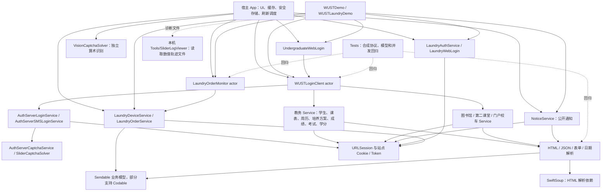
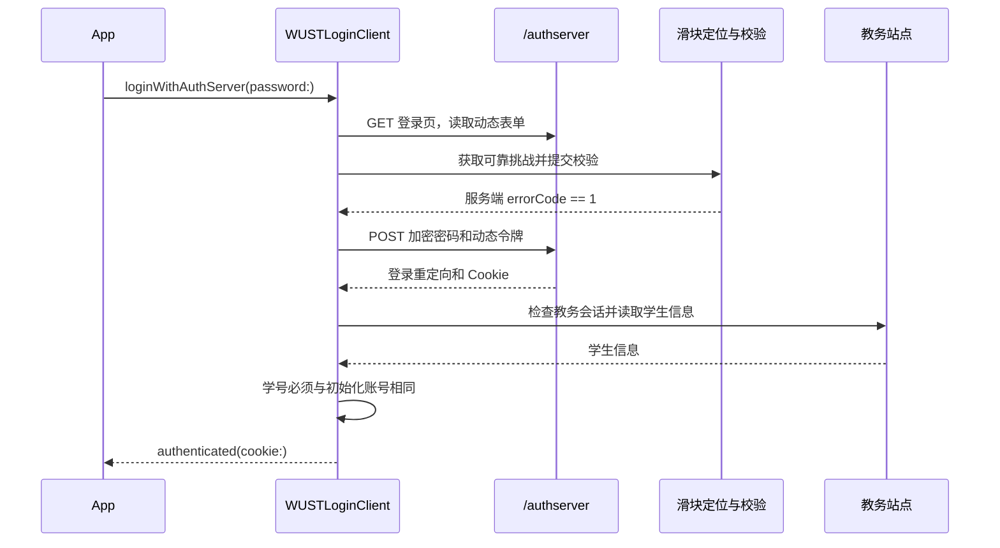
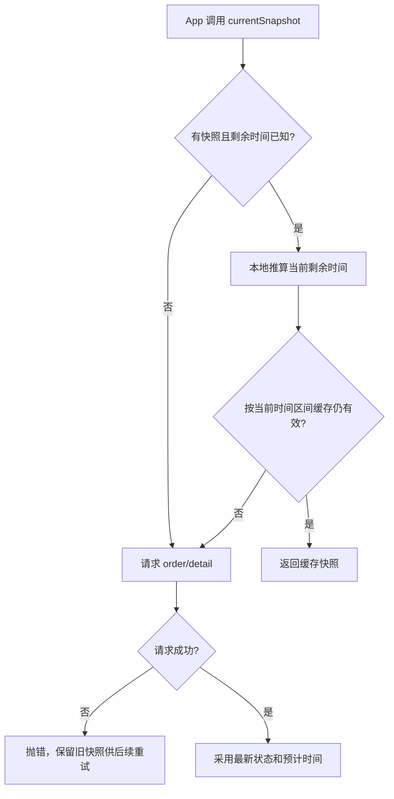

# WUSTFoundation 开发与接入手册

更新日期：2026-11-26。本文以当前工作区源码为准，包含刚完成的旧版登录移除。示例里的账号、查询条件和返回数据均为占位或虚构资料，不包含个人凭据。

本文是项目的统一接入入口：先看架构和登录，再按业务章节调用；查完整参数、默认值和返回类型时使用附录 A，查内部实现使用附录 B。正文示例中的 `studentID`、`password`、`smsCode`、`cookie`、`html` 和已认证的 `session` 均由调用方提供。示例函数可编译用于接入参考，不会在阅读或编译时请求网络。

## 目录

1. [环境、安装与当前能力](#setup)
2. [项目架构与目录](#architecture)
3. [学校登录、会话与退出](#login)
4. [滑块、诊断与算术识别](#captcha)
5. [学生信息](#student)
6. [学期、课表与教学周日期](#timetable)
7. [培养方案与合并表格](#training)
8. [课程成绩](#grades)
9. [考试安排](#exams)
10. [学分完成情况](#credits)
11. [学校通知、正文和 PDF](#notices)
12. [图书馆只读查询](#library)
13. [第二课堂与校车](#other-services)
14. [胖乖登录、洗衣机和倒计时](#laundry)
15. [错误、并发、缓存和平台职责](#operations)
16. [Demo、开发工具和验证](#development)
17. [附录 A：公开 API 与返回模型完整索引](#public-api)
18. [附录 B：内部函数、调用入口与源码地图](#internals)

<a id="setup"></a>
## 1. 环境、安装与当前能力

### 1.1 产品与依赖

| 项目 | 当前配置 |
|---|---|
| Swift tools version | 6.4，见根目录 `Package.swift` |
| 库产品／模块 | `WUSTFoundation` |
| 学校业务 Demo | 可执行产品 `WUSTDemo` |
| 胖乖业务 Demo | 可执行产品 `WUSTLaundryDemo` |
| 平台声明 | iOS 15+、macOS 15+、visionOS 1+ |
| 第三方库 | SwiftSoup，最低 2.14.3；当前锁定版本见 `Package.resolved` |
| 系统依赖 | Foundation / URLSession、Vision、CommonCrypto；WebKit 入口按 `canImport(WebKit)` 编译；Demo 另用 AppKit、Security、CryptoKit、Quick Look |
| watchOS | 尚未声明支持，见第 15 节的后续边界 |

在 Xcode 的 Add Package Dependencies 中加入仓库，将 `WUSTFoundation` 产品关联到 App target，业务文件使用：

```swift
import Foundation
import WUSTFoundation
```

仓库地址为 [xiaoka520/WUSTFoundation](https://github.com/xiaoka520/WUSTFoundation)。需要本机尚未推送的改动时，在 Xcode 中添加本地 package。命令行应进入实际包含 `Package.swift` 的目录；本仓库目录可能位于同名外层目录之下。

其他 Swift Package 可写入依赖并在 target 中引用产品。版本号和分支由接入方选择，下例跟踪主分支：

```swift
.package(url: "https://github.com/xiaoka520/WUSTFoundation.git", branch: "main")
.product(name: "WUSTFoundation", package: "WUSTFoundation")
```

上面两行分别放入宿主 manifest 的 `dependencies` 和目标的 `dependencies`，不是一份独立的 `Package.swift`。

### 1.2 能力与限制

| 能力 | 当前入口与限制 |
|---|---|
| 学校密码登录 | 新 `/authserver/login` 表单、自动滑块、教务会话及学号核对 |
| 学校短信登录 | 独立手机号／学号短信入口；真实短信闭环仍待运行确认 |
| 官方网页登录 | App 持有 WKWebView，完成后校验并接入教务 Cookie |
| 会话检查 | 复用当前 client 的教务 Cookie；失效返回需要登录 |
| 续期／跨启动恢复 | 新版统一认证会话保留、静默换票、凭据导出导入尚未实现 |
| 教务只读业务 | 学生信息、课表、教学周日期、培养方案、成绩、考试、学分 |
| 公告通知 | 五个来源、分页、正文纯文本、附件及原始 PDF |
| 图书馆／第二课堂／校车 | 查询与解析保留，需要各自有效会话；新版跨系统自动登录尚未接入 |
| 胖乖 | 独立短信／网页登录、附近门店、空闲设备、本人订单和剩余时间 |
| 设备控制 | 未接入扫码启动、支付、远程控制等写操作 |

旧 `/lyuapServer` 登录、TGT 类型与存取、旧短信二次验证、旧 RSA 编码及 aTrust 自动换票链路已删除。`VisionCaptchaSolver` 算术图片识别工具独立保留。

<a id="architecture"></a>
## 2. 项目架构与目录

### 2.1 整体架构图



`WUSTLoginClient` 负责学校账号和教务会话的编排；通知与胖乖是独立入口。相同 client 的教务业务共享 URLSession。图书馆、门户和学工是独立业务站点，教务已登录并不表示它们也已认证。

### 2.2 目录、函数入口和职责

| 位置 | 主要类型／函数 | 职责 |
|---|---|---|
| `Sources/WUSTFoundation/Authentication/Client/` | `WUSTLoginClient`、各 `fetch…` 扩展 | 账号隔离、会话检查、登录和业务编排 |
| `Authentication/AuthServer/` | `login`、`sendCode`、短信 `login` | 新版表单、动态令牌、加密与提交 |
| `Authentication/Captcha/` | `beginSession`、`fetchChallenge`、`solveAndVerify`、`solve` | 滑块会话、定位、轨迹、加密；独立算术 OCR |
| `Authentication/Undergraduate/` | `currentSessionCookie`、WebKit `complete` | 教务 Cookie 校验及网页会话接入 |
| `StudentInfo/` | `fetchStudentInfo`、`parse` | 学籍卡片请求与字段解析 |
| `Timetable/Models/` | `meetings`、`range`、`week`、`date`、`adding` | 学期、课程、教学周和日期计算 |
| `Timetable/Networking/` | `fetchAcademicTerms`、`fetchTimetable`、`fetchTeachingCalendar` | 表单查询、服务端周次校准 |
| `Timetable/Parsing/` | `parse`、`parseAcademicTerms`、内部时间与表单函数 | HTML、列表和周次脚本解析 |
| `TrainingPlan/` | `fetchTrainingPlan`、`parse`、`cell(atRow:column:)` | 正文、结构化合并表格 |
| `Grades/` | `fetchQueryOptions`、`fetchGrades`、`parse` | 成绩条件、表单和结果 |
| `Exams/` | `fetchQueryOptions`、`fetchExamSchedule`、`parse` | 两类考试列表及可解析的日期时间 |
| `Credits/` | `fetchCreditProgress`、`parse` | 学分分类、历史统计及课程修读状态 |
| `Notices/` | `fetchPage`、`fetchDetail`、`fetchPDF`、两个 Parser | 通知分页、纯文本、图片和原始附件 |
| `Library/` | `fetchStatistics`、各分页查询 | 图书馆只读 API 及异构字段 |
| `SecondClass/` | `fetchTranscript` | 学分要求、已获学分、总学分及评价 |
| `CampusShuttle/` | client `fetchCampusShuttleSchedule`、内部 `fetchSchedule` | 门户卡片及发车信息解析 |
| `Laundry/` | 独立登录、设备／订单请求、`currentSnapshot` | 胖乖业务；动态远端校正 |
| `Sources/WUSTDemo/` | `main`、`run`、各业务 Demo | 交互、诊断、原始课表采集、PDF 预览 |
| `Sources/WUSTLaundryDemo/` | `main`、`showDevices`、`testLogin`、订单监测 | 胖乖独立演示与本地凭据存储 |
| `Tests/` | 各 `@Test` 函数 | 合成协议与模型回归，不用于采集真实资料 |
| `Tools/SliderLogViewer/` | 独立 macOS 工具 | 本机日志、轨迹图和回放，不属于库产品 |

每个文件中完整的函数与可见性见[附录 B](#internals)。Parser 主要做同步本地处理；Service 做网络；Model 承载返回值。没有 `public` 的辅助类型和函数由库内调用，App 通过对应 Service／Parser 使用它们。

<a id="login"></a>
## 3. 学校登录、会话与退出

### 3.1 最小密码登录流程

<!-- example: school-password -->
```swift
func loadStudentWithPassword(studentID: String, password: String) async throws -> StudentInfo {
    let client = try WUSTLoginClient(username: studentID)
    let result = try await client.loginWithAuthServer(password: password)
    guard case .authenticated = result else {
        throw WUSTLoginClientError.notAuthenticated
    }
    return try await client.fetchStudentInfo()
}
```

这是从输入到一次查询的完整示例。实际 App 应把 `client` 保留在账号状态容器中，后续课表等请求复用它；不要每个页面重新创建 client 或重新登录。



滑块通过只是认证过程中的一步。只有教务会话检查和学号核对均通过，client 才采用候选会话；失败不覆盖先前有效会话。

### 3.2 登录与会话函数

| 调用 | 返回 | 参数和行为 |
|---|---|---|
| `WUSTLoginClient(username:sessionConfiguration:)` | client | 学号不能为空；配置默认 `.ephemeral`，Cookie 容器隔离 |
| `loginWithAuthServer(password:maxSliderAttempts:diagnostics:)` | `WUSTLoginResult` | 默认 3 次滑块校验，允许 1～5；诊断回调可选 |
| `sendLoginSMSCode(to:maxSliderAttempts:diagnostics:)` | `Int?` | 向绑定手机号或学号申请一次短信；返回服务器给出的重发等待秒数 |
| `loginWithSMSCode(_:)` | `WUSTLoginResult` | 提交该 client 当前等待的数字短信码，最长 10 字节 |
| `ensureSession()` | `WUSTLoginResult` | 只检查现有会话；没有静默换票或后台保活 |
| `logout()` | `Void` | 取消操作、清理待提交短信、替换内存 Cookie 容器 |
| `withUndergraduateSession(authenticationFailure:perform:)` | 闭包返回的 `Value` | 自定义请求复用教务 Cookie、URLSession；可提供明确认证失效分类器 |

`WUSTLoginResult` 只有 `.authenticated(cookie:)` 和 `.loginRequired`。Cookie 不应打印或当作普通缓存保存。直接查询时缺少有效会话抛 `WUSTLoginClientError.notAuthenticated`，App 再展示登录入口。

网络错误、TLS 错误、未知检查页或 HTTP 异常原样向上传递，不直接认定密码错误。明确的教务认证失效会使后续检查返回 `.loginRequired`。

### 3.3 独立短信登录

<!-- example: school-sms -->
```swift
func requestSchoolSMS(client: WUSTLoginClient, phoneOrStudentID: String) async throws -> Int? {
    try await client.sendLoginSMSCode(to: phoneOrStudentID)
}

func finishSchoolSMS(client: WUSTLoginClient, smsCode: String) async throws -> StudentInfo {
    let result = try await client.loginWithSMSCode(smsCode)
    guard case .authenticated = result else {
        throw WUSTLoginClientError.notAuthenticated
    }
    return try await client.fetchStudentInfo()
}
```

App 先用学号创建 client。发送按钮调用第一个函数，用户收到短信后再调用第二个；两步之间保留同一个 client。填学号时，由学校服务器找到它绑定的手机，库不推算或查询出手机号。

发送前先读取短信表单并完成滑块。只有短信接口业务码 `success` 才确认发送；不会因 HTTP 200 或请求已发出就提示成功。App 按可选等待秒数展示重发状态；等待时间不是自动重发定时器。

输错码且服务器返回更新后的登录表单时，client 保存新的执行令牌，允许更正后再次调用 `loginWithSMSCode`。重新申请短信、开始密码登录或退出都会清理待提交上下文。取消和网络错误不会自动重复发短信。

### 3.4 官方网页登录

<!-- example: school-web -->
```swift
#if canImport(WebKit)
import WebKit

@MainActor
func makeSchoolLoginView() -> WKWebView {
    let view = UndergraduateWebLogin.makeWebView()
    view.load(URLRequest(url: UndergraduateWebLogin.url))
    return view
}

@MainActor
func acceptSchoolWebLogin(view: WKWebView, client: WUSTLoginClient) async throws -> WUSTLoginResult {
    try await UndergraduateWebLogin.complete(in: view, using: client)
}
#endif
```

将 view 放进 App 界面，用户完成学校页面的验证并进入教务后，由按钮或页面状态处理调用 `acceptSchoolWebLogin`。`complete` 先检查当前 URL 为教务 HTTPS 页面，再接入 Cookie 并核对学号。仅调用 `load` 或关闭窗口不会自动完成 client 登录。

WebKit API 需要 MainActor。此工具创建临时网站数据存储，不直接共享 Safari 的登录。

### 3.5 低层认证接口

已有自定义 URLSession 编排时，可直接调用下列 Service。它们不替调用方存储凭据或确认最终学生账号。

<!-- example: low-level-password -->
```swift
func submitSchoolPassword(username: String, password: String, session: URLSession) async throws -> String {
    try await AuthServerLoginService().login(
        username: username,
        password: password,
        using: session
    )
    return try await UndergraduateAuthService().currentSessionCookie(using: session)
}
```

`AuthServerLoginService.login(username:password:service:using:maxSliderAttempts:diagnostics:)` 的目标服务默认教务首页。`Void` 返回表示提交与目标站点跳转满足检查，仍须业务会话与账号校验；高层 client 已负责这两步。

低层短信先调用 `AuthServerSMSLoginService.sendCode(account:service:using:...)` 获得 `AuthServerSMSLoginContext`，再向同一 Service 的 `login(code:context:using:)` 传回它，并使用同一个 URLSession。结果 `.loginNotCompleted(updatedContext)` 时，后续更正需使用新 context；`.authenticated` 后仍需检查目标业务。App 通常使用高层 client 即可。

### 3.6 自定义只读请求、退出与账号切换

<!-- example: custom-session -->
```swift
func checkSchoolCookie(client: WUSTLoginClient) async throws -> Bool {
    try await client.withUndergraduateSession { cookie, session in
        let checked = try await UndergraduateAuthService().currentSessionCookie(using: session)
        return !cookie.isEmpty && !checked.isEmpty
    }
}

func leaveSchoolAccount(client: WUSTLoginClient) async throws {
    try await client.logout()
}
```

闭包可在同一会话中执行自定义只读请求，不应在闭包外长期持有 Cookie 或 URLSession。退出会取消当前认证／检查操作，旧操作完成不能恢复已退出账号。切换账号时退出旧 client，再创建新 client。退出不退出 Safari、其他 client、其他设备或学校服务端。

### 3.7 迁移与续期边界

当前初始化只需要 `username`，可选 `sessionConfiguration`。旧参数 `deviceID`、`credential`、`credentialStore`、`maxCaptchaAttempts`、`captchaSolver` 已移除。旧 `UnionAuthService`、`UnionCredentialStore`、`currentCredential()`、`login(password:)`、`sendSMSCode()`、`submitSMSCode(_:password:)` 不再属于学校 API。胖乖自身的 `LaundryAuthService.sendSMSCode` 不受影响。

新版目前只采用教务 Cookie，没有完成统一认证会话保留、静默续期和跨启动恢复。Cookie 有效时复用；失效后由 App 展示新版登录。不要把 Demo 保存账密用于重复测试的功能理解为库的会话恢复实现。

<a id="captcha"></a>
## 4. 滑块、诊断与算术识别

### 4.1 自动滑块的调用顺序

<!-- example: slider -->
```swift
func verifySchoolSlider() async throws -> SliderCaptchaSolution {
    let session = URLSession(configuration: .ephemeral)
    defer { session.finishTasksAndInvalidate() }
    let service = AuthServerCaptchaService()
    try await service.beginSession(using: session)
    return try await service.solveAndVerify(using: session, maxAttempts: 3)
}
```

| 函数 | 用途 |
|---|---|
| `AuthServerCaptchaService.beginSession(using:diagnostics:)` | 建立匿名 CAS 会话 |
| `fetchChallenge(using:diagnostics:)` | 取得背景、拼图、尺寸与竖向坐标 |
| `SliderCaptchaSolver.solve(_:canvasLength:diagnostics:)` | 本地定位；默认组件宽度 280 |
| `verify(_:solution:using:)` | 提交给定结果；由调用方保证挑战、会话及时序一致 |
| `solveAndVerify(using:maxAttempts:diagnostics:)` | 取可靠图片、定位、生成轨迹、按时长等待、校验和有限重试 |
| `VisionCaptchaSolver.solve(imageData:)` | 独立算术图片 OCR，返回计算答案字符串 |

手工组合 `fetchChallenge`、`solve`、`verify` 时不要跳过必要会话与等待；正常登录优先走 `solveAndVerify` 或 client。

`maxAttempts` 统计实际服务端校验提交。图片未通过本地可靠性门槛时立即换图，不计入该次数；每轮连续十张不可靠时停止。匹配分数不是服务端通过概率，只有业务码 `1` 表示滑块通过。`0` 不说明具体拒绝原因。

当前生成 61 个轨迹点，总时长 1400 毫秒；`a` 为累计水平位移，`b` 为累计纵向位移，`c` 为距上一点的毫秒间隔。实际生成的同一份载荷用于等待、加密提交和诊断，查看器不重新生成坐标。

### 4.2 诊断回调与日志

<!-- example: slider-diagnostics -->
```swift
func loginWithNumericDiagnostics(client: WUSTLoginClient, password: String) async throws -> WUSTLoginResult {
    try await client.loginWithAuthServer(password: password, maxSliderAttempts: 3) { event in
        if case .result(let code) = event {
            print("滑块业务码：\(code)")
        }
    }
}
```

回调为 `@Sendable`，事件包含阶段、请求头配置、HTTP 状态、Cookie 数量、图片字节数、候选分数、弃图、实际轨迹、业务码及安全错误类别。回调不会提供 Cookie 值、账号密码、图片内容、密钥或短信码；App 需自行选择安全记录位置。

`SliderCaptchaTrace` 是可编码轨迹模型，可保存数值并由本机工具回放。Demo 每次生成轨迹即写文件，收到业务码后更新同一记录；程序在返回前中断时仍能看到“未取得结果”的载荷。路径及查看器见第 16 节。

### 4.3 算术图片识别

<!-- example: arithmetic -->
```swift
func solveArithmeticImage(imageData: Data) throws -> String {
    try VisionCaptchaSolver().solve(imageData: imageData)
}
```

输入为有效图片 Data，返回如 `"36"` 的答案字符串。识别支持当前实现归一化的加、减、乘、除写法；非二元算式、除数为零或不能整除等抛 `CaptchaRecognitionError.invalidExpression`，无文字抛 `.noText`。它不获取验证码图片、不发送校验请求，也不参与当前学校滑块登录。

<a id="student"></a>
## 5. 学生信息

### 5.1 函数和调用

| 层次 | 函数 | 返回 |
|---|---|---|
| client | `fetchStudentInfo()` | `StudentInfo`，并核对学号 |
| 网络 | `StudentInfoService.fetchStudentInfo(cookie:using:)` | 已有教务会话下的学生信息 |
| 本地解析 | `StudentInfoParser.parse(from:)` | 从学籍卡片 HTML 解析模型 |

<!-- example: student-parser -->
```swift
func parseStudentCard(html: String) throws -> StudentInfo {
    try StudentInfoParser().parse(from: html)
}

func fetchStudentWithExistingCookie(cookie: String, session: URLSession) async throws -> StudentInfo {
    try await StudentInfoService().fetchStudentInfo(cookie: cookie, using: session)
}
```

### 5.2 返回内容

`StudentInfo` 包含 `name`、`studentID`、`college`、`major`、`className`、`birthday`、`sex`、`nationality`、`hometown`、`idNumber`，均为 String。学号保留前导零，生日保持网页文本。模型支持 Sendable，当前没有 Codable；不要直接对它使用 JSONEncoder。

虚构对象内容示意：

```text
name = 学生甲
studentID = 0012345678
college = 示例学院
major = 示例专业
className = 示例班级
birthday = 2007-01-01
sex / nationality / hometown / idNumber = 对应网页字段
```

client 校验后读到其他学号会退出本 client 并抛 `.studentIDMismatch`，不会返回该份数据。低层 Parser／Service 不知道 App 当前账号，调用方自行承担账号检查和敏感字段展示策略。

<a id="timetable"></a>
## 6. 学期、课表与教学周日期

### 6.1 先选学期，再取整学期安排

<!-- example: timetable -->
```swift
func loadTimetable(client: WUSTLoginClient, termID: String) async throws -> Timetable {
    let options = try await client.fetchAcademicTerms()
    guard let term = options.terms.first(where: { $0.id == termID }) else {
        throw TimetableError.invalidTerm
    }
    return try await client.fetchTimetable(term: term)
}

func coursesOnMonday(timetable: Timetable, teachingWeek: Int) -> [CourseMeeting] {
    timetable.meetings(inWeek: teachingWeek, on: .monday)
}

func coursesInWeek(timetable: Timetable, teachingWeek: Int) -> [CourseMeeting] {
    timetable.meetings(inWeek: teachingWeek)
}
```

| client 函数 | 返回与默认值 |
|---|---|
| `fetchAcademicTerms()` | `AcademicTermList`：`terms` 和可选 `selectedTermID` |
| `fetchTimetable(term:maxWeek:maxSection:)` | `Timetable`；边界默认教学周 30、节次 12 |
| `fetchTeachingCalendar(on:)` | `TeachingCalendar`；不传日期时使用上海时区今天 |

学期 `id` 是服务器查询值，`name` 是展示文本；两者可能相同，仍是不同字段。选项多不代表用户就读了全部学期，也不代表未来学期已开放查询。App 使用用户选择或服务器选中值，不根据年份猜查询结果。

`fetchTimetable` 通过入口实际表单查询整学期，保留必需隐藏字段。结构不支持、条件未回显、缺少课表表格会抛错，不伪装为“本学期无课”。有效的空表格才返回空 `meetings`。

### 6.2 返回字段与筛选

| 模型 | 字段／函数 |
|---|---|
| `AcademicTerm` | `id: String`、`name: String` |
| `Timetable` | `term`、`meetings: [CourseMeeting]`；两个 `meetings(inWeek:…)` 做本地筛选 |
| `CourseMeeting` | `name`、`weekday`、`weeks`、`sections`；可选 `courseID`、`teacher`、`teachingClass`、`location` |
| `Weekday` | 原始值 1～7 分别为 `.monday`～`.sunday` |

下面是模型的虚构展示投影，非原始接口 JSON：

```json
{
  "term": {"id": "2026-2027-1", "name": "2026-2027-1"},
  "meetings": [{
    "name": "示例课程", "weekday": 1,
    "weeks": [1, 3, 5], "sections": [3, 4],
    "teacher": "示例教师", "location": "示例教室"
  }]
}
```

同一课程在不同星期、地点、节次或周次的安排可以是多条，`meetings.count` 不是去重后的课程门数。数组保留分段和间隔，不把 `[1, 3, 5]` 扩展成 1～5；筛选返回原安排，仍保留原始完整周次数组。

### 6.3 教学周和日期的对应

<!-- example: teaching-calendar -->
```swift
func calibrateCalendar(client: WUSTLoginClient, reference: String) async throws -> TeachingCalendar {
    let date = try AcademicDate(yyyyMMdd: reference)
    return try await client.fetchTeachingCalendar(on: date)
}

func inspectCalendar(_ calendar: TeachingCalendar) throws -> (String, String, String, Int?) {
    let week = try calendar.range(ofWeek: calendar.referenceWeek)
    let monday = try calendar.date(inWeek: calendar.referenceWeek, on: .monday)
    let weekNumber = try calendar.week(containing: calendar.referenceDate)
    return (week.startDate.yyyyMMdd, week.endDate.yyyyMMdd, monday.yyyyMMdd, weekNumber)
}

func dateUtilities() throws -> (AcademicDate, AcademicDate, Weekday, Bool) {
    let date = try AcademicDate(yyyyMMdd: "20261105")
    let next = try date.adding(days: 1)
    return (try AcademicDate.today(), next, try date.weekday(), date < next)
}

func cacheTeachingCalendar(_ calendar: TeachingCalendar) throws -> TeachingCalendar {
    let bytes = try JSONEncoder().encode(calendar)
    return try JSONDecoder().decode(TeachingCalendar.self, from: bytes)
}
```

校准会发送一次日期查询，由服务器响应确认 `referenceWeek` 和 `totalWeeks`，再计算 `firstMonday`、`lastSunday`。模型不从学校通知推理开学日，不固定总周数。

| 本地函数 | 行为 |
|---|---|
| `range(ofWeek:)` | 返回 `TeachingWeek(number:startDate:endDate:)`；无效周次抛错 |
| `week(containing:)` | 学期内返回周次，范围外返回 nil |
| `date(inWeek:on:)` | 指定周次与星期对应的 `AcademicDate` |
| `AcademicDate.today()` | 上海时区今天，不发网络请求 |
| `adding(days:)`、`weekday()`、`<` | 纯日期计算与比较 |
| `AcademicDate` 的三个业务构造器 | 年月日、`yyyyMMdd` 或 Date；验证日期真实存在 |
| `init(from:)`／`encode(to:)` | 由 JSONDecoder／JSONEncoder 调用；`AcademicDate` 编码为 `yyyyMMdd` 字符串 |

虚构／历史校准示意：若服务器确认 `20261105` 为第 10 周、共 22 周，则第 1 周周一为 `20260831`，第 10 周范围为 `20261102`～`20261108`。实际查询以当次服务器结果为准。学期外日期响应没有周次标签时抛 `teachingWeekNotFound`；本地 `week(containing:)` 的范围外 nil 是另一种结果。

校准后的日期换算不发请求。换学期或学校更改周历后应重新校准；普通周次换算不包含调休、临时调课或每日上下课时刻。

### 6.4 低层网络和纯解析

<!-- example: timetable-low-level -->
```swift
func timetableFromHTML(html: String, term: AcademicTerm) throws -> Timetable {
    try TimetableParser().parse(from: html, term: term, maxWeek: 30, maxSection: 12)
}

func termsFromHTML(html: String) throws -> AcademicTermList {
    try TimetableParser().parseAcademicTerms(from: html)
}

func calendarFromHTML(html: String, referenceDate: AcademicDate) throws -> TeachingCalendar {
    try TeachingCalendarParser().parse(from: html, referenceDate: referenceDate)
}

func timetableFromSession(cookie: String, session: URLSession, term: AcademicTerm) async throws -> Timetable {
    let service = TimetableService(maxWeek: 30, maxSection: 12)
    _ = try await service.fetchAcademicTerms(cookie: cookie, using: session)
    return try await service.fetchTimetable(term: term, cookie: cookie, using: session)
}

func calendarFromSession(cookie: String, session: URLSession, date: AcademicDate) async throws -> TeachingCalendar {
    try await TeachingCalendarService().fetchTeachingCalendar(on: date, cookie: cookie, using: session)
}
```

Parser 只处理传入 HTML，读取页面中的周次脚本文本时不执行 JavaScript。Service 需要同一份已认证会话，不自动显示登录窗口。

<a id="training"></a>
## 7. 培养方案与合并表格

| 层次 | 函数 |
|---|---|
| client | `fetchTrainingPlan()` |
| Service | `TrainingPlanService.fetchTrainingPlan(cookie:using:)` |
| Parser | `TrainingPlanParser.parse(from:)` |
| 表格查询 | `TrainingPlanTable.cell(atRow:column:)` |

<!-- example: training -->
```swift
func loadTrainingPlan(client: WUSTLoginClient) async throws -> TrainingPlan {
    try await client.fetchTrainingPlan()
}

func trainingPlanFromHTML(html: String) throws -> TrainingPlan {
    try TrainingPlanParser().parse(from: html)
}

func trainingPlanFromSession(cookie: String, session: URLSession) async throws -> TrainingPlan {
    try await TrainingPlanService().fetchTrainingPlan(cookie: cookie, using: session)
}

func firstTrainingCell(plan: TrainingPlan) -> String? {
    for block in plan.blocks {
        if case .table(let table) = block {
            return table.cell(atRow: 0, column: 0)?.text
        }
    }
    return nil
}
```

`TrainingPlan` 返回 `title` 和按原网页顺序排列的 `blocks`。`TrainingPlanBlock` 为 `.paragraph(text:)` 或 `.table(value:)`，可表达表格单元格中的嵌套块。

表格提供可选 `caption`、`rowCount`、`columnCount`、`cells`。每个 `TrainingPlanCell` 包含从 0 开始的 `row`、`column`，以及 `rowSpan`、`columnSpan`、`isHeader`、`blocks`。调用 `cell(atRow:column:)` 时，处于合并区域的坐标返回覆盖该位置的原始单元格，越界返回 nil。

虚构结构示意：

```text
TrainingPlan(title: "示例培养方案")
  paragraph: "培养目标说明"
  table: 2 行 × 2 列
    (0,0) rowSpan=1 columnSpan=2 text="课程安排"
    (1,0) text="课程名称"
    (1,1) text="要求学分"
```

App 用结构化跨度绘制原生表格，纯文本可用 `plan.text`、`table.text`、`cell.text`。`table.text` 使用制表符生成简化阅读文本，不能单靠它还原合并关系。包不强制输出 Markdown；普通 Markdown 表格无法完整表达 rowspan/colspan。

<a id="grades"></a>
## 8. 课程成绩

### 8.1 查询条件与调用

<!-- example: grades -->
```swift
func gradeOptions(client: WUSTLoginClient) async throws -> GradeQueryOptions {
    try await client.fetchGradeQueryOptions()
}

func loadGrades(client: WUSTLoginClient, termID: String?) async throws -> GradeReport {
    let query = GradeQuery(
        termID: termID,
        courseNatureID: nil,
        courseName: "",
        displayMode: .best,
        includesRetakes: false
    )
    return try await client.fetchGrades(query: query)
}

func gradesFromHTML(html: String, query: GradeQuery) throws -> GradeReport {
    try GradeParser().parse(from: html, query: query)
}

func gradesFromSession(cookie: String, session: URLSession, query: GradeQuery) async throws -> GradeReport {
    let service = GradeService()
    _ = try await service.fetchQueryOptions(cookie: cookie, using: session)
    return try await service.fetchGrades(query: query, cookie: cookie, using: session)
}
```

`fetchGrades()` 不传参数时使用 `GradeQuery()`：不限学期、不限课程性质、空课程名、`.all`、不包含补重标记。`.all` 与 `.best` 对应页面的全部／最好成绩；这些是服务端查询模式。

`GradeQueryOptions` 的 `terms`、`courseNatures`、`displayModes` 由页面提供，每项是 `GradeOption(id:name:)`。`termID`、`courseNatureID` 应传选项 id；nil 表示不限制。服务保留表单实际字段并核对结果条件，不自行编造查询值。

### 8.2 返回字段与读取

<!-- example: grade-record -->
```swift
func gradeText(_ record: GradeRecord) -> (String, String, String?) {
    (record.courseName, record.score, record.value(for: "学分"))
}

func makeExampleGrade() -> GradeReport {
    let record = GradeRecord(fields: [
        GradeField(name: "课程名称", value: "示例课程"),
        GradeField(name: "成绩", value: "优秀"),
        GradeField(name: "学分", value: "2.0")
    ])
    return GradeReport(query: GradeQuery(), columns: ["课程名称", "成绩", "学分"], records: [record])
}
```

`GradeReport` 返回 `query`、原表头 `columns` 和 `records`。每条记录保留按表头命名的 `[GradeField]`，并提供 `termID`、`courseID`、`courseName`、`score`、`credits`、`gradePoint`、`courseNature`、`examType` 等便捷属性，完整列表见附录。

成绩、学分和绩点保留页面字符串，可能是数字、等级或其他标记。缺少可选列为 nil，不把“优秀”等非数字成绩转换成 0。未处理的分页抛 `unsupportedPagination`，避免误报查询完整。

<a id="exams"></a>
## 9. 考试安排

<!-- example: exams -->
```swift
func examOptions(client: WUSTLoginClient) async throws -> ExamQueryOptions {
    try await client.fetchExamQueryOptions()
}

func loadExams(client: WUSTLoginClient, termID: String, categoryID: String?) async throws -> ExamSchedule {
    try await client.fetchExamSchedule(query: ExamQuery(termID: termID, categoryID: categoryID))
}

func examsFromHTML(html: String, query: ExamQuery) throws -> ExamSchedule {
    try ExamParser().parse(from: html, query: query)
}

func examsFromSession(cookie: String, session: URLSession, query: ExamQuery) async throws -> ExamSchedule {
    let service = ExamService()
    _ = try await service.fetchQueryOptions(cookie: cookie, using: session)
    return try await service.fetchExamSchedule(query: query, cookie: cookie, using: session)
}

func examSummary(_ arrangement: ExamArrangement) -> (String, String?, String?) {
    (arrangement.courseName, arrangement.timeText, arrangement.value(for: "座位号"))
}
```

| 类型 | 重要字段 |
|---|---|
| `ExamQueryOptions` | 学期、考试类别选项，以及服务器选中的 id |
| `ExamQuery` | 必填 `termID`、可选 `categoryID` |
| `ExamSchedule` | `query`、`lists`，以及扁平化便捷属性 `arrangements` |
| `ExamArrangementList` | 来源 `source`、表头 `columns`、安排 `arrangements` |
| `ExamArrangement` | 原始 `fields`、可选 `timeRange`，课程、周次、星期、节次、地点、座位等便捷属性 |
| `ExamTimeRange` | `start`、`end` 为 Date，`timeZoneIdentifier` 为 `Asia/Shanghai` |

两类来源分别为 `.centralized` 与 `.selfRequested`。Parser 要求预期的两张表和字段关系成立；有效的“未查询到数据”与表格结构缺失分开处理。

虚构对象示意：

```text
source = centralized
courseName = 示例课程
timeText = 网页原始考试日期时间
seatNumber = 12
location = 示例考场
timeRange = 可解析时包含 start/end，否则 nil
```

解析不出的时间文本仍保留在 `timeText`，`timeRange` 为 nil，不能据此捏造时间。请求条件不一致抛 `selectionNotReflected`，未支持的分页抛 `unsupportedPagination`。

<a id="credits"></a>
## 10. 学分完成情况

<!-- example: credits -->
```swift
func loadCreditProgress(client: WUSTLoginClient) async throws -> CreditProgress {
    try await client.fetchCreditProgress()
}

func creditsFromHTML(html: String) throws -> CreditProgress {
    try CreditProgressParser().parse(from: html)
}

func creditsFromSession(cookie: String, session: URLSession) async throws -> CreditProgress {
    try await CreditProgressService().fetchCreditProgress(cookie: cookie, using: session)
}
```

`CreditProgress` 同时返回四部分：

| 字段 | 类型和用途 |
|---|---|
| `courseCategories` | `[CreditCategoryProgress]`，课程性质／属性分类进度 |
| `generalElectives` | `[CreditCategoryProgress]`，通识选修分类进度 |
| `pastSemesterStatistics` | `CreditSemesterStatistics?`，历史课程与学分统计 |
| `courses` | `[CreditCourseProgress]`，培养方案课程修读明细 |

分类字段为 `name`、可选 `courseAttribute`、`requiredCredits`、`earnedCredits`；分数采用 `Decimal?`。`remainingCredits` 仅在要求和已获数值都存在时计算，并且不小于 0。缺失数值返回 nil，不作为 0。

历史统计包括学期数、已修课程数／学分、平均学期学分、不及格与未选课程数／学分，以及未获学分的必修项目。课程明细保留学期、课程编号、名称、学分、性质、属性和状态。

虚构分类示意：`name="示例必修课程"`、`requiredCredits=42`、`earnedCredits=12`、`remainingCredits=30`。不同表可能是交叉分类，包不把多张表直接相加生成未经定义的“总完成率”。进度条与展示规则由 App 决定。

<a id="notices"></a>
## 11. 学校通知、正文和 PDF

### 11.1 来源、分页与详情

公开通知独立于学校登录，不需要先创建 client。来源如下，实际 URL 可通过 `NoticeSource.listURL` 读取：

| 枚举值 | `name` 对应来源 |
|---|---|
| `.campus` | 校园通知 |
| `.academicAffairs` | 教务通知 |
| `.studentAffairs` | 学工通知 |
| `.research` | 科研通知 |
| `.graduateSchool` | 研究生院通知 |

<!-- example: notices -->
```swift
func loadNoticePage(source: NoticeSource, session: URLSession) async throws -> NoticePage {
    try await NoticeService().fetchPage(source: source, using: session)
}

func loadNextNoticePage(page: NoticePage, session: URLSession) async throws -> NoticePage? {
    guard let next = page.nextPageURL else { return nil }
    return try await NoticeService().fetchPage(source: page.source, at: next, using: session)
}

func loadNotice(summary: NoticeSummary, session: URLSession) async throws -> NoticeDetail {
    try await NoticeService().fetchDetail(summary, using: session)
}
```

`NoticePage` 包含 `source`、本页 `url`、`items`、可选的上一页／下一页 URL、可选 `currentPage`／`totalPages`、`filteredItemCount`。`NoticeSummary` 包含来源、标题、原文 URL 和 `yyyy-MM-dd` 发布日期。

使用服务器返回的 `nextPageURL` 翻页，不自行拼页码文件名；CMS 文件编号可能与展示页码反向。一页的条目全被过滤时仍可能有下一页，不能只以 `items.isEmpty` 判定结束。结果保持原页面顺序，包括置顶顺序，并去除重复 URL。

### 11.2 日期规则

默认 `NoticeDatePolicy()` 只排除特殊日期 `1980-01-01`。其他真实旧日期和未来日期保留；缺失、格式无法识别或不存在的日期不猜成今天，而是过滤。列表中的过滤数量由 `filteredItemCount` 给出。

<!-- example: notice-policy -->
```swift
func makeNoticeService() -> NoticeService {
    let policy = NoticeDatePolicy(
        excludedDates: ["1980-01-01"],
        earliestDate: nil,
        latestDate: nil
    )
    return NoticeService(datePolicy: policy, maximumPDFBytes: 20 * 1024 * 1024)
}
```

仅在 App 有明确要求时设置最早／最晚日期。传 `excludedDates: []` 可取消特殊日期过滤。日期配置必须是有效 `yyyy-MM-dd`。详情有独立发布日期时以详情为准，无独立日期才沿用列表日期；被规则排除时抛 `filteredPublicationDate`。

### 11.3 返回正文、图片与附件

| `NoticeDetail` 字段 | 用途 |
|---|---|
| `summary` | 通知摘要与实际发布日期 |
| `text`、`paragraphs` | 纯文本正文及段落，适合原生深色模式 |
| `images` | 原始图片 URL、可选 alt |
| `attachments` | 附件标题和 URL |
| `links` | 正文其他链接 |
| `documents` | 原始 PDF URL 及所在页面 `sourceURL` |
| `hasText` | 当前正文是否非空 |

虚构展示投影：

```json
{
  "summary": {"title": "示例通知", "publishedDate": "2027-01-10"},
  "text": "第一段通知正文。\n\n第二段通知正文。",
  "paragraphs": ["第一段通知正文。", "第二段通知正文。"],
  "images": [], "attachments": [], "links": [], "documents": []
}
```

列表来源可能链接至其他学校部门；详情地址经过库的 URL 检查。遇到需要认证的文章抛 `authenticationRequired`，库不自动提交学校账号或跳过访问权限。

### 11.4 PDF 保留原版

<!-- example: notice-pdf -->
```swift
func originalNoticePDF(detail: NoticeDetail, session: URLSession) async throws -> Data? {
    guard let document = detail.documents.first else { return nil }
    return try await NoticeService().fetchPDF(document, using: session)
}
```

`fetchDetail` 不自动下载 PDF。`fetchPDF` 返回整份原始 Data，带来源页 Referer，检查 HTTP、大小与 PDF 标识。默认上限 20 MiB，在响应读入后检查，不是流式下载限额。返回 HTML 或无效文件抛 `invalidDocument`，超限抛 `documentTooLarge`。

App 可以把 Data 保存为临时 `.pdf`，交给 Quick Look／原生 PDF 组件显示，保留原排版。包不返回网页 PDF 控件，也不通过 PDFKit 提取文字或自动 OCR。Word、Excel 等其他附件提供原始链接。

### 11.5 直接解析已取得的 HTML

<!-- example: notice-parsers -->
```swift
func noticeListFromHTML(html: String, source: NoticeSource, url: URL) throws -> NoticePage {
    try NoticeListParser().parse(from: html, source: source, sourceURL: url)
}

func noticeDetailFromHTML(html: String, summary: NoticeSummary, responseURL: URL) throws -> NoticeDetail {
    try NoticeDetailParser().parse(from: html, summary: summary, responseURL: responseURL)
}
```

两个 Parser 都可传自定义 `datePolicy`，默认与 Service 一致。Parser 不发网络请求，也不自动下载图片或附件。

<a id="library"></a>
## 12. 图书馆只读查询

### 12.1 会话前提

当前新版教务登录没有接入图书馆 SSO。旧自动 TGT 换票已移除，默认新 client 不能建立图书馆会话。App 已有认证后的图书馆 URLSession／Cookie 时，可直接用 `LibraryService`。保留的 client `fetchLibrary…` 方法也要求其容器中已有图书馆会话；缺少会话抛 `LibraryError.authenticationRequired`。

不要将教务 Cookie 当作图书馆 Cookie。低层 Service 不弹出登录 UI、不发送短信、不执行图书续借、预约、支付或其他写操作。

### 12.2 函数对照

| client 方法 | `LibraryService` 方法 | 返回 |
|---|---|---|
| `fetchLibraryDashboard(pageSize:)` | `fetchDashboard(using:)` | `LibraryDashboard` |
| `fetchLibraryStatistics()` | `fetchStatistics(cookie:using:)` | `LibraryStatistics` |
| `fetchLibraryCurrentLoans(page:pageSize:)` | `fetchCurrentLoans(cookie:page:pageSize:using:)` | `LibraryPage<LibraryLoan>` |
| `fetchLibraryOverdueSoon(page:pageSize:)` | `fetchOverdueSoon(cookie:page:pageSize:using:)` | 同上 |
| `fetchLibraryRequests(page:pageSize:)` | `fetchRequests(cookie:page:pageSize:using:)` | `LibraryPage<LibraryRecord>` |
| `fetchLibraryFines(page:pageSize:)` | `fetchFines(cookie:page:pageSize:using:)` | 同上 |
| `fetchLibraryBooklists()` | `fetchBooklists(cookie:using:)` | `[LibraryBooklist]` |
| `fetchLibraryBooklistInfo(id:)` | `fetchBooklistInfo(id:cookie:using:)` | `LibraryBooklist` |
| `fetchLibraryBooklistBooks(id:page:pageSize:)` | `fetchBooklistBooks(id:cookie:page:pageSize:using:)` | `LibraryPage<LibraryRecord>` |

<!-- example: library -->
```swift
func libraryDashboard(session: URLSession) async throws -> LibraryDashboard {
    try await LibraryService(pageSize: 100).fetchDashboard(using: session)
}

func libraryLists(cookie: String, session: URLSession) async throws -> [LibraryBooklist] {
    let service = LibraryService()
    _ = try await service.fetchStatistics(cookie: cookie, using: session)
    _ = try await service.fetchCurrentLoans(cookie: cookie, page: 1, pageSize: 10, using: session)
    _ = try await service.fetchOverdueSoon(cookie: cookie, page: 1, pageSize: 10, using: session)
    _ = try await service.fetchRequests(cookie: cookie, page: 1, pageSize: 5, using: session)
    _ = try await service.fetchFines(cookie: cookie, page: 1, pageSize: 10, using: session)
    return try await service.fetchBooklists(cookie: cookie, using: session)
}

func libraryBooklistDetail(id: String, cookie: String, session: URLSession) async throws -> LibraryBooklist {
    let service = LibraryService()
    _ = try await service.fetchBooklistBooks(id: id, cookie: cookie, page: 1, pageSize: 10, using: session)
    return try await service.fetchBooklistInfo(id: id, cookie: cookie, using: session)
}
```

上例集中展示方法，实际 App 按页面需要调用，不必每次刷新全部列表。`fetchDashboard` 自动从所传 session 读取图书馆 Cookie，一次返回统计、当前借阅和即将到期三部分。

### 12.3 返回字段和分页

`LibraryStatistics` 一次承载五张卡片：`loanCount`、`expireCount`、`requestCount`、`booklistCount` 为 `Int?`，`fineSum` 为 `Decimal?`。滞纳金的金额与明细条数分开，后者见分页 `totalItems`。

<!-- example: library-values -->
```swift
func libraryCounters(_ stats: LibraryStatistics) -> (Int?, Int?, Decimal?, LibraryJSONValue?) {
    (stats.loanCount, stats.integer(for: "expireCount"), stats.fineSum, stats["requestCount"])
}

func libraryRawValue(_ value: LibraryJSONValue) -> (Int?, String?) {
    (value.integerValue, value.stringValue)
}
```

`LibraryPage` 保存实际 `currentPage`、`pageSize`、`totalPages`、`totalItems` 和 `items`，不把服务器实际每页条数强制改成请求值。

`LibraryLoan` 提供书名、作者、借阅／归还日期、条码、位置等可选字段，并保留异构状态值。`LibraryBooklist` 提供可选 id、名称、封面、描述、点击数、记录数；原始字段在 `fields` 中。

`LibraryRecord` 是 `[String: LibraryJSONValue]`。`LibraryJSONValue` 支持 object、array、string、integer、number、bool、null，使用 JSONEncoder／JSONDecoder 编解码。书目和请求等未固定的字段通过此模型保留，不猜测未知键名。

查询参数如页码、每页条数和书单 id 先验证；HTTP 登录重定向／401 表示需要图书馆认证。业务非成功码抛 `serviceRejected`，不伪造空列表。

<a id="other-services"></a>
## 13. 第二课堂与校车

### 13.1 第二课堂成绩单

<!-- example: second-class -->
```swift
func secondClassTranscript(session: URLSession) async throws -> SecondClassTranscript {
    try await SecondClassService().fetchTranscript(using: session)
}

func secondClassFromClient(client: WUSTLoginClient) async throws -> SecondClassTranscript {
    try await client.fetchSecondClassTranscript()
}
```

两种调用都需要有效的学工会话。`SecondClassService` 先初始化应用，再取成绩与素质发展评价；当前新版教务登录不会自动建立学工会话。

| 模型／字段 | 含义 |
|---|---|
| `SecondClassTranscript.categories` | 有学分要求的分类 |
| `.earnedCredits`、`.evaluation` | 素质发展总学分和评价 |
| `SecondClassCreditCategory` | id、名称、要求学分、已获学分、requirements |
| `SecondClassCreditRequirement` | `.required` 或 `.elective`、要求／已获／剩余学分、`isCompleted` |

所有学分使用 Decimal。要求为 0 的子项目被过滤；整分类无要求时也过滤。`0/2` 保留，`0/0` 过滤。选修已获学分采用官网显示字段 `xxyxxfR`。App 自行绘制进度条。

虚构展示投影：

```json
{
  "categories": [{
    "id": "example", "name": "文化艺术与身心发展",
    "requiredCredits": 2, "earnedCredits": 1,
    "requirements": [{"kind": "elective", "requiredCredits": 2, "earnedCredits": 1}]
  }],
  "earnedCredits": 1,
  "evaluation": "示例评价"
}
```

会话无效抛 `SecondClassError.authenticationRequired`；业务失败不会作为零分成绩单返回。

### 13.2 门户校车时刻表

<!-- example: shuttle -->
```swift
func shuttleSchedule(client: WUSTLoginClient) async throws -> CampusShuttleSchedule {
    try await client.fetchCampusShuttleSchedule()
}

func shuttleOriginalPage() -> URL {
    CampusShuttle.scheduleURL
}
```

公开入口为 client 的 `fetchCampusShuttleSchedule()`，原始页面为 `https://portal.wust.edu.cn/#/index70`。`CampusShuttleService` 和 Parser 当前是库内实现，App 不能直接初始化它们。

查询返回 `CampusShuttleSchedule(title:departures:notes:)`。每条 `CampusShuttleDeparture` 包含 `operatingDays`、`origin`、`destination`、`departureTime`、`route`，均为文本，不自行推断节假日日期。

虚构对象示意：`operatingDays="工作日"`、`origin="示例校区甲"`、`destination="示例校区乙"`、`departureTime="08:00"`、`route="示例路线"`。

此功能需要门户会话。旧门户 ST 自动换票已移除，新版门户自动登录尚未接入，因此当前默认新 client 的调用可能返回 `CampusShuttleError.authenticationRequired`；不能把教务登录成功当作校车接口已就绪。该接口仍保留实际内容解析，返回值不是网页控件或单个链接。

<a id="laundry"></a>
## 14. 胖乖登录、洗衣机和倒计时

### 14.1 与学校认证独立

胖乖使用自己的手机号、短信及 Token。门店和空闲设备查询不依赖学校登录；查询本人订单则需要 `LaundryCredential`。学校账号、教务 Cookie 不能用于这些接口。

<!-- example: laundry-auth -->
```swift
func requestLaundrySMS(phone: String) async throws {
    try await LaundryAuthService().sendSMSCode(to: phone)
}

func finishLaundryLogin(phone: String, code: String) async throws -> LaundryCredential {
    try await LaundryAuthService().login(phone: phone, smsCode: code)
}

func restoreLaundryLogin(credential: LaundryCredential) async throws -> LaundryCredential {
    try await LaundryAuthService().restore(credential)
}

func validateExistingLaundryToken(token: String) async throws -> LaundryCredential {
    try await LaundryAuthService().validate(token: token)
}

func encodeLaundryCredential(credential: LaundryCredential) throws -> Data {
    try JSONEncoder().encode(credential)
}
```

`sendSMSCode` 先检查是否需要人机验证，需要时抛 `LaundryAuthError.captchaRequired`，不会继续发送。`login` 验证手机号和数字短信码，再向服务端确认用户；`validate(token:)` 供 App 已有 Token 时验证；`restore` 使用同一 Token 检查账号一致性。

`LaundryCredential` 的公开字段是 `userID`、`firstVerifiedAt`、`lastVerifiedAt`。Token 在库内使用，其 Codable 数据包含 Token，应放入受保护的存储。两个时间只是本地首次／最近验证成功记录，不是服务端过期时间；`restore` 没有给 Token 续期。网络异常保留原凭据，明确失效才提示重新登录。

App 取出已安全保存的 Data 后可用 `JSONDecoder().decode(LaundryCredential.self, from:)` 恢复模型，再调用 `restore`；解码成功不代表远端仍认可它。

### 14.2 官方网页登录

<!-- example: laundry-web -->
```swift
#if canImport(WebKit)
@MainActor
func makeLaundryLoginView() -> WKWebView {
    let configuration = WKWebViewConfiguration()
    configuration.websiteDataStore = .nonPersistent()
    let view = WKWebView(frame: .zero, configuration: configuration)
    view.load(URLRequest(url: LaundryWebLogin.url))
    return view
}

@MainActor
func acceptLaundryLogin(view: WKWebView) async throws -> LaundryCredential {
    try await LaundryWebLogin.credential(from: view)
}
#endif
```

用户完成官方 `https://h5.qiekj.com/login` 验证和登录后调用 `credential(from:using:)`。方法只从允许的官方 HTTPS 来源取 Token，再调用服务端验证；当前页面来源不符会抛错。App 展示 WebView、判断用户已完成交互并管理凭据存储。

### 14.3 门店、设备和空闲名单

<!-- example: laundry-devices -->
```swift
func nearbyLaundryShops(session: URLSession) async throws -> LaundryShopPage {
    try await LaundryDeviceService(session: session).fetchNearbyShops()
}

func nearbyLaundryAt(latitude: Double, longitude: Double, session: URLSession) async throws -> LaundryShopPage {
    try await LaundryDeviceService(session: session).fetchNearbyShops(
        latitude: latitude, longitude: longitude, page: 1
    )
}

func laundryInventory(shop: LaundryShop) async throws -> LaundryShopInventory {
    let service = LaundryDeviceService()
    _ = try await service.fetchAvailableWashers(shopID: shop.id, page: 1)
    return try await service.fetchInventory(for: shop)
}
```

| 函数 | 行为 |
|---|---|
| `fetchNearbyShops(page:)` | 使用实现中黄家湖校区的默认定位，默认第 1 页 |
| `fetchNearbyShops(latitude:longitude:page:)` | 按调用方提供的高德坐标查询 |
| `fetchAvailableWashers(shopID:page:)` | 一页空闲设备，返回 `LaundryWasherPage` 和可选 nextPage |
| `fetchInventory(for:)` | 汇总该门店空闲名单，排序后返回 `LaundryShopInventory` |

`LaundryShop` 返回 id、名称、可选距离、门店报告设备总数和空闲数。`LaundryWasher` 返回设备 id、名称。`availableDevices` 是实际取到的空闲设备；只有空闲名单覆盖总数时 `allDevices` 才有值，否则为 nil。统计和名单来自不同请求，状态变化可能导致数量不一致。

南区、北区按实现规则排序，同一区内按楼栋与机号自然排序；保留设备原名。已确认接口不提供所有占用设备的完整明细，不能把总数减空闲数补造成一张占用设备列表。

### 14.4 本人使用中订单

<!-- example: laundry-orders -->
```swift
func runningLaundry(credential: LaundryCredential) async throws -> [LaundryOrderSnapshot] {
    try await LaundryOrderService().fetchRunningWashers(credential: credential)
}

func laundryOrderPage(credential: LaundryCredential, session: URLSession) async throws -> LaundryOrderPage {
    try await LaundryOrderService(session: session).fetchOrders(credential: credential, page: 1)
}

func refreshLaundryOrder(id: String, credential: LaundryCredential) async throws -> LaundryOrderSnapshot {
    try await LaundryOrderService().fetchOrderDetail(orderID: id, credential: credential)
}
```

`fetchOrders` 对应“我的 → 我的订单”，返回 `total`、`items` 和可选 `nextPage`。`fetchRunningWashers` 会继续分页，按订单 id 去重，只保留洗衣机类别、订单类型和运行状态都匹配的记录，并逐笔读取详情，不因首页出现已完成记录就停止。

`LaundryOrder` 提供订单 id、类型、状态、设备名、门店名、模式名、设备类别，以及 `isRunningWasher`。`LaundryOrderSnapshot` 提供订单、可选预计结束时间、详情请求采样时间、采样时剩余秒数。

剩余时间优先使用 HTTP Date 的服务器时间与 `completeTime` 计算；无服务器时间时采用本地采样时间。`completeTime` 按上海时区解析。未提供结束时间或订单已非运行状态时倒计时为 nil，不代表“还剩零秒”。

### 14.5 本地倒计时与远端校正

<!-- example: laundry-monitor -->
```swift
func makeLaundryMonitor(snapshot: LaundryOrderSnapshot, credential: LaundryCredential) -> LaundryOrderMonitor {
    LaundryOrderMonitor(
        orderID: snapshot.order.id,
        credential: credential,
        initialSnapshot: snapshot
    )
}

func correctedLaundryState(monitor: LaundryOrderMonitor) async throws -> (Int?, Bool) {
    let snapshot = try await monitor.currentSnapshot()
    return (snapshot.remainingSeconds(at: Date()), snapshot.order.isRunningWasher)
}

func localCountdown(snapshot: LaundryOrderSnapshot, now: Date) -> Int? {
    snapshot.remainingSeconds(at: now)
}
```

每笔订单保留同一个 monitor，反复新建会丢掉缓存。UI 的每秒刷新使用 `remainingSeconds(at:)` 做本地估算；App 按自己的刷新节奏调用 `currentSnapshot()`，由 monitor 决定是否请求远端。

| 当前估算剩余时间 | 远端详情最长缓存 |
|---|---|
| 大于 10 分钟 | 120 秒 |
| 大于 5 分钟、至多 10 分钟 | 60 秒 |
| 大于 2 分钟、至多 5 分钟 | 30 秒 |
| 至多 2 分钟，包括 0 | 每次调用请求远端 |
| 无快照或未知剩余时间 | 请求远端 |

缓存年龄以最近详情采样时间计算，每次调用按当前估算剩余秒数选择区间；进入更短区间后采用更短期限。重叠调用共享同一次远端请求。远端延长预计结束时间时采用新值；校正失败抛错，旧快照不会作为本次成功结果返回。



本地倒计时归零不能判定机器已结束。App 必须继续请求远端确认订单状态；如果服务端仍在运行且把时间延后，就继续显示。单独 `fetchOrderDetail` 始终请求远端，适合用户主动刷新。

`LaundryOrderMonitor` 本身不创建后台定时器、不启动设备、不安排系统通知。胖乖业务码 2 映射为 `LaundryAuthError.loginRequired`；其他业务码和网络错误继续向上传递。

<a id="operations"></a>
## 15. 错误、并发、缓存和平台职责

### 15.1 错误处理按业务域区分

<!-- example: error-handling -->
```swift
func readStudentOrRequestLogin(client: WUSTLoginClient) async throws -> StudentInfo? {
    do {
        return try await client.fetchStudentInfo()
    } catch WUSTLoginClientError.notAuthenticated {
        return nil
    } catch let error as URLError {
        throw error
    }
}
```

App 看到上例的 nil 后展示登录入口。不要对所有错误都退出账号或无限重试；未知 HTML、服务器错误和断网不是“用户密码错误”。

| 错误域 | 典型处理 |
|---|---|
| `AuthServerLoginError` | 参数、表单、响应、HTTP、未完成登录或短信发送业务码；提示对应类别 |
| `SliderCaptchaError` | 弃图上限、无可靠匹配、校验拒绝、图片或加密异常；可提供官方网页登录 |
| `CaptchaRecognitionError` | 算术图无文字或表达式不支持 |
| `WUSTLoginClientError` | 当前会话不可用、操作冲突、没有待提交短信、账号不一致 |
| `UndergraduateAuthServiceError` | 教务 Cookie 缺失、失效、异常检查页、编码或系统状态 |
| `TimetableError` | 表单／结构／时间列表错误、条件未回显、日期和教学周异常 |
| `TrainingPlanError`、`GradeError`、`ExamError`、`CreditProgressError` | 对应业务页面的认证、请求与解析问题 |
| `NoticeError` | 通知结构、日期过滤、URL、认证和 PDF 文件问题 |
| `LibraryError`、`SecondClassError`、`CampusShuttleError` | 对应站点缺少独立会话或业务响应异常 |
| `LaundryAuthError`、`LaundryQueryError` | 胖乖验证、凭据失效、参数、HTTP 与业务码 |
| `URLError` | 网络、DNS、TLS、超时；不擅自判定凭据已失效 |

各错误枚举完整 case 随公开声明列于附录 A。文档中的“有效空列表”仅用于服务端结构已经确认的空结果；结构缺失、业务拒绝和未处理分页不会静默变成空数组。

### 15.2 并发和生命周期

- `WUSTLoginClient` 是 actor。登录、短信发送与提交互斥，重复操作抛 `.operationInProgress`；并发 `ensureSession()` 共享检查。
- 退出会取消当前认证／检查，版本检查阻止旧响应重新接入账号。账号切换必须替换 client。
- `LaundryOrderMonitor` 是 actor，缓存与远端请求按订单实例隔离，重叠查询共享请求。
- 直接调用低层 Service 时，App 保留并管理 URLSession；同一次认证链路不能中途更换 Cookie 容器。
- WebKit 接入在 MainActor；普通异步 Service 不要求 App 把网络工作放在主线程。

### 15.3 缓存与持久化

| 数据 | 库内行为 | App 职责 |
|---|---|---|
| 学校教务 Cookie | 当前 client 内存会话，未提供跨启动恢复 | 保留 client、检查状态和重新登录 UI |
| 学校密码、短信码 | 调用参数，不在库中持久保存 | 输入、可选的安全密码存储、隐藏展示 |
| 课表与教学周模型 | 取数、解析、本地筛选／换算；部分可 Codable | 数据库／文件缓存、更新时间、失效刷新 |
| 公告图片和 PDF | 返回链接或显式下载 Data | 缓存、系统预览、清理临时文件 |
| 胖乖凭据 | Codable 模型包含 Token，`restore` 只验证 | 受保护存储、更新验证时间和退出清理 |
| 洗衣机快照 | monitor 按剩余时间区间缓存 | UI 每秒本地倒计时、调用节奏、生命周期 |
| 轨迹日志 | 仅 Demo 写仓库外文件 | 生产 App 自选安全诊断策略 |

表中学校 Cookie 的 App 职责为管理 client 生命周期和重新登录 UI；当前没有可直接用于恢复的学校凭据导出 API。不要自行反序列化内部字段冒充稳定接口。

标记 Codable 的类型可用 JSONEncoder／JSONDecoder；未标记的模型（例如 `StudentInfo`、`LibraryDashboard`、`LaundryOrderSnapshot`）不能直接编码。附录 A 的类型声明列明协议。没有显式 public init 的返回模型应从 Service／Parser／Decoder 取得，不依赖模块内部的成员初始化器。

### 15.4 watchOS 和 App 边界

当前 package 没有 watchOS 平台声明。后续优先由配对 iPhone 完成登录，通过 WatchConnectivity 同步课表等业务数据到 Watch，Watch 展示更新时间并可离线读缓存。

新版统一认证凭据能否跨设备使用尚未验证，包也未实现导出导入。Watch 独立取数需在新版会话恢复、服务器环境限制和安全传递都验证后单独接入。旧 TGT 方案不再作为当前计划。

App 负责界面、深色模式、进度条、后台调度、通知、Widget、课表数据库、账号切换和安全存储。后台任务是否运行不能作为恢复正确性的前提；用户重新打开 App 时仍须能检查会话或重新登录。

<a id="development"></a>
## 16. Demo、开发工具和验证

### 16.1 运行与构建

在含 `Package.swift` 的目录运行：

```sh
swift run WUSTDemo
swift run WUSTLaundryDemo
```

macOS 开发环境需要完整 Xcode 时，可仅为当前命令设置路径：

```sh
DEVELOPER_DIR=/Applications/Xcode.app/Contents/Developer swift build
DEVELOPER_DIR=/Applications/Xcode.app/Contents/Developer swift test
```

这不会修改系统的 xcode-select 选择。平台声明不代表所有真实设备已验收。

### 16.2 学校 Demo

| 启动参数／菜单 | 行为 |
|---|---|
| 默认登录菜单 1 | 检查当前会话；新进程无会话时进入官方网页登录 |
| 登录菜单 2 | 打开官方学校登录窗口 |
| 登录菜单 3 | 清除当前 client 会话，不清除保存的密码文件 |
| 登录菜单 4／`--native-login` | 原生密码登录，自动滑块；读取或保存本机加密测试账密 |
| 登录菜单 5／`--sms-login` | 学校短信登录；自动滑块失败时在 macOS 转官网页面继续 |
| `--slider-captcha` | 只测试匿名滑块，不提交账号密码 |
| `--notices` | 独立通知演示，不要求教务登录 |
| `--update-login-file` | 在本机录入或更新加密测试账密，不发起登录 |
| `--login-file-path` | 只显示账密文件位置 |
| `--clear-login-file` | 清除 Demo 的加密账密文件 |

登录后的菜单 1～14 对应：新 client 重新网页登录、复用当前会话、清除会话、采集课表原始响应、查询课表、教学周日期、通知、培养方案、成绩、考试、学分、图书馆、校车、第二课堂。后三个跨站业务的自动登录限制同正文说明。

Demo 的原生登录重试使用一轮一次底层校验、最多三轮的方式，避免叠乘成九次。短信申请不套这个整体重试器。定位不可靠的图有独立换图预算。密码和短信码在终端隐藏输入，Xcode 下使用安全输入弹窗。

原始课表采集复用当前已验证教务会话。响应 HTML 按原始字节存到本地 `TestData/timetable/captured/`，旁边 JSON 记录请求条件、编码、HTTP 和摘要；目录被 Git 忽略。原始学籍／课表可能含个人信息，不作为公开样本上传。

### 16.3 本机文件位置

| 位置 | 内容 |
|---|---|
| `~/Library/Application Support/WUSTDemo/login.enc` | 加密测试账密；AES-GCM 密钥由 Demo 存入本机 Keychain |
| `~/Library/Application Support/WUSTDemo/Diagnostics/` | 逐轮诊断日志 |
| `…/Diagnostics/Trajectories/` | 每次生成并原子更新的数值轨迹 JSON |
| 仓库 `TestData/` | 本地原始响应和采集元数据，被忽略 |
| 本机 Keychain | Demo 自身加密密钥、胖乖 Demo 凭据；不属于仓库文件 |

正常诊断不输出图片、账号密码、Cookie 值、短信码或挑战密钥。Demo 的存储策略是演示实现，不是 App 的统一凭据存储服务。

### 16.4 胖乖 Demo

`WUSTLaundryDemo` 菜单 1 查询附近门店和空闲设备，2 测试胖乖登录／恢复，3 读取使用中洗衣机订单。首次登录输入手机号和短信码；之后可从该 Demo 的本机 Keychain 读取凭据验证。

已发布订单页支持更新当前快照或重新查找订单。需要持续监测时，App 自行安排调用 `LaundryOrderMonitor.currentSnapshot()`，在预计时间归零后仍复查远端，以订单状态结束为准。本机工作区另有尚未发布的持续监测 Demo 修改，不属于当前发布接口。

### 16.5 本机轨迹查看器

`Tools/SliderLogViewer` 是独立 macOS 15+ 本机工具，不是 WUSTFoundation 产品。工具源码当前仅保留在开发工作区，未随本次库版本发布到 GitHub。持有工具源码时可运行：

```sh
DEVELOPER_DIR=/Applications/Xcode.app/Contents/Developer swift test --package-path Tools/SliderLogViewer
Tools/SliderLogViewer/build-app.sh
```

打开 `Tools/SliderLogViewer/dist/WUSTLogViewer.app`，选择诊断文件夹或拖入单个 `.log`／`.json`。左侧列文件，右侧切换同文件内多轮记录，默认每 0.5 秒跟随新文件和结果更新。可暂停跟随、查看原始 a/b/c、播放轨迹并导出 PNG。

图表包括空间轨迹、按速度着色、水平／时间、纵向／时间、采样间隔。速度按相邻两点距离除以 c 的秒值计算；零间隔为未知，不当作无限速度。不同轨迹各自标定颜色，不能直接用颜色比较全局绝对速度。坐标展示三位小数，绘图使用原始 Double，不根据显示精度补造新数据。

查看器只读本机文件，不上传；没有逐点数据的旧日志不伪造轨迹。构建产物和日志不应作为库代码提交。

### 16.6 验证状态和范围

旧登录移除后，本机构建和当前 81 项合成测试已通过：79 项库测试、2 项 Demo 轨迹存储测试。这些测试使用 URLProtocol 和合成数据，不连接学校、不发送真实短信、不读取个人学籍或真实 Keychain。

当前新版原生密码入口在 2026-11-26 的一批实测中：20 次 Demo 运行，5 次完成学生信息核对；55 次实际滑块校验中通过 5 次，另有 1 张本地判定不可靠的图在提交前换掉。这是当时版本的样本，不能作为稳定通过率承诺，也不能根据业务码 0 判断具体拒绝原因。

历史上已运行过课表读取、按周筛选与服务端日期校准；这些结果不证明所有历史学期、调休安排和平台都覆盖。学校短信真实闭环、新版跨站 SSO、跨启动续期、iPhone／Watch 设备等应分别验收。文档中的示例数据是接口说明，不代替真实账号运行结果。


<a id="public-api"></a>
## 附录 A：公开 API 与返回模型完整索引

本索引按源码文件归属列出当前库的 **170 个显式公开可调用声明**（169 个函数／构造器，另有 1 个下标），并列出公开类型、返回字段、计算属性与枚举 case。签名保留参数标签、默认值、async、throws 和返回类型。构造器按所属类型区分；`init(from:)`／`encode(to:)` 通常由 JSONDecoder／JSONEncoder 调用。

这些代码块是声明索引，不是独立完整的 Swift 类型实现。编译器自动合成的 Codable、Hashable、CaseIterable、RawRepresentable 等协议成员不逐一展开；如 `Weekday(rawValue:)`、`NoticeSource.allCases` 按类型协议正常使用。无显式 public init 的返回模型不依赖内部成员初始化器构造。

### Authentication/AuthServer/AuthServerLoginService.swift

[查看源码](../Sources/WUSTFoundation/Authentication/AuthServer/AuthServerLoginService.swift)。正文中的业务章节说明调用顺序、示例和会话前提。

#### AuthServerLoginError

```swift
public enum AuthServerLoginError: Error, Sendable, Equatable
case invalidInput
case invalidForm
case invalidResponse
case unexpectedStatusCode(Int)
case loginNotCompleted
case smsCodeRejected(String)
```

#### AuthServerLoginService

```swift
public struct AuthServerLoginService: Sendable
public init()
public func login(
    username: String,
    password: String,
    service: URL = URL(string: "https://bkjx.wust.edu.cn/jsxsd/")!,
    using session: URLSession,
    maxSliderAttempts: Int = 3,
    diagnostics: (@Sendable (SliderCaptchaDiagnostic) -> Void)? = nil
) async throws
```

### Authentication/AuthServer/AuthServerSMSLoginService.swift

[查看源码](../Sources/WUSTFoundation/Authentication/AuthServer/AuthServerSMSLoginService.swift)。正文中的业务章节说明调用顺序、示例和会话前提。

#### AuthServerSMSLoginContext

```swift
public struct AuthServerSMSLoginContext: Sendable, CustomStringConvertible
public let resendAfterSeconds: Int?
public var description: String
```

#### AuthServerSMSLoginResult

```swift
public enum AuthServerSMSLoginResult: Sendable
case authenticated
case loginNotCompleted(AuthServerSMSLoginContext)
```

#### AuthServerSMSLoginService

```swift
public struct AuthServerSMSLoginService: Sendable
public init()
public func sendCode(
    account: String,
    service: URL = URL(string: "https://bkjx.wust.edu.cn/jsxsd/")!,
    using session: URLSession,
    maxSliderAttempts: Int = 3,
    diagnostics: (@Sendable (SliderCaptchaDiagnostic) -> Void)? = nil
) async throws -> AuthServerSMSLoginContext
public func login(
    code: String,
    context: AuthServerSMSLoginContext,
    using session: URLSession
) async throws -> AuthServerSMSLoginResult
```

### Authentication/Captcha/AuthServerCaptchaService.swift

[查看源码](../Sources/WUSTFoundation/Authentication/Captcha/AuthServerCaptchaService.swift)。正文中的业务章节说明调用顺序、示例和会话前提。

#### AuthServerCaptchaService

```swift
public struct AuthServerCaptchaService: Sendable
public init(baseURL: URL = URL(string: "https://auth.wust.edu.cn/authserver/")!, referer: URL? = nil)
public func beginSession(
    using session: URLSession,
    diagnostics: (@Sendable (SliderCaptchaDiagnostic) -> Void)? = nil
) async throws
public func fetchChallenge(
    using session: URLSession,
    diagnostics: (@Sendable (SliderCaptchaDiagnostic) -> Void)? = nil
) async throws -> SliderCaptcha
public func verify(
    _ challenge: SliderCaptcha,
    solution: SliderCaptchaSolution,
    using session: URLSession
) async throws
public func solveAndVerify(
    using session: URLSession,
    maxAttempts: Int = 3,
    diagnostics: (@Sendable (SliderCaptchaDiagnostic) -> Void)? = nil
) async throws -> SliderCaptchaSolution
```

### Authentication/Captcha/SliderCaptcha.swift

[查看源码](../Sources/WUSTFoundation/Authentication/Captcha/SliderCaptcha.swift)。正文中的业务章节说明调用顺序、示例和会话前提。

#### SliderCaptcha

```swift
public struct SliderCaptcha: Decodable, Sendable
public let bigImage: String
public let smallImage: String
public let tagWidth: Int
public let yHeight: Int
public init(bigImage: String, smallImage: String, tagWidth: Int, yHeight: Int)
```

#### SliderCaptchaError

```swift
public enum SliderCaptchaError: Error, Sendable, Equatable
case invalidImage
case invalidGeometry
case noReliableMatch
case challengeRefreshLimitExceeded(Int)
case encryptionFailed
case invalidResponse
case unexpectedStatusCode(Int)
case rejected(Int)
case invalidAttempts
```

#### SliderCaptchaSolution

```swift
public struct SliderCaptchaSolution: Sendable
public let pixelOffset: Int
public let confidence: Double
public let canvasLength: Int
public let moveLength: Double
```

### Authentication/Captcha/SliderCaptchaDiagnostic.swift

[查看源码](../Sources/WUSTFoundation/Authentication/Captcha/SliderCaptchaDiagnostic.swift)。正文中的业务章节说明调用顺序、示例和会话前提。

#### SliderCaptchaDiagnostic

```swift
public enum SliderCaptchaDiagnostic: Sendable
case phase(Phase)
case request(endpoint: String, cookieCount: Int)
case requestProfile(name: String)
case httpResponse(endpoint: String, status: Int, expectedHost: Bool, cookieCount: Int)
case challenge(backgroundBytes: Int, pieceBytes: Int, tagWidth: Int, yHeight: Int)
case match(pixelOffset: Int, moveLength: Double, confidence: Double)
case candidates(pixelOffset: Int, bestScore: Double, alternativeScore: Double)
case matchingRejected(reason: String)
case challengeDiscarded(count: Int, limit: Int)
case trajectory(points: Int, durationMilliseconds: Int, verticalMin: Double, verticalMax: Double)
case trajectoryPoints(SliderCaptchaTrace)
case result(code: Int)
case failure(kind: String)
```

#### SliderCaptchaDiagnostic.Phase

```swift
public enum Phase: String, Sendable
case session, fetch, decode, matching, preparing, waiting, verification
```

### Authentication/Captcha/SliderCaptchaSolver.swift

[查看源码](../Sources/WUSTFoundation/Authentication/Captcha/SliderCaptchaSolver.swift)。正文中的业务章节说明调用顺序、示例和会话前提。

#### SliderCaptchaSolver

```swift
public struct SliderCaptchaSolver: Sendable
public init()
public func solve(
    _ challenge: SliderCaptcha,
    canvasLength: Int = 280,
    diagnostics: (@Sendable (SliderCaptchaDiagnostic) -> Void)? = nil
) throws -> SliderCaptchaSolution
```

### Authentication/Captcha/SliderCaptchaTrace.swift

[查看源码](../Sources/WUSTFoundation/Authentication/Captcha/SliderCaptchaTrace.swift)。正文中的业务章节说明调用顺序、示例和会话前提。

#### SliderCaptchaTrace

```swift
public struct SliderCaptchaTrace: Codable, Sendable
public let canvasLength: Int
public let moveLength: Double
public let tracks: [Point]
```

#### SliderCaptchaTrace.Point

```swift
public struct Point: Codable, Sendable
public let a: Double
public let b: Double
public let c: Int
```

### Authentication/Captcha/VisionCaptchaSolver.swift

[查看源码](../Sources/WUSTFoundation/Authentication/Captcha/VisionCaptchaSolver.swift)。正文中的业务章节说明调用顺序、示例和会话前提。

#### CaptchaRecognitionError

```swift
public enum CaptchaRecognitionError: Error
case noText
case invalidExpression
```

#### VisionCaptchaSolver

```swift
public struct VisionCaptchaSolver
public init()
public func solve(imageData: Data) throws -> String
```

### Authentication/Client/WUSTLoginClient.swift

[查看源码](../Sources/WUSTFoundation/Authentication/Client/WUSTLoginClient.swift)。正文中的业务章节说明调用顺序、示例和会话前提。

#### WUSTLoginClient

```swift
public actor WUSTLoginClient
public init(username: String, sessionConfiguration: URLSessionConfiguration = .ephemeral) throws
public func ensureSession() async throws -> WUSTLoginResult
public func loginWithAuthServer(
    password: String,
    maxSliderAttempts: Int = 3,
    diagnostics: (@Sendable (SliderCaptchaDiagnostic) -> Void)? = nil
) async throws -> WUSTLoginResult
public func sendLoginSMSCode(
    to account: String,
    maxSliderAttempts: Int = 3,
    diagnostics: (@Sendable (SliderCaptchaDiagnostic) -> Void)? = nil
) async throws -> Int?
public func loginWithSMSCode(_ code: String) async throws -> WUSTLoginResult
public func fetchStudentInfo() async throws -> StudentInfo
public func withUndergraduateSession<Value: Sendable>(
    authenticationFailure: @Sendable (any Error) -> Bool = { _ in false },
    perform request: @Sendable (String, URLSession) async throws -> Value
) async throws -> Value
public func logout() async throws
```

### Authentication/Client/WUSTLoginClientCampusShuttle.swift

[查看源码](../Sources/WUSTFoundation/Authentication/Client/WUSTLoginClientCampusShuttle.swift)。正文中的业务章节说明调用顺序、示例和会话前提。

#### WUSTLoginClient

```swift
public func fetchCampusShuttleSchedule() async throws -> CampusShuttleSchedule
```

### Authentication/Client/WUSTLoginClientCredits.swift

[查看源码](../Sources/WUSTFoundation/Authentication/Client/WUSTLoginClientCredits.swift)。正文中的业务章节说明调用顺序、示例和会话前提。

#### WUSTLoginClient

```swift
public func fetchCreditProgress() async throws -> CreditProgress
```

### Authentication/Client/WUSTLoginClientExams.swift

[查看源码](../Sources/WUSTFoundation/Authentication/Client/WUSTLoginClientExams.swift)。正文中的业务章节说明调用顺序、示例和会话前提。

#### WUSTLoginClient

```swift
public func fetchExamQueryOptions() async throws -> ExamQueryOptions
public func fetchExamSchedule(query: ExamQuery) async throws -> ExamSchedule
```

### Authentication/Client/WUSTLoginClientGrades.swift

[查看源码](../Sources/WUSTFoundation/Authentication/Client/WUSTLoginClientGrades.swift)。正文中的业务章节说明调用顺序、示例和会话前提。

#### WUSTLoginClient

```swift
public func fetchGradeQueryOptions() async throws -> GradeQueryOptions
public func fetchGrades(query: GradeQuery = GradeQuery()) async throws -> GradeReport
```

### Authentication/Client/WUSTLoginClientLibrary.swift

[查看源码](../Sources/WUSTFoundation/Authentication/Client/WUSTLoginClientLibrary.swift)。正文中的业务章节说明调用顺序、示例和会话前提。

#### WUSTLoginClient

```swift
public func fetchLibraryDashboard(pageSize: Int = 100) async throws -> LibraryDashboard
public func fetchLibraryStatistics() async throws -> LibraryStatistics
public func fetchLibraryCurrentLoans(
    page: Int = 1,
    pageSize: Int = 10
) async throws -> LibraryPage<LibraryLoan>
public func fetchLibraryOverdueSoon(
    page: Int = 1,
    pageSize: Int = 10
) async throws -> LibraryPage<LibraryLoan>
public func fetchLibraryRequests(page: Int = 1, pageSize: Int = 5) async throws -> LibraryPage<LibraryRecord>
public func fetchLibraryFines(page: Int = 1, pageSize: Int = 10) async throws -> LibraryPage<LibraryRecord>
public func fetchLibraryBooklists() async throws -> [LibraryBooklist]
public func fetchLibraryBooklistInfo(id: String) async throws -> LibraryBooklist
public func fetchLibraryBooklistBooks(
    id: String,
    page: Int = 1,
    pageSize: Int = 10
) async throws -> LibraryPage<LibraryRecord>
```

### Authentication/Client/WUSTLoginClientSecondClass.swift

[查看源码](../Sources/WUSTFoundation/Authentication/Client/WUSTLoginClientSecondClass.swift)。正文中的业务章节说明调用顺序、示例和会话前提。

#### WUSTLoginClient

```swift
public func fetchSecondClassTranscript() async throws -> SecondClassTranscript
```

### Authentication/Client/WUSTLoginClientTimetable.swift

[查看源码](../Sources/WUSTFoundation/Authentication/Client/WUSTLoginClientTimetable.swift)。正文中的业务章节说明调用顺序、示例和会话前提。

#### WUSTLoginClient

```swift
public func fetchAcademicTerms() async throws -> AcademicTermList
public func fetchTimetable(
    term: AcademicTerm,
    maxWeek: Int = 30,
    maxSection: Int = 12
) async throws -> Timetable
public func fetchTeachingCalendar(on date: AcademicDate? = nil) async throws -> TeachingCalendar
```

### Authentication/Client/WUSTLoginClientTrainingPlan.swift

[查看源码](../Sources/WUSTFoundation/Authentication/Client/WUSTLoginClientTrainingPlan.swift)。正文中的业务章节说明调用顺序、示例和会话前提。

#### WUSTLoginClient

```swift
public func fetchTrainingPlan() async throws -> TrainingPlan
```

### Authentication/Client/WUSTLoginResult.swift

[查看源码](../Sources/WUSTFoundation/Authentication/Client/WUSTLoginResult.swift)。正文中的业务章节说明调用顺序、示例和会话前提。

#### WUSTLoginResult

```swift
public enum WUSTLoginResult: Sendable
case authenticated(cookie: String)
case loginRequired
```

#### WUSTLoginClientError

```swift
public enum WUSTLoginClientError: Error
case invalidConfiguration
case operationInProgress
case verificationNotPending
case notAuthenticated
case studentIDMismatch
```

### Authentication/Undergraduate/UndergraduateAuthService.swift

[查看源码](../Sources/WUSTFoundation/Authentication/Undergraduate/UndergraduateAuthService.swift)。正文中的业务章节说明调用顺序、示例和会话前提。

#### UndergraduateAuthServiceError

```swift
public enum UndergraduateAuthServiceError: Error, Equatable
case invalidURL
case invalidResponse
case unexpectedStatusCode(Int)
case cookieMissing
case invalidEncoding
case invalidSession
case systemUnavailable
case studentRecordNotFound
case remoteSystemError
```

#### UndergraduateAuthService

```swift
public struct UndergraduateAuthService
public init()
public func currentSessionCookie( using session: URLSession ) async throws -> String
```

### Authentication/Undergraduate/UndergraduateWebLogin.swift

[查看源码](../Sources/WUSTFoundation/Authentication/Undergraduate/UndergraduateWebLogin.swift)。正文中的业务章节说明调用顺序、示例和会话前提。

#### UndergraduateWebLogin

```swift
public enum UndergraduateWebLogin
public static let url = URL(string: "https://auth.wust.edu.cn/authserver/login?service=https%3A%2F%2Fbkjx.wust.edu.cn%2Fjsxsd%2F")!
public static func makeWebView() -> WKWebView
public static func complete(
    in webView: WKWebView,
    using client: WUSTLoginClient
) async throws -> WUSTLoginResult
```

### CampusShuttle/CampusShuttle.swift

[查看源码](../Sources/WUSTFoundation/CampusShuttle/CampusShuttle.swift)。正文中的业务章节说明调用顺序、示例和会话前提。

#### CampusShuttle

```swift
public enum CampusShuttle
public static let scheduleURL = URL(string: "https://portal.wust.edu.cn/#/index70")!
```

#### CampusShuttleSchedule

```swift
public struct CampusShuttleSchedule: Codable, Hashable, Sendable
public let title: String
public let departures: [CampusShuttleDeparture]
public let notes: [String]
```

#### CampusShuttleDeparture

```swift
public struct CampusShuttleDeparture: Codable, Hashable, Sendable
public let operatingDays: String
public let origin: String
public let destination: String
public let departureTime: String
public let route: String
```

#### CampusShuttleError

```swift
public enum CampusShuttleError: Error, Equatable, Sendable
case authenticationRequired
case unexpectedStatusCode(Int)
case rejected(Int)
case invalidResponse
case invalidSchedule
```

### Credits/CreditProgressError.swift

[查看源码](../Sources/WUSTFoundation/Credits/CreditProgressError.swift)。正文中的业务章节说明调用顺序、示例和会话前提。

#### CreditProgressError

```swift
public enum CreditProgressError: Error, Equatable, Sendable
case invalidURL
case invalidResponse
case unexpectedStatusCode(Int)
case unexpectedRedirect
case authenticationRequired
case invalidEncoding
case tableNotFound(String)
case invalidTableStructure(String)
case invalidNumber(String)
```

### Credits/Models/CreditProgress.swift

[查看源码](../Sources/WUSTFoundation/Credits/Models/CreditProgress.swift)。正文中的业务章节说明调用顺序、示例和会话前提。

#### CreditProgress

```swift
public struct CreditProgress: Codable, Hashable, Sendable
public let courseCategories: [CreditCategoryProgress]
public let generalElectives: [CreditCategoryProgress]
public let pastSemesterStatistics: CreditSemesterStatistics?
public let courses: [CreditCourseProgress]
```

#### CreditCategoryProgress

```swift
public struct CreditCategoryProgress: Codable, Hashable, Sendable
public let name: String
public let courseAttribute: String?
public let requiredCredits: Decimal?
public let earnedCredits: Decimal?
public var remainingCredits: Decimal?
```

#### CreditSemesterStatistics

```swift
public struct CreditSemesterStatistics: Codable, Hashable, Sendable
public let semesterCount: Int?
public let completedCourseCount: Int?
public let completedCredits: Decimal?
public let averageCreditsPerSemester: Decimal?
public let failedCourseCount: Int?
public let failedCredits: Decimal?
public let unselectedCourseCount: Int?
public let unselectedCredits: Decimal?
public let requiredCourseCountWithoutCredits: Int?
public let requiredCreditsNotEarned: Decimal?
```

#### CreditCourseProgress

```swift
public struct CreditCourseProgress: Codable, Hashable, Sendable
public let termID: String?
public let courseID: String
public let courseName: String
public let credits: Decimal?
public let courseNature: String?
public let courseAttribute: String?
public let status: String?
```

### Credits/Networking/CreditProgressService.swift

[查看源码](../Sources/WUSTFoundation/Credits/Networking/CreditProgressService.swift)。正文中的业务章节说明调用顺序、示例和会话前提。

#### CreditProgressService

```swift
public struct CreditProgressService: Sendable
public init()
public func fetchCreditProgress(cookie: String, using session: URLSession) async throws -> CreditProgress
```

### Credits/Parsing/CreditProgressParser.swift

[查看源码](../Sources/WUSTFoundation/Credits/Parsing/CreditProgressParser.swift)。正文中的业务章节说明调用顺序、示例和会话前提。

#### CreditProgressParser

```swift
public struct CreditProgressParser: Sendable
public init()
public func parse(from html: String) throws -> CreditProgress
```

### Exams/ExamError.swift

[查看源码](../Sources/WUSTFoundation/Exams/ExamError.swift)。正文中的业务章节说明调用顺序、示例和会话前提。

#### ExamError

```swift
public enum ExamError: Error, Equatable, Sendable
case invalidURL
case invalidResponse
case unexpectedStatusCode(Int)
case unexpectedRedirect
case authenticationRequired
case invalidEncoding
case formNotFound
case unsupportedForm
case invalidQuery
case invalidFormEncoding
case tableNotFound
case invalidTableStructure
case unsupportedPagination
case selectionNotReflected
```

### Exams/Models/ExamQuery.swift

[查看源码](../Sources/WUSTFoundation/Exams/Models/ExamQuery.swift)。正文中的业务章节说明调用顺序、示例和会话前提。

#### ExamQuery

```swift
public struct ExamQuery: Codable, Hashable, Sendable
public let termID: String
public let categoryID: String?
public init(termID: String, categoryID: String? = nil)
```

#### ExamOption

```swift
public struct ExamOption: Codable, Hashable, Sendable
public let id: String
public let name: String
public init(id: String, name: String)
```

#### ExamQueryOptions

```swift
public struct ExamQueryOptions: Codable, Hashable, Sendable
public let terms: [ExamOption]
public let categories: [ExamOption]
public let selectedTermID: String?
public let selectedCategoryID: String?
public init(
    terms: [ExamOption],
    categories: [ExamOption],
    selectedTermID: String?,
    selectedCategoryID: String?
)
```

### Exams/Models/ExamSchedule.swift

[查看源码](../Sources/WUSTFoundation/Exams/Models/ExamSchedule.swift)。正文中的业务章节说明调用顺序、示例和会话前提。

#### ExamArrangementSource

```swift
public enum ExamArrangementSource: String, Codable, Hashable, Sendable
case centralized
case selfRequested
public var name: String
```

#### ExamField

```swift
public struct ExamField: Codable, Hashable, Sendable
public let name: String
public let value: String
public init(name: String, value: String)
```

#### ExamTimeRange

```swift
public struct ExamTimeRange: Codable, Hashable, Sendable
public let start: Date
public let end: Date
public var timeZoneIdentifier: String
public init(start: Date, end: Date)
```

#### ExamArrangement

```swift
public struct ExamArrangement: Codable, Hashable, Sendable
public let source: ExamArrangementSource
public let fields: [ExamField]
public let timeRange: ExamTimeRange?
public var termID: String
public var courseID: String
public var courseName: String
public var examSession: String?
public var weekText: String?
public var weekdayText: String?
public var sectionText: String?
public var timeText: String?
public var seatNumber: String?
public var location: String?
public var campus: String?
public init(source: ExamArrangementSource, fields: [ExamField], timeRange: ExamTimeRange?)
public func value(for fieldName: String) -> String?
```

#### ExamArrangementList

```swift
public struct ExamArrangementList: Codable, Hashable, Sendable
public let source: ExamArrangementSource
public let columns: [String]
public let arrangements: [ExamArrangement]
public init(source: ExamArrangementSource, columns: [String], arrangements: [ExamArrangement])
```

#### ExamSchedule

```swift
public struct ExamSchedule: Codable, Hashable, Sendable
public let query: ExamQuery
public let lists: [ExamArrangementList]
public var arrangements: [ExamArrangement]
public init(query: ExamQuery, lists: [ExamArrangementList])
```

### Exams/Networking/ExamService.swift

[查看源码](../Sources/WUSTFoundation/Exams/Networking/ExamService.swift)。正文中的业务章节说明调用顺序、示例和会话前提。

#### ExamService

```swift
public struct ExamService: Sendable
public init()
public func fetchQueryOptions(cookie: String, using session: URLSession) async throws -> ExamQueryOptions
public func fetchExamSchedule(
    query: ExamQuery,
    cookie: String,
    using session: URLSession
) async throws -> ExamSchedule
```

### Exams/Parsing/ExamParser.swift

[查看源码](../Sources/WUSTFoundation/Exams/Parsing/ExamParser.swift)。正文中的业务章节说明调用顺序、示例和会话前提。

#### ExamParser

```swift
public struct ExamParser: Sendable
public init()
public func parse(from html: String, query: ExamQuery) throws -> ExamSchedule
```

### Grades/GradeError.swift

[查看源码](../Sources/WUSTFoundation/Grades/GradeError.swift)。正文中的业务章节说明调用顺序、示例和会话前提。

#### GradeError

```swift
public enum GradeError: Error, Equatable, Sendable
case invalidURL
case invalidResponse
case unexpectedStatusCode(Int)
case unexpectedRedirect
case authenticationRequired
case invalidEncoding
case formNotFound
case unsupportedForm
case invalidQuery
case invalidFormEncoding
case tableNotFound
case invalidTableStructure
case unsupportedPagination
case selectionNotReflected
```

### Grades/Models/GradeQuery.swift

[查看源码](../Sources/WUSTFoundation/Grades/Models/GradeQuery.swift)。正文中的业务章节说明调用顺序、示例和会话前提。

#### GradeDisplayMode

```swift
public enum GradeDisplayMode: String, Codable, Hashable, Sendable
case all = "all"
case best = "max"
```

#### GradeQuery

```swift
public struct GradeQuery: Codable, Hashable, Sendable
public let termID: String?
public let courseNatureID: String?
public let courseName: String
public let displayMode: GradeDisplayMode
public let includesRetakes: Bool
public init(
    termID: String? = nil,
    courseNatureID: String? = nil,
    courseName: String = "",
    displayMode: GradeDisplayMode = .all,
    includesRetakes: Bool = false
)
```

#### GradeOption

```swift
public struct GradeOption: Codable, Hashable, Sendable
public let id: String
public let name: String
public init(id: String, name: String)
```

#### GradeQueryOptions

```swift
public struct GradeQueryOptions: Codable, Hashable, Sendable
public let terms: [GradeOption]
public let courseNatures: [GradeOption]
public let displayModes: [GradeOption]
public init(terms: [GradeOption], courseNatures: [GradeOption], displayModes: [GradeOption])
```

### Grades/Models/GradeReport.swift

[查看源码](../Sources/WUSTFoundation/Grades/Models/GradeReport.swift)。正文中的业务章节说明调用顺序、示例和会话前提。

#### GradeField

```swift
public struct GradeField: Codable, Hashable, Sendable
public let name: String
public let value: String
public init(name: String, value: String)
```

#### GradeRecord

```swift
public struct GradeRecord: Codable, Hashable, Sendable
public let fields: [GradeField]
public var termID: String
public var courseID: String
public var courseName: String
public var score: String
public var groupName: String?
public var scoreFlag: String?
public var credits: String?
public var totalHours: String?
public var gradePoint: String?
public var retakeTermID: String?
public var assessmentMethod: String?
public var examType: String?
public var courseNature: String?
public var generalElectiveCategory: String?
public init(fields: [GradeField])
public func value(for fieldName: String) -> String?
```

#### GradeReport

```swift
public struct GradeReport: Codable, Hashable, Sendable
public let query: GradeQuery
public let columns: [String]
public let records: [GradeRecord]
public init(query: GradeQuery, columns: [String], records: [GradeRecord])
```

### Grades/Networking/GradeService.swift

[查看源码](../Sources/WUSTFoundation/Grades/Networking/GradeService.swift)。正文中的业务章节说明调用顺序、示例和会话前提。

#### GradeService

```swift
public struct GradeService: Sendable
public init()
public func fetchQueryOptions(cookie: String, using session: URLSession) async throws -> GradeQueryOptions
public func fetchGrades(
    query: GradeQuery = GradeQuery(),
    cookie: String,
    using session: URLSession
) async throws -> GradeReport
```

### Grades/Parsing/GradeParser.swift

[查看源码](../Sources/WUSTFoundation/Grades/Parsing/GradeParser.swift)。正文中的业务章节说明调用顺序、示例和会话前提。

#### GradeParser

```swift
public struct GradeParser: Sendable
public init()
public func parse(from html: String, query: GradeQuery = GradeQuery()) throws -> GradeReport
```

### Laundry/LaundryAuthService.swift

[查看源码](../Sources/WUSTFoundation/Laundry/LaundryAuthService.swift)。正文中的业务章节说明调用顺序、示例和会话前提。

#### LaundryAuthError

```swift
public enum LaundryAuthError: Error, Equatable
case invalidPhoneNumber
case invalidSMSCode
case captchaRequired
case loginRequired
case unexpectedStatusCode(Int)
case rejected(Int)
case invalidResponse
case accountMismatch
case unexpectedWebOrigin
```

#### LaundryAuthService

```swift
public struct LaundryAuthService: Sendable
public init()
public init(session: URLSession)
public func sendSMSCode(to phone: String) async throws
public func login(phone: String, smsCode: String) async throws -> LaundryCredential
public func validate(token: String) async throws -> LaundryCredential
public func restore(_ credential: LaundryCredential) async throws -> LaundryCredential
```

### Laundry/LaundryCredential.swift

[查看源码](../Sources/WUSTFoundation/Laundry/LaundryCredential.swift)。正文中的业务章节说明调用顺序、示例和会话前提。

#### LaundryCredential

```swift
public struct LaundryCredential: Codable, Sendable, CustomStringConvertible, CustomDebugStringConvertible
public let userID: String
public let firstVerifiedAt: Date
public let lastVerifiedAt: Date
public var description: String
public var debugDescription: String
```

### Laundry/LaundryDeviceService.swift

[查看源码](../Sources/WUSTFoundation/Laundry/LaundryDeviceService.swift)。正文中的业务章节说明调用顺序、示例和会话前提。

#### LaundryQueryError

```swift
public enum LaundryQueryError: Error, Equatable
case invalidQuery
case invalidResponse
case unexpectedStatusCode(Int)
case rejected(Int)
```

#### LaundryShop

```swift
public struct LaundryShop: Decodable, Identifiable, Sendable
public let id: String
public let name: String
public let distance: Int?
public let machineCount: Int?
public let freeMachine: Int?
```

#### LaundryShopPage

```swift
public struct LaundryShopPage: Decodable, Sendable
public let total: Int
public let items: [LaundryShop]
```

#### LaundryWasher

```swift
public struct LaundryWasher: Decodable, Identifiable, Sendable
public let id: String
public let name: String
```

#### LaundryWasherPage

```swift
public struct LaundryWasherPage: Sendable
public let items: [LaundryWasher]
public let nextPage: Int?
```

#### LaundryShopInventory

```swift
public struct LaundryShopInventory: Sendable
public let shop: LaundryShop
public let allDevices: [LaundryWasher]?
public let availableDevices: [LaundryWasher]
```

#### LaundryDeviceService

```swift
public struct LaundryDeviceService: Sendable
public init()
public init(session: URLSession)
public func fetchNearbyShops(page: Int = 1) async throws -> LaundryShopPage
public func fetchNearbyShops(
    latitude: Double,
    longitude: Double,
    page: Int = 1
) async throws -> LaundryShopPage
public func fetchAvailableWashers(shopID: String, page: Int = 1) async throws -> LaundryWasherPage
public func fetchInventory(for shop: LaundryShop) async throws -> LaundryShopInventory
```

### Laundry/LaundryOrder.swift

[查看源码](../Sources/WUSTFoundation/Laundry/LaundryOrder.swift)。正文中的业务章节说明调用顺序、示例和会话前提。

#### LaundryOrder

```swift
public struct LaundryOrder: Decodable, Identifiable, Sendable
public let id: String
public let orderType: Int
public let orderStatus: Int
public let machineName: String?
public let shopName: String?
public let machineFunctionName: String?
public let parentTypeId: String?
public var isRunningWasher: Bool
public init(from decoder: Decoder) throws
```

#### LaundryOrderPage

```swift
public struct LaundryOrderPage: Sendable
public let total: Int
public let items: [LaundryOrder]
public let nextPage: Int?
```

#### LaundryOrderSnapshot

```swift
public struct LaundryOrderSnapshot: Sendable
public let order: LaundryOrder
public let estimatedCompletionTime: Date?
public let observedAt: Date
public let remainingSeconds: Int?
public func remainingSeconds(at date: Date) -> Int?
```

### Laundry/LaundryOrderMonitor.swift

[查看源码](../Sources/WUSTFoundation/Laundry/LaundryOrderMonitor.swift)。正文中的业务章节说明调用顺序、示例和会话前提。

#### LaundryOrderMonitor

```swift
public actor LaundryOrderMonitor
public init(
    orderID: String,
    credential: LaundryCredential,
    service: LaundryOrderService = LaundryOrderService(),
    initialSnapshot: LaundryOrderSnapshot? = nil
)
public func currentSnapshot() async throws -> LaundryOrderSnapshot
```

### Laundry/LaundryOrderService.swift

[查看源码](../Sources/WUSTFoundation/Laundry/LaundryOrderService.swift)。正文中的业务章节说明调用顺序、示例和会话前提。

#### LaundryOrderService

```swift
public struct LaundryOrderService: Sendable
public init()
public init(session: URLSession)
public func fetchOrders(credential: LaundryCredential, page: Int = 1) async throws -> LaundryOrderPage
public func fetchOrderDetail(
    orderID: String,
    credential: LaundryCredential
) async throws -> LaundryOrderSnapshot
public func fetchRunningWashers(credential: LaundryCredential) async throws -> [LaundryOrderSnapshot]
```

### Laundry/LaundryWebLogin.swift

[查看源码](../Sources/WUSTFoundation/Laundry/LaundryWebLogin.swift)。正文中的业务章节说明调用顺序、示例和会话前提。

#### LaundryWebLogin

```swift
public enum LaundryWebLogin
public static let url = URL(string: "https://h5.qiekj.com/login")!
public static func credential(
    from webView: WKWebView,
    using service: LaundryAuthService = .init()
) async throws -> LaundryCredential
```

### Library/LibraryError.swift

[查看源码](../Sources/WUSTFoundation/Library/LibraryError.swift)。正文中的业务章节说明调用顺序、示例和会话前提。

#### LibraryError

```swift
public enum LibraryError: Error, Equatable, Sendable
case invalidURL
case invalidResponse
case unexpectedStatusCode(Int)
case unexpectedRedirect
case authenticationRequired
case invalidEncoding
case invalidPayload
case invalidPagination
case invalidBooklistID
case serviceRejected(Int)
```

### Library/Models/LibraryDashboard.swift

[查看源码](../Sources/WUSTFoundation/Library/Models/LibraryDashboard.swift)。正文中的业务章节说明调用顺序、示例和会话前提。

#### LibraryStatistics

```swift
public struct LibraryStatistics: Codable, Hashable, Sendable
public let fields: [String: LibraryJSONValue]
public var loanCount: Int?
public var expireCount: Int?
public var requestCount: Int?
public var booklistCount: Int?
public var fineSum: Decimal?
public subscript(_ key: String) -> LibraryJSONValue?
public func integer(for key: String) -> Int?
```

#### LibraryBooklist

```swift
public struct LibraryBooklist: Codable, Hashable, Sendable
public let fields: LibraryRecord
public var id: String?
public var name: String?
public var coverURL: String?
public var description: String?
public var clickCount: Int?
public var recordCount: Int?
```

#### LibraryPage

```swift
public struct LibraryPage<Item: Codable & Hashable & Sendable>: Codable, Hashable, Sendable
public let currentPage: Int
public let pageSize: Int
public let totalPages: Int
public let totalItems: Int
public let items: [Item]
public init(currentPage: Int, pageSize: Int, totalPages: Int, totalItems: Int, items: [Item])
```

#### LibraryDashboard

```swift
public struct LibraryDashboard: Sendable
public let statistics: LibraryStatistics
public let currentLoans: LibraryPage<LibraryLoan>
public let overdueSoon: LibraryPage<LibraryLoan>
public init(
    statistics: LibraryStatistics,
    currentLoans: LibraryPage<LibraryLoan>,
    overdueSoon: LibraryPage<LibraryLoan>
)
```

#### 文件级声明

```swift
public typealias LibraryRecord = [String: LibraryJSONValue]
```

### Library/Models/LibraryJSONValue.swift

[查看源码](../Sources/WUSTFoundation/Library/Models/LibraryJSONValue.swift)。正文中的业务章节说明调用顺序、示例和会话前提。

#### LibraryJSONValue

```swift
public indirect enum LibraryJSONValue: Codable, Hashable, Sendable
case object([String: LibraryJSONValue])
case array([LibraryJSONValue])
case string(String)
case integer(Int64)
case number(Double)
case bool(Bool)
case null
public var integerValue: Int?
public var stringValue: String?
public init(from decoder: any Decoder) throws
public func encode(to encoder: any Encoder) throws
```

### Library/Models/LibraryLoan.swift

[查看源码](../Sources/WUSTFoundation/Library/Models/LibraryLoan.swift)。正文中的业务章节说明调用顺序、示例和会话前提。

#### LibraryLoan

```swift
public struct LibraryLoan: Codable, Hashable, Sendable
public let bibID: String?
public let title: String?
public let author: String?
public let loanDate: String?
public let dueDate: String?
public let location: String?
public let barcode: String?
public let attributes: LibraryBookAttributes?
public let circulationStatus: LibraryJSONValue?
public let status: LibraryJSONValue?
public let temporaryLocation: LibraryJSONValue?
public let callNumber: LibraryJSONValue?
```

#### LibraryBookAttributes

```swift
public struct LibraryBookAttributes: Codable, Hashable, Sendable
public let isbn: String?
public let publisher: String?
public let publishYear: String?
public let price: String?
public let callNumber: String?
public let classNumber: String?
```

### Library/Networking/LibraryService.swift

[查看源码](../Sources/WUSTFoundation/Library/Networking/LibraryService.swift)。正文中的业务章节说明调用顺序、示例和会话前提。

#### LibraryService

```swift
public struct LibraryService: Sendable
public init(pageSize: Int = 100)
public func fetchDashboard( using session: URLSession ) async throws -> LibraryDashboard
public func fetchStatistics(cookie: String, using session: URLSession) async throws -> LibraryStatistics
public func fetchCurrentLoans(
    cookie: String,
    page: Int = 1,
    pageSize: Int? = nil,
    using session: URLSession
) async throws -> LibraryPage<LibraryLoan>
public func fetchOverdueSoon(
    cookie: String,
    page: Int = 1,
    pageSize: Int? = nil,
    using session: URLSession
) async throws -> LibraryPage<LibraryLoan>
public func fetchRequests(
    cookie: String,
    page: Int = 1,
    pageSize: Int = 5,
    using session: URLSession
) async throws -> LibraryPage<LibraryRecord>
public func fetchFines(
    cookie: String,
    page: Int = 1,
    pageSize: Int = 10,
    using session: URLSession
) async throws -> LibraryPage<LibraryRecord>
public func fetchBooklists(cookie: String, using session: URLSession) async throws -> [LibraryBooklist]
public func fetchBooklistInfo(
    id: String,
    cookie: String,
    using session: URLSession
) async throws -> LibraryBooklist
public func fetchBooklistBooks(
    id: String,
    cookie: String,
    page: Int = 1,
    pageSize: Int = 10,
    using session: URLSession
) async throws -> LibraryPage<LibraryRecord>
```

### Notices/Models/NoticeDatePolicy.swift

[查看源码](../Sources/WUSTFoundation/Notices/Models/NoticeDatePolicy.swift)。正文中的业务章节说明调用顺序、示例和会话前提。

#### NoticeDatePolicy

```swift
public struct NoticeDatePolicy: Sendable
public let excludedDates: Set<String>
public let earliestDate: String?
public let latestDate: String?
public init(
    excludedDates: Set<String> = ["1980-01-01"],
    earliestDate: String? = nil,
    latestDate: String? = nil
)
```

### Notices/Models/NoticeDetail.swift

[查看源码](../Sources/WUSTFoundation/Notices/Models/NoticeDetail.swift)。正文中的业务章节说明调用顺序、示例和会话前提。

#### NoticeLink

```swift
public struct NoticeLink: Codable, Hashable, Sendable
public let title: String
public let url: URL
```

#### NoticeImage

```swift
public struct NoticeImage: Codable, Hashable, Sendable
public let url: URL
public let alt: String?
```

#### NoticeDocument

```swift
public struct NoticeDocument: Codable, Hashable, Sendable
public let url: URL
public let sourceURL: URL
```

#### NoticeDetail

```swift
public struct NoticeDetail: Codable, Hashable, Sendable
public let summary: NoticeSummary
public let text: String
public let paragraphs: [String]
public let images: [NoticeImage]
public let attachments: [NoticeLink]
public let links: [NoticeLink]
public let documents: [NoticeDocument]
public var hasText: Bool
```

### Notices/Models/NoticeSource.swift

[查看源码](../Sources/WUSTFoundation/Notices/Models/NoticeSource.swift)。正文中的业务章节说明调用顺序、示例和会话前提。

#### NoticeSource

```swift
public enum NoticeSource: String, CaseIterable, Codable, Hashable, Sendable
case campus
case academicAffairs
case studentAffairs
case research
case graduateSchool
public var name: String
public var listURL: URL
```

### Notices/Models/NoticeSummary.swift

[查看源码](../Sources/WUSTFoundation/Notices/Models/NoticeSummary.swift)。正文中的业务章节说明调用顺序、示例和会话前提。

#### NoticeSummary

```swift
public struct NoticeSummary: Codable, Hashable, Sendable
public let source: NoticeSource
public let title: String
public let url: URL
public let publishedDate: String
public init(source: NoticeSource, title: String, url: URL, publishedDate: String)
```

#### NoticePage

```swift
public struct NoticePage: Codable, Hashable, Sendable
public let source: NoticeSource
public let url: URL
public let items: [NoticeSummary]
public let previousPageURL: URL?
public let nextPageURL: URL?
public let currentPage: Int?
public let totalPages: Int?
public let filteredItemCount: Int
```

### Notices/Networking/NoticeService.swift

[查看源码](../Sources/WUSTFoundation/Notices/Networking/NoticeService.swift)。正文中的业务章节说明调用顺序、示例和会话前提。

#### NoticeService

```swift
public struct NoticeService: Sendable
public init( datePolicy: NoticeDatePolicy = NoticeDatePolicy(), maximumPDFBytes: Int = 20 * 1024 * 1024 )
public func fetchPage(
    source: NoticeSource,
    at pageURL: URL? = nil,
    using session: URLSession
) async throws -> NoticePage
public func fetchDetail(_ summary: NoticeSummary, using session: URLSession) async throws -> NoticeDetail
public func fetchPDF(_ document: NoticeDocument, using session: URLSession) async throws -> Data
```

### Notices/NoticeError.swift

[查看源码](../Sources/WUSTFoundation/Notices/NoticeError.swift)。正文中的业务章节说明调用顺序、示例和会话前提。

#### NoticeError

```swift
public enum NoticeError: Error, Equatable
case invalidURL
case unsupportedURL
case invalidResponse
case unexpectedStatusCode(Int)
case unexpectedRedirect
case authenticationRequired
case invalidEncoding
case listNotFound
case titleNotFound
case bodyNotFound
case missingPublicationDate
case filteredPublicationDate
case invalidDatePolicy
case invalidConfiguration
case invalidDocument
case documentTooLarge
```

### Notices/Parsing/NoticeDetailParser.swift

[查看源码](../Sources/WUSTFoundation/Notices/Parsing/NoticeDetailParser.swift)。正文中的业务章节说明调用顺序、示例和会话前提。

#### NoticeDetailParser

```swift
public struct NoticeDetailParser
public init()
public func parse(
    from html: String,
    summary: NoticeSummary,
    responseURL: URL,
    datePolicy: NoticeDatePolicy = NoticeDatePolicy()
) throws -> NoticeDetail
```

### Notices/Parsing/NoticeListParser.swift

[查看源码](../Sources/WUSTFoundation/Notices/Parsing/NoticeListParser.swift)。正文中的业务章节说明调用顺序、示例和会话前提。

#### NoticeListParser

```swift
public struct NoticeListParser
public init()
public func parse(
    from html: String,
    source: NoticeSource,
    sourceURL: URL,
    datePolicy: NoticeDatePolicy = NoticeDatePolicy()
) throws -> NoticePage
```

### SecondClass/SecondClassService.swift

[查看源码](../Sources/WUSTFoundation/SecondClass/SecondClassService.swift)。正文中的业务章节说明调用顺序、示例和会话前提。

#### SecondClassService

```swift
public struct SecondClassService: Sendable
public init()
public func fetchTranscript(using session: URLSession) async throws -> SecondClassTranscript
```

### SecondClass/SecondClassTranscript.swift

[查看源码](../Sources/WUSTFoundation/SecondClass/SecondClassTranscript.swift)。正文中的业务章节说明调用顺序、示例和会话前提。

#### SecondClassTranscript

```swift
public struct SecondClassTranscript: Codable, Hashable, Sendable
public let categories: [SecondClassCreditCategory]
public let earnedCredits: Decimal
public let evaluation: String
```

#### SecondClassCreditCategory

```swift
public struct SecondClassCreditCategory: Codable, Hashable, Sendable
public let id: String
public let name: String
public let requiredCredits: Decimal
public let earnedCredits: Decimal
public let requirements: [SecondClassCreditRequirement]
```

#### SecondClassCreditRequirement

```swift
public struct SecondClassCreditRequirement: Codable, Hashable, Sendable
public let kind: Kind
public let requiredCredits: Decimal
public let earnedCredits: Decimal
public var remainingCredits: Decimal
public var isCompleted: Bool
```

#### SecondClassCreditRequirement.Kind

```swift
public enum Kind: String, Codable, Sendable
case required
case elective
```

#### SecondClassError

```swift
public enum SecondClassError: Error, Equatable, Sendable
case authenticationRequired
case unexpectedStatusCode(Int)
case unexpectedRedirect
case rejected(String)
case invalidResponse
```

### StudentInfo/StudentInfo.swift

[查看源码](../Sources/WUSTFoundation/StudentInfo/StudentInfo.swift)。正文中的业务章节说明调用顺序、示例和会话前提。

#### StudentInfo

```swift
public struct StudentInfo: Sendable
public let name: String
public let studentID: String
public let college: String
public let major: String
public let className: String
public let birthday: String
public let sex: String
public let nationality: String
public let hometown: String
public let idNumber: String
public init(
    name: String,
    studentID: String,
    college: String,
    major: String,
    className: String,
    birthday: String,
    sex: String,
    nationality: String,
    hometown: String,
    idNumber: String
)
```

### StudentInfo/StudentInfoParser.swift

[查看源码](../Sources/WUSTFoundation/StudentInfo/StudentInfoParser.swift)。正文中的业务章节说明调用顺序、示例和会话前提。

#### StudentInfoParserError

```swift
public enum StudentInfoParserError: Error, Equatable
case tableNotFound
case fieldNotFound(String)
```

#### StudentInfoParser

```swift
public struct StudentInfoParser
public init()
public func parse(from html: String) throws -> StudentInfo
```

### StudentInfo/StudentInfoService.swift

[查看源码](../Sources/WUSTFoundation/StudentInfo/StudentInfoService.swift)。正文中的业务章节说明调用顺序、示例和会话前提。

#### StudentInfoServiceError

```swift
public enum StudentInfoServiceError: Error
case invalidResponse
case unexpectedStatusCode(Int)
case invalidEncoding
case invalidURL
```

#### StudentInfoService

```swift
public struct StudentInfoService
public init()
public func fetchStudentInfo(cookie: String, using session: URLSession) async throws -> StudentInfo
```

### Timetable/Models/AcademicDate.swift

[查看源码](../Sources/WUSTFoundation/Timetable/Models/AcademicDate.swift)。正文中的业务章节说明调用顺序、示例和会话前提。

#### AcademicDate

```swift
public struct AcademicDate: Codable, Hashable, Comparable, Sendable
public let year: Int
public let month: Int
public let day: Int
public var yyyyMMdd: String
public init(year: Int, month: Int, day: Int) throws
public init(yyyyMMdd value: String) throws
public init(date: Date) throws
public static func today() throws -> AcademicDate
public func adding(days: Int) throws -> AcademicDate
public func weekday() throws -> Weekday
public static func < (lhs: AcademicDate, rhs: AcademicDate) -> Bool
public init(from decoder: any Decoder) throws
public func encode(to encoder: any Encoder) throws
```

### Timetable/Models/AcademicTerm.swift

[查看源码](../Sources/WUSTFoundation/Timetable/Models/AcademicTerm.swift)。正文中的业务章节说明调用顺序、示例和会话前提。

#### AcademicTerm

```swift
public struct AcademicTerm: Codable, Hashable, Sendable
public let id: String
public let name: String
public init(id: String, name: String)
```

#### AcademicTermList

```swift
public struct AcademicTermList: Codable, Hashable, Sendable
public let terms: [AcademicTerm]
public let selectedTermID: String?
public init(terms: [AcademicTerm], selectedTermID: String? = nil)
```

### Timetable/Models/CourseMeeting.swift

[查看源码](../Sources/WUSTFoundation/Timetable/Models/CourseMeeting.swift)。正文中的业务章节说明调用顺序、示例和会话前提。

#### Weekday

```swift
public enum Weekday: Int, Codable, Hashable, Sendable
case monday = 1
case tuesday = 2
case wednesday = 3
case thursday = 4
case friday = 5
case saturday = 6
case sunday = 7
```

#### CourseMeeting

```swift
public struct CourseMeeting: Codable, Hashable, Sendable
public let courseID: String?
public let name: String
public let teacher: String?
public let teachingClass: String?
public let location: String?
public let weekday: Weekday
public let weeks: [Int]
public let sections: [Int]
public init(
    name: String,
    weekday: Weekday,
    weeks: [Int],
    sections: [Int],
    courseID: String? = nil,
    teacher: String? = nil,
    teachingClass: String? = nil,
    location: String? = nil
)
```

### Timetable/Models/TeachingCalendar.swift

[查看源码](../Sources/WUSTFoundation/Timetable/Models/TeachingCalendar.swift)。正文中的业务章节说明调用顺序、示例和会话前提。

#### TeachingWeek

```swift
public struct TeachingWeek: Codable, Hashable, Sendable
public let number: Int
public let startDate: AcademicDate
public let endDate: AcademicDate
```

#### TeachingCalendar

```swift
public struct TeachingCalendar: Codable, Hashable, Sendable
public let referenceDate: AcademicDate
public let referenceWeek: Int
public let totalWeeks: Int
public let firstMonday: AcademicDate
public let lastSunday: AcademicDate
public init(referenceDate: AcademicDate, referenceWeek: Int, totalWeeks: Int) throws
public func range(ofWeek week: Int) throws -> TeachingWeek
public func week(containing date: AcademicDate) throws -> Int?
public func date(inWeek week: Int, on weekday: Weekday) throws -> AcademicDate
public init(from decoder: any Decoder) throws
```

### Timetable/Models/Timetable.swift

[查看源码](../Sources/WUSTFoundation/Timetable/Models/Timetable.swift)。正文中的业务章节说明调用顺序、示例和会话前提。

#### Timetable

```swift
public struct Timetable: Codable, Hashable, Sendable
public let term: AcademicTerm
public let meetings: [CourseMeeting]
public init(term: AcademicTerm, meetings: [CourseMeeting])
public func meetings(inWeek week: Int) -> [CourseMeeting]
public func meetings( inWeek week: Int, on weekday: Weekday ) -> [CourseMeeting]
```

### Timetable/Networking/TeachingCalendarService.swift

[查看源码](../Sources/WUSTFoundation/Timetable/Networking/TeachingCalendarService.swift)。正文中的业务章节说明调用顺序、示例和会话前提。

#### TeachingCalendarService

```swift
public struct TeachingCalendarService: Sendable
public init()
public func fetchTeachingCalendar(
    on date: AcademicDate,
    cookie: String,
    using session: URLSession
) async throws -> TeachingCalendar
```

### Timetable/Networking/TimetableService.swift

[查看源码](../Sources/WUSTFoundation/Timetable/Networking/TimetableService.swift)。正文中的业务章节说明调用顺序、示例和会话前提。

#### TimetableService

```swift
public struct TimetableService: Sendable
public init(maxWeek: Int = 30, maxSection: Int = 12)
public func fetchAcademicTerms( cookie: String, using session: URLSession ) async throws -> AcademicTermList
public func fetchTimetable(
    term: AcademicTerm,
    cookie: String,
    using session: URLSession
) async throws -> Timetable
```

### Timetable/Parsing/TeachingCalendarParser.swift

[查看源码](../Sources/WUSTFoundation/Timetable/Parsing/TeachingCalendarParser.swift)。正文中的业务章节说明调用顺序、示例和会话前提。

#### TeachingCalendarParser

```swift
public struct TeachingCalendarParser
public init()
public func parse(from html: String, referenceDate: AcademicDate) throws -> TeachingCalendar
```

### Timetable/Parsing/TimetableParser.swift

[查看源码](../Sources/WUSTFoundation/Timetable/Parsing/TimetableParser.swift)。正文中的业务章节说明调用顺序、示例和会话前提。

#### TimetableParser

```swift
public struct TimetableParser
public init()
public func parse( from html: String, term: AcademicTerm, maxWeek: Int, maxSection: Int ) throws -> Timetable
public func parseAcademicTerms( from html: String ) throws -> AcademicTermList
```

### Timetable/TimetableError.swift

[查看源码](../Sources/WUSTFoundation/Timetable/TimetableError.swift)。正文中的业务章节说明调用顺序、示例和会话前提。

#### TimetableError

```swift
public enum TimetableError: Error, Equatable
case invalidNumberList
case invalidTimeFormat
case missingCourseName
case missingCourseTime
case tableNotFound
case invalidTableStructure
case invalidURL
case invalidFormEncoding
case formNotFound
case unsupportedForm
case invalidResponse
case unexpectedStatusCode(Int)
case invalidEncoding
case unexpectedRedirect
case authenticationRequired
case invalidTerm
case selectionNotReflected
case invalidDate
case teachingWeekNotFound
case invalidTeachingWeek
```

### TrainingPlan/Models/TrainingPlan.swift

[查看源码](../Sources/WUSTFoundation/TrainingPlan/Models/TrainingPlan.swift)。正文中的业务章节说明调用顺序、示例和会话前提。

#### TrainingPlan

```swift
public struct TrainingPlan: Codable, Hashable, Sendable
public let title: String
public let blocks: [TrainingPlanBlock]
public var text: String
public init(title: String, blocks: [TrainingPlanBlock])
```

#### TrainingPlanBlock

```swift
public indirect enum TrainingPlanBlock: Codable, Hashable, Sendable
case paragraph(text: String)
case table(value: TrainingPlanTable)
public var text: String
```

### TrainingPlan/Models/TrainingPlanTable.swift

[查看源码](../Sources/WUSTFoundation/TrainingPlan/Models/TrainingPlanTable.swift)。正文中的业务章节说明调用顺序、示例和会话前提。

#### TrainingPlanTable

```swift
public struct TrainingPlanTable: Codable, Hashable, Sendable
public let caption: String?
public let rowCount: Int
public let columnCount: Int
public let cells: [TrainingPlanCell]
public var text: String
public init(caption: String?, rowCount: Int, columnCount: Int, cells: [TrainingPlanCell])
public func cell(atRow row: Int, column: Int) -> TrainingPlanCell?
```

#### TrainingPlanCell

```swift
public struct TrainingPlanCell: Codable, Hashable, Sendable
public let row: Int
public let column: Int
public let rowSpan: Int
public let columnSpan: Int
public let isHeader: Bool
public let blocks: [TrainingPlanBlock]
public var text: String
public init(
    row: Int,
    column: Int,
    rowSpan: Int = 1,
    columnSpan: Int = 1,
    isHeader: Bool = false,
    blocks: [TrainingPlanBlock]
)
```

### TrainingPlan/Networking/TrainingPlanService.swift

[查看源码](../Sources/WUSTFoundation/TrainingPlan/Networking/TrainingPlanService.swift)。正文中的业务章节说明调用顺序、示例和会话前提。

#### TrainingPlanService

```swift
public struct TrainingPlanService: Sendable
public init()
public func fetchTrainingPlan(cookie: String, using session: URLSession) async throws -> TrainingPlan
```

### TrainingPlan/Parsing/TrainingPlanParser.swift

[查看源码](../Sources/WUSTFoundation/TrainingPlan/Parsing/TrainingPlanParser.swift)。正文中的业务章节说明调用顺序、示例和会话前提。

#### TrainingPlanParser

```swift
public struct TrainingPlanParser: Sendable
public init()
public func parse(from html: String) throws -> TrainingPlan
```

### TrainingPlan/TrainingPlanError.swift

[查看源码](../Sources/WUSTFoundation/TrainingPlan/TrainingPlanError.swift)。正文中的业务章节说明调用顺序、示例和会话前提。

#### TrainingPlanError

```swift
public enum TrainingPlanError: Error, Equatable, Sendable
case invalidURL
case invalidResponse
case unexpectedStatusCode(Int)
case unexpectedRedirect
case authenticationRequired
case invalidEncoding
case planNotFound
case titleNotFound
case invalidTableStructure
case contentTooLarge
```

<a id="internals"></a>
## 附录 B：内部函数、调用入口与源码地图

表格覆盖库、两个 Demo 及测试源码，并附本机未发布查看器的函数说明。发布源码可点击文件查看；未发布工具只列本地路径。函数名包含所属类型，同名重载用数量标记。公开方法在附录 A 有完整声明，内部／private 方法通过对应入口调用，不作为宿主 App 的接口。纯模型文件的属性与枚举见附录 A。

### B.1 库内主要调用链

| 入口 | 内部调用关系 |
|---|---|
| 密码登录 | `loginWithAuthServer` → `performAuthServerLogin` → `AuthServerLoginService.login` → 表单 `submission` / 滑块 `solveAndVerify` → `validateUndergraduateWebSession` |
| 短信登录 | `sendLoginSMSCode` → `performSendLoginSMS` → `sendCode`；`loginWithSMSCode` → `performSMSLogin` → 短信表单 `login` → 统一会话与账号校验 |
| 会话检查 | `ensureSession` → `run(.check)` → `checkSession` → `currentSessionCookie` → `readCookie` / `validateSession` |
| 教务业务 | client `fetch…` → `withUndergraduateSession` → 对应 Service → RequestFactory / PageLoader → Parser → Model |
| 成绩与考试 | 查询选项／结果 Service 读取实际 Form → RequestFactory 构造请求 → Parser 按表头映射与核对选择条件 |
| 培养方案 | `TrainingPlanParser.parse` → 正文块提取与表格跨度解析 → `TrainingPlanBlock` |
| 通知 | `NoticeService.fetchPage` / `fetchDetail` → 列表／详情 Parser → URL、日期、正文提取辅助函数 |
| 图书馆 | client → `withAuthenticatedSession` → `withLibraryCookie`／只读 Service → RequestFactory / PageLoader → JSON 模型 |
| 校车 | client → `withAuthenticatedSession` → `CampusShuttleService.fetchSchedule` → 门户卡片 → `CampusShuttleParser.parse` |
| 第二课堂 | `fetchTranscript` → `initializeApplication` → 成绩／评价 `fetch` → 分类学分模型 |
| 胖乖 | 独立 Service → `LaundryAPI` → 请求签名、业务码和 JSON；订单详情再计算服务器时间快照 |
| 洗衣机监测 | `currentSnapshot` → 本地区间缓存或共享 `fetchOrderDetail` → 新快照 |
| Demo 诊断 | `DemoCaptchaRetry.run` → `DemoCaptchaDiagnostics.record` → `DemoTrajectoryStore.append` / `result` / `failure` |

### B.2 库源码

| 源码文件 | 函数清单 |
|---|---|
| [Authentication/AuthServer/AuthServerLoginService.swift](../Sources/WUSTFoundation/Authentication/AuthServer/AuthServerLoginService.swift) | `AuthServerLoginService.init [public]`；`AuthServerLoginService.login [public]`；`AuthServerLoginService.submission`；`AuthServerLoginService.http`；`AuthServerRedirectPolicy.init`；`AuthServerRedirectPolicy.permits`；`AuthServerRedirectPolicy.urlSession` |
| [Authentication/AuthServer/AuthServerSMSLoginService.swift](../Sources/WUSTFoundation/Authentication/AuthServer/AuthServerSMSLoginService.swift) | `AuthServerSMSLoginService.init [public]`；`AuthServerSMSLoginService.sendCode [public]`；`AuthServerSMSLoginService.login [public]`；`AuthServerSMSLoginService.formFields`；`AuthServerSMSLoginService.codeRequest`；`AuthServerSMSLoginService.submission`；`AuthServerSMSLoginService.formRequest`；`AuthServerSMSLoginService.CodeResponse.init` |
| [Authentication/Captcha/AuthServerCaptchaService.swift](../Sources/WUSTFoundation/Authentication/Captcha/AuthServerCaptchaService.swift) | `AuthServerCaptchaService.init [public]`；`AuthServerCaptchaService.beginSession [public]`；`AuthServerCaptchaService.fetchChallenge [public]`；`AuthServerCaptchaService.verify [public]`；`AuthServerCaptchaService.verify`；`AuthServerCaptchaService.solveAndVerify [public]`；`AuthServerCaptchaService.reliableChallenge`；`AuthServerCaptchaService.request`；`SliderVerificationPayload.init ×2`；`AuthServerEncryption.encrypt` |
| [Authentication/Captcha/AuthServerRequestHeaders.swift](../Sources/WUSTFoundation/Authentication/Captcha/AuthServerRequestHeaders.swift) | `AuthServerRequestHeaders.apply` |
| [Authentication/Captcha/SliderCaptcha.swift](../Sources/WUSTFoundation/Authentication/Captcha/SliderCaptcha.swift) | `SliderCaptcha.init [public]`；`SliderCaptcha.imageData` |
| [Authentication/Captcha/SliderCaptchaDiagnostic.swift](../Sources/WUSTFoundation/Authentication/Captcha/SliderCaptchaDiagnostic.swift) | 仅类型／属性／枚举声明 |
| [Authentication/Captcha/SliderCaptchaSolver.swift](../Sources/WUSTFoundation/Authentication/Captcha/SliderCaptchaSolver.swift) | `SliderCaptchaSolver.init [public]`；`SliderCaptchaSolver.solve [public]`；`Raster.init`；`Raster.alpha`；`Raster.gray` |
| [Authentication/Captcha/SliderCaptchaTrace.swift](../Sources/WUSTFoundation/Authentication/Captcha/SliderCaptchaTrace.swift) | 仅类型／属性／枚举声明 |
| [Authentication/Captcha/VisionCaptchaSolver.swift](../Sources/WUSTFoundation/Authentication/Captcha/VisionCaptchaSolver.swift) | `VisionCaptchaSolver.init [public]`；`VisionCaptchaSolver.recognizaExpression`；`VisionCaptchaSolver.calculateAnswer`；`VisionCaptchaSolver.solve [public]` |
| [Authentication/Client/WUSTLoginClient.swift](../Sources/WUSTFoundation/Authentication/Client/WUSTLoginClient.swift) | `WUSTLoginClient.init [public]`；`WUSTLoginClient.deinit`；`WUSTLoginClient.ensureSession [public]`；`WUSTLoginClient.loginWithAuthServer [public]`；`WUSTLoginClient.performAuthServerLogin`；`WUSTLoginClient.sendLoginSMSCode [public]`；`WUSTLoginClient.loginWithSMSCode [public]`；`WUSTLoginClient.performSendLoginSMS`；`WUSTLoginClient.performSMSLogin`；`WUSTLoginClient.clearPendingSMSLogin`；`WUSTLoginClient.adoptUndergraduateWebSession`；`WUSTLoginClient.validateUndergraduateWebSession`；`WUSTLoginClient.fetchStudentInfo [public]`；`WUSTLoginClient.withUndergraduateSession [public]`；`WUSTLoginClient.withAuthenticatedSession`；`WUSTLoginClient.logout [public]`；`WUSTLoginClient.run`；`WUSTLoginClient.checkSession`；`WUSTLoginClient.checkActive`；`WUSTLoginClient.makeSession` |
| [Authentication/Client/WUSTLoginClientCampusShuttle.swift](../Sources/WUSTFoundation/Authentication/Client/WUSTLoginClientCampusShuttle.swift) | `WUSTLoginClient.fetchCampusShuttleSchedule [public]` |
| [Authentication/Client/WUSTLoginClientCredits.swift](../Sources/WUSTFoundation/Authentication/Client/WUSTLoginClientCredits.swift) | `WUSTLoginClient.fetchCreditProgress [public]`；`WUSTLoginClient.isCreditProgressAuthenticationFailure` |
| [Authentication/Client/WUSTLoginClientExams.swift](../Sources/WUSTFoundation/Authentication/Client/WUSTLoginClientExams.swift) | `WUSTLoginClient.fetchExamQueryOptions [public]`；`WUSTLoginClient.fetchExamSchedule [public]`；`WUSTLoginClient.isExamAuthenticationFailure` |
| [Authentication/Client/WUSTLoginClientGrades.swift](../Sources/WUSTFoundation/Authentication/Client/WUSTLoginClientGrades.swift) | `WUSTLoginClient.fetchGradeQueryOptions [public]`；`WUSTLoginClient.fetchGrades [public]`；`WUSTLoginClient.isGradeAuthenticationFailure` |
| [Authentication/Client/WUSTLoginClientLibrary.swift](../Sources/WUSTFoundation/Authentication/Client/WUSTLoginClientLibrary.swift) | `WUSTLoginClient.fetchLibraryDashboard [public]`；`WUSTLoginClient.fetchLibraryStatistics [public]`；`WUSTLoginClient.fetchLibraryCurrentLoans [public]`；`WUSTLoginClient.fetchLibraryOverdueSoon [public]`；`WUSTLoginClient.fetchLibraryRequests [public]`；`WUSTLoginClient.fetchLibraryFines [public]`；`WUSTLoginClient.fetchLibraryBooklists [public]`；`WUSTLoginClient.fetchLibraryBooklistInfo [public]`；`WUSTLoginClient.fetchLibraryBooklistBooks [public]`；`WUSTLoginClient.withLibraryQuery` |
| [Authentication/Client/WUSTLoginClientSecondClass.swift](../Sources/WUSTFoundation/Authentication/Client/WUSTLoginClientSecondClass.swift) | `WUSTLoginClient.fetchSecondClassTranscript [public]` |
| [Authentication/Client/WUSTLoginClientTimetable.swift](../Sources/WUSTFoundation/Authentication/Client/WUSTLoginClientTimetable.swift) | `WUSTLoginClient.fetchAcademicTerms [public]`；`WUSTLoginClient.fetchTimetable [public]`；`WUSTLoginClient.fetchTeachingCalendar [public]`；`WUSTLoginClient.isTimetableAuthenticationFailure` |
| [Authentication/Client/WUSTLoginClientTrainingPlan.swift](../Sources/WUSTFoundation/Authentication/Client/WUSTLoginClientTrainingPlan.swift) | `WUSTLoginClient.fetchTrainingPlan [public]`；`WUSTLoginClient.isTrainingPlanAuthenticationFailure` |
| [Authentication/Client/WUSTLoginResult.swift](../Sources/WUSTFoundation/Authentication/Client/WUSTLoginResult.swift) | 仅类型／属性／枚举声明 |
| [Authentication/Undergraduate/UndergraduateAuthService.swift](../Sources/WUSTFoundation/Authentication/Undergraduate/UndergraduateAuthService.swift) | `UndergraduateAuthService.init [public]`；`UndergraduateAuthService.validateSession`；`UndergraduateAuthService.readCookie`；`UndergraduateAuthService.currentSessionCookie [public]` |
| [Authentication/Undergraduate/UndergraduateWebLogin.swift](../Sources/WUSTFoundation/Authentication/Undergraduate/UndergraduateWebLogin.swift) | `UndergraduateWebLogin.makeWebView [public]`；`UndergraduateWebLogin.complete [public]`；`UndergraduateWebLogin.isUndergraduatePage` |
| [CampusShuttle/CampusShuttle.swift](../Sources/WUSTFoundation/CampusShuttle/CampusShuttle.swift) | 仅类型／属性／枚举声明 |
| [CampusShuttle/CampusShuttleParser.swift](../Sources/WUSTFoundation/CampusShuttle/CampusShuttleParser.swift) | `CampusShuttleParser.parse` |
| [CampusShuttle/CampusShuttleService.swift](../Sources/WUSTFoundation/CampusShuttle/CampusShuttleService.swift) | `CampusShuttleService.fetchSchedule`；`CampusShuttleService.makeRequest`；`CampusShuttleService.fetch`；`CampusShuttleService.isPortalURL`；`CampusShuttleRedirectDelegate.urlSession`；`PortalResponse.init`；`PortalID.init` |
| [Credits/CreditProgressError.swift](../Sources/WUSTFoundation/Credits/CreditProgressError.swift) | 仅类型／属性／枚举声明 |
| [Credits/Models/CreditProgress.swift](../Sources/WUSTFoundation/Credits/Models/CreditProgress.swift) | 仅类型／属性／枚举声明 |
| [Credits/Networking/CreditProgressService.swift](../Sources/WUSTFoundation/Credits/Networking/CreditProgressService.swift) | `CreditProgressService.init [public]`；`CreditProgressService.fetchCreditProgress [public]` |
| [Credits/Parsing/CreditProgressParser.swift](../Sources/WUSTFoundation/Credits/Parsing/CreditProgressParser.swift) | `CreditProgressParser.init [public]`；`CreditProgressParser.parse [public]`；`CreditProgressParser.category`；`CreditProgressParser.rows`；`CreditProgressParser.cellText`；`CreditProgressParser.value`；`CreditProgressParser.decimal`；`CreditProgressParser.integer` |
| [Exams/ExamError.swift](../Sources/WUSTFoundation/Exams/ExamError.swift) | 仅类型／属性／枚举声明 |
| [Exams/Models/ExamQuery.swift](../Sources/WUSTFoundation/Exams/Models/ExamQuery.swift) | `ExamQuery.init [public]`；`ExamOption.init [public]`；`ExamQueryOptions.init [public]` |
| [Exams/Models/ExamSchedule.swift](../Sources/WUSTFoundation/Exams/Models/ExamSchedule.swift) | `ExamField.init [public]`；`ExamTimeRange.init [public]`；`ExamArrangement.init [public]`；`ExamArrangement.value [public]`；`ExamArrangementList.init [public]`；`ExamSchedule.init [public]` |
| [Exams/Networking/ExamPageLoader.swift](../Sources/WUSTFoundation/Exams/Networking/ExamPageLoader.swift) | `ExamPageLoader.fetch` |
| [Exams/Networking/ExamRequestFactory.swift](../Sources/WUSTFoundation/Exams/Networking/ExamRequestFactory.swift) | `ExamRequestFactory.entryURL`；`ExamRequestFactory.listURL`；`ExamRequestFactory.makeEntryRequest`；`ExamRequestFactory.makeQueryRequest`；`ExamRequestFactory.url` |
| [Exams/Networking/ExamService.swift](../Sources/WUSTFoundation/Exams/Networking/ExamService.swift) | `ExamService.init [public]`；`ExamService.fetchQueryOptions [public]`；`ExamService.fetchExamSchedule [public]`；`ExamService.fetchForm` |
| [Exams/Parsing/ExamFormParser.swift](../Sources/WUSTFoundation/Exams/Parsing/ExamFormParser.swift) | `ExamFormParser.parse`；`ExamFormParser.readOptions` |
| [Exams/Parsing/ExamParser.swift](../Sources/WUSTFoundation/Exams/Parsing/ExamParser.swift) | `ExamParser.init [public]`；`ExamParser.parse [public]`；`ExamParser.parseTable` |
| [Exams/Parsing/ExamTimeParser.swift](../Sources/WUSTFoundation/Exams/Parsing/ExamTimeParser.swift) | `ExamTimeParser.parse`；`ExamTimeParser.makeDate` |
| [Grades/GradeError.swift](../Sources/WUSTFoundation/Grades/GradeError.swift) | 仅类型／属性／枚举声明 |
| [Grades/Models/GradeQuery.swift](../Sources/WUSTFoundation/Grades/Models/GradeQuery.swift) | `GradeQuery.init [public]`；`GradeOption.init [public]`；`GradeQueryOptions.init [public]` |
| [Grades/Models/GradeReport.swift](../Sources/WUSTFoundation/Grades/Models/GradeReport.swift) | `GradeField.init [public]`；`GradeRecord.init [public]`；`GradeRecord.value [public]`；`GradeReport.init [public]` |
| [Grades/Networking/GradePageLoader.swift](../Sources/WUSTFoundation/Grades/Networking/GradePageLoader.swift) | `GradePageLoader.fetch` |
| [Grades/Networking/GradeRequestFactory.swift](../Sources/WUSTFoundation/Grades/Networking/GradeRequestFactory.swift) | `GradeRequestFactory.makeEntryRequest`；`GradeRequestFactory.makeQueryRequest`；`GradeRequestFactory.listURL`；`GradeRequestFactory.url` |
| [Grades/Networking/GradeService.swift](../Sources/WUSTFoundation/Grades/Networking/GradeService.swift) | `GradeService.init [public]`；`GradeService.fetchQueryOptions [public]`；`GradeService.fetchGrades [public]`；`GradeService.fetchForm` |
| [Grades/Parsing/GradeFormParser.swift](../Sources/WUSTFoundation/Grades/Parsing/GradeFormParser.swift) | `GradeFormParser.parse`；`GradeFormParser.readOptions` |
| [Grades/Parsing/GradeParser.swift](../Sources/WUSTFoundation/Grades/Parsing/GradeParser.swift) | `GradeParser.init [public]`；`GradeParser.parse [public]` |
| [Laundry/LaundryAPI.swift](../Sources/WUSTFoundation/Laundry/LaundryAPI.swift) | `LaundryAPI.init`；`LaundryAPI.post`；`LaundryAPI.request`；`LaundryAPI.Envelope.init`；`RejectLaundryRedirects.urlSession` |
| [Laundry/LaundryAuthService.swift](../Sources/WUSTFoundation/Laundry/LaundryAuthService.swift) | `LaundryAuthService.init ×2 [public]`；`LaundryAuthService.sendSMSCode [public]`；`LaundryAuthService.login [public]`；`LaundryAuthService.validate [public]`；`LaundryAuthService.restore [public]`；`LaundryAuthService.fetchUserID`；`LaundryAuthService.validatePhone`；`LaundryAuthService.post`；`LaundryAuthService.EmptyPayload.init`；`LaundryAuthService.UserPayload.init` |
| [Laundry/LaundryCredential.swift](../Sources/WUSTFoundation/Laundry/LaundryCredential.swift) | 仅类型／属性／枚举声明 |
| [Laundry/LaundryDeviceService.swift](../Sources/WUSTFoundation/Laundry/LaundryDeviceService.swift) | `LaundryDeviceService.init ×2 [public]`；`LaundryDeviceService.fetchNearbyShops ×2 [public]`；`LaundryDeviceService.fetchAvailableWashers [public]`；`LaundryDeviceService.fetchInventory [public]`；`LaundryDeviceService.washerComesFirst`；`LaundryDeviceService.washerSortKey` |
| [Laundry/LaundryOrder.swift](../Sources/WUSTFoundation/Laundry/LaundryOrder.swift) | `LaundryOrder.init [public]`；`LaundryOrderSnapshot.remainingSeconds [public]` |
| [Laundry/LaundryOrderMonitor.swift](../Sources/WUSTFoundation/Laundry/LaundryOrderMonitor.swift) | `LaundryOrderMonitor.init [public]`；`LaundryOrderMonitor.init`；`LaundryOrderMonitor.currentSnapshot [public]`；`LaundryOrderMonitor.cacheLifetime` |
| [Laundry/LaundryOrderService.swift](../Sources/WUSTFoundation/Laundry/LaundryOrderService.swift) | `LaundryOrderService.init ×2 [public]`；`LaundryOrderService.fetchOrders [public]`；`LaundryOrderService.fetchOrderDetail [public]`；`LaundryOrderService.fetchRunningWashers [public]`；`LaundryOrderService.authenticatedRequest`；`LaundryOrderService.completionDate`；`LaundryOrderService.OrderDetailPayload.init` |
| [Laundry/LaundryWebLogin.swift](../Sources/WUSTFoundation/Laundry/LaundryWebLogin.swift) | `LaundryWebLogin.credential [public]` |
| [Library/LibraryError.swift](../Sources/WUSTFoundation/Library/LibraryError.swift) | 仅类型／属性／枚举声明 |
| [Library/Models/LibraryDashboard.swift](../Sources/WUSTFoundation/Library/Models/LibraryDashboard.swift) | `LibraryStatistics.subscript [public]`；`LibraryStatistics.integer [public]`；`LibraryPage.init [public]`；`LibraryDashboard.init [public]` |
| [Library/Models/LibraryJSONValue.swift](../Sources/WUSTFoundation/Library/Models/LibraryJSONValue.swift) | `LibraryJSONValue.init [public]`；`LibraryJSONValue.encode [public]` |
| [Library/Models/LibraryLoan.swift](../Sources/WUSTFoundation/Library/Models/LibraryLoan.swift) | 仅类型／属性／枚举声明 |
| [Library/Networking/LibraryPageLoader.swift](../Sources/WUSTFoundation/Library/Networking/LibraryPageLoader.swift) | `LibraryPageLoader.fetch`；`LibraryReadRedirectDelegate.urlSession` |
| [Library/Networking/LibraryRequestFactory.swift](../Sources/WUSTFoundation/Library/Networking/LibraryRequestFactory.swift) | `LibraryRequestFactory.statisticsURL`；`LibraryRequestFactory.makeStatisticsRequest`；`LibraryRequestFactory.makeCurrentLoansRequest`；`LibraryRequestFactory.makeOverdueSoonRequest`；`LibraryRequestFactory.makeRequestsRequest`；`LibraryRequestFactory.makeFinesRequest`；`LibraryRequestFactory.makeBooklistsRequest`；`LibraryRequestFactory.makeBooklistInfoRequest`；`LibraryRequestFactory.makeBooklistBooksRequest`；`LibraryRequestFactory.booklistPath`；`LibraryRequestFactory.validatePagination`；`LibraryRequestFactory.pagedGet`；`LibraryRequestFactory.get`；`LibraryRequestFactory.url` |
| [Library/Networking/LibraryService.swift](../Sources/WUSTFoundation/Library/Networking/LibraryService.swift) | `LibraryService.init [public]`；`LibraryService.fetchDashboard [public]`；`LibraryService.fetchStatistics [public]`；`LibraryService.fetchCurrentLoans [public]`；`LibraryService.fetchOverdueSoon [public]`；`LibraryService.fetchRequests [public]`；`LibraryService.fetchFines [public]`；`LibraryService.fetchBooklists [public]`；`LibraryService.fetchBooklistInfo [public]`；`LibraryService.fetchBooklistBooks [public]`；`LibraryService.withLibraryCookie`；`LibraryService.fetchRecords`；`LibraryService.fetchPage`；`LibraryService.fetchPayload`；`LibraryService.record`；`LibraryService.decodeLoan`；`LibraryService.readCookie` |
| [Notices/Models/NoticeDatePolicy.swift](../Sources/WUSTFoundation/Notices/Models/NoticeDatePolicy.swift) | `NoticeDatePolicy.init [public]`；`NoticeDatePolicy.resolve`；`NoticeDateRange.allows` |
| [Notices/Models/NoticeDetail.swift](../Sources/WUSTFoundation/Notices/Models/NoticeDetail.swift) | 仅类型／属性／枚举声明 |
| [Notices/Models/NoticeSource.swift](../Sources/WUSTFoundation/Notices/Models/NoticeSource.swift) | 仅类型／属性／枚举声明 |
| [Notices/Models/NoticeSummary.swift](../Sources/WUSTFoundation/Notices/Models/NoticeSummary.swift) | `NoticeSummary.init [public]` |
| [Notices/Networking/NoticeService.swift](../Sources/WUSTFoundation/Notices/Networking/NoticeService.swift) | `NoticeService.init [public]`；`NoticeService.fetchPage [public]`；`NoticeService.fetchDetail [public]`；`NoticeService.fetchHTML`；`NoticeService.fetchPDF [public]`；`NoticeService.makeRequest` |
| [Notices/Networking/NoticeURL.swift](../Sources/WUSTFoundation/Notices/Networking/NoticeURL.swift) | `NoticeURL.resolve`；`NoticeURL.isUniversityURL`；`NoticeURL.isList`；`NoticeURL.isArticle` |
| [Notices/NoticeError.swift](../Sources/WUSTFoundation/Notices/NoticeError.swift) | 仅类型／属性／枚举声明 |
| [Notices/Parsing/NoticeDate.swift](../Sources/WUSTFoundation/Notices/Parsing/NoticeDate.swift) | `NoticeDate.<`；`NoticeDate.parseExact`；`NoticeDate.extract` |
| [Notices/Parsing/NoticeDetailParser.swift](../Sources/WUSTFoundation/Notices/Parsing/NoticeDetailParser.swift) | `NoticeDetailParser.init [public]`；`NoticeDetailParser.parse [public]`；`NoticeDetailParser.articleTitle`；`NoticeDetailParser.publicationDate`；`NoticeDetailParser.isAttachment` |
| [Notices/Parsing/NoticeListParser.swift](../Sources/WUSTFoundation/Notices/Parsing/NoticeListParser.swift) | `NoticeListParser.init [public]`；`NoticeListParser.parse [public]`；`NoticeListParser.publicationDate` |
| [Notices/Parsing/NoticeTextExtractor.swift](../Sources/WUSTFoundation/Notices/Parsing/NoticeTextExtractor.swift) | `NoticeTextExtractor.paragraphs ×2`；`NoticeTextExtractor.append` |
| [SecondClass/SecondClassService.swift](../Sources/WUSTFoundation/SecondClass/SecondClassService.swift) | `SecondClassService.init [public]`；`SecondClassService.fetchTranscript [public]`；`SecondClassService.initializeApplication`；`SecondClassService.fetch`；`SecondClassService.makeRequest`；`SecondClassService.fetchData`；`SecondClassService.isStudentAffairsURL`；`SecondClassRedirectDelegate.urlSession`；`SecondClassResponse.init`；`SecondClassNumber.init` |
| [SecondClass/SecondClassTranscript.swift](../Sources/WUSTFoundation/SecondClass/SecondClassTranscript.swift) | 仅类型／属性／枚举声明 |
| [StudentInfo/StudentInfo.swift](../Sources/WUSTFoundation/StudentInfo/StudentInfo.swift) | `StudentInfo.init [public]` |
| [StudentInfo/StudentInfoParser.swift](../Sources/WUSTFoundation/StudentInfo/StudentInfoParser.swift) | `StudentInfoParser.findTable`；`StudentInfoParser.parseLabeledField`；`StudentInfoParser.parseStudentID`；`StudentInfoParser.parseCollege`；`StudentInfoParser.parseMajor`；`StudentInfoParser.parseClassName`；`StudentInfoParser.readCellText`；`StudentInfoParser.parseName`；`StudentInfoParser.parseSex`；`StudentInfoParser.parseBirthday`；`StudentInfoParser.parseHometown`；`StudentInfoParser.parseNationality`；`StudentInfoParser.parseIDNumber`；`StudentInfoParser.init [public]`；`StudentInfoParser.parse [public]` |
| [StudentInfo/StudentInfoService.swift](../Sources/WUSTFoundation/StudentInfo/StudentInfoService.swift) | `StudentInfoService.init [public]`；`StudentInfoService.makeRequest`；`StudentInfoService.fetchHTML`；`StudentInfoService.fetchStudentInfo [public]` |
| [Timetable/Models/AcademicDate.swift](../Sources/WUSTFoundation/Timetable/Models/AcademicDate.swift) | `AcademicDate.init ×4 [public]`；`AcademicDate.today [public]`；`AcademicDate.adding [public]`；`AcademicDate.weekday [public]`；`AcademicDate.< [public]`；`AcademicDate.encode [public]`；`AcademicDate.days`；`AcademicDate.foundationDate` |
| [Timetable/Models/AcademicTerm.swift](../Sources/WUSTFoundation/Timetable/Models/AcademicTerm.swift) | `AcademicTerm.init [public]`；`AcademicTermList.init [public]` |
| [Timetable/Models/CourseMeeting.swift](../Sources/WUSTFoundation/Timetable/Models/CourseMeeting.swift) | `CourseMeeting.init [public]` |
| [Timetable/Models/TeachingCalendar.swift](../Sources/WUSTFoundation/Timetable/Models/TeachingCalendar.swift) | `TeachingCalendar.init ×2 [public]`；`TeachingCalendar.range [public]`；`TeachingCalendar.week [public]`；`TeachingCalendar.date [public]` |
| [Timetable/Models/Timetable.swift](../Sources/WUSTFoundation/Timetable/Models/Timetable.swift) | `Timetable.init [public]`；`Timetable.meetings ×2 [public]` |
| [Timetable/Networking/TeachingCalendarService.swift](../Sources/WUSTFoundation/Timetable/Networking/TeachingCalendarService.swift) | `TeachingCalendarService.init [public]`；`TeachingCalendarService.fetchTeachingCalendar [public]` |
| [Timetable/Networking/TimetablePageLoader.swift](../Sources/WUSTFoundation/Timetable/Networking/TimetablePageLoader.swift) | `TimetablePageLoader.fetch` |
| [Timetable/Networking/TimetableRequestFactory.swift](../Sources/WUSTFoundation/Timetable/Networking/TimetableRequestFactory.swift) | `TimetableRequestFactory.makeEntryRequest`；`TimetableRequestFactory.makeTimetableRequest`；`TimetableRequestFactory.makeTeachingCalendarRequest`；`TimetableRequestFactory.makeFormRequest` |
| [Timetable/Networking/TimetableService.swift](../Sources/WUSTFoundation/Timetable/Networking/TimetableService.swift) | `TimetableService.init [public]`；`TimetableService.fetchAcademicTerms [public]`；`TimetableService.fetchTimetable [public]`；`TimetableService.fetchEntry`；`TimetableService.singleValue`；`TimetableService.currentCookie` |
| [Timetable/Parsing/TeachingCalendarParser.swift](../Sources/WUSTFoundation/Timetable/Parsing/TeachingCalendarParser.swift) | `TeachingCalendarParser.init [public]`；`TeachingCalendarParser.parse [public]` |
| [Timetable/Parsing/TimetableFormParser.swift](../Sources/WUSTFoundation/Timetable/Parsing/TimetableFormParser.swift) | `TimetableFormParser.parse` |
| [Timetable/Parsing/TimetableParser.swift](../Sources/WUSTFoundation/Timetable/Parsing/TimetableParser.swift) | `TimetableParser.init [public]`；`TimetableParser.readOptionalField`；`TimetableParser.parseCourseBlock`；`TimetableParser.parse [public]`；`TimetableParser.parseAcademicTerms [public]` |
| [Timetable/Parsing/TimetableTimeParser.swift](../Sources/WUSTFoundation/Timetable/Parsing/TimetableTimeParser.swift) | `TimetableTimeParser.parseNumberList`；`TimetableTimeParser.parse` |
| [Timetable/TimetableError.swift](../Sources/WUSTFoundation/Timetable/TimetableError.swift) | 仅类型／属性／枚举声明 |
| [TrainingPlan/Models/TrainingPlan.swift](../Sources/WUSTFoundation/TrainingPlan/Models/TrainingPlan.swift) | `TrainingPlan.init [public]` |
| [TrainingPlan/Models/TrainingPlanTable.swift](../Sources/WUSTFoundation/TrainingPlan/Models/TrainingPlanTable.swift) | `TrainingPlanTable.init [public]`；`TrainingPlanTable.cell [public]`；`TrainingPlanCell.init [public]` |
| [TrainingPlan/Networking/TrainingPlanService.swift](../Sources/WUSTFoundation/TrainingPlan/Networking/TrainingPlanService.swift) | `TrainingPlanService.init [public]`；`TrainingPlanService.fetchTrainingPlan [public]` |
| [TrainingPlan/Parsing/TrainingPlanContentParser.swift](../Sources/WUSTFoundation/TrainingPlan/Parsing/TrainingPlanContentParser.swift) | `TrainingPlanContentParser.parse`；`TrainingPlanContentParser.append`；`TrainingPlanContentParser.flush` |
| [TrainingPlan/Parsing/TrainingPlanParser.swift](../Sources/WUSTFoundation/TrainingPlan/Parsing/TrainingPlanParser.swift) | `TrainingPlanParser.init [public]`；`TrainingPlanParser.parse [public]` |
| [TrainingPlan/Parsing/TrainingPlanTableParser.swift](../Sources/WUSTFoundation/TrainingPlan/Parsing/TrainingPlanTableParser.swift) | `TrainingPlanTableParser.parse`；`TrainingPlanTableParser.span` |
| [TrainingPlan/TrainingPlanError.swift](../Sources/WUSTFoundation/TrainingPlan/TrainingPlanError.swift) | 仅类型／属性／枚举声明 |

### B.3 学校 Demo

| 源码文件 | 函数清单 |
|---|---|
| [CampusShuttleDemo.swift](../Sources/WUSTDemo/CampusShuttleDemo.swift) | `CampusShuttleDemo.run`；`CampusShuttleDemo.errorMessage`；`CampusShuttleDemo.log` |
| [CreditProgressDemo.swift](../Sources/WUSTDemo/CreditProgressDemo.swift) | `CreditProgressDemo.run`；`CreditProgressDemo.show`；`CreditProgressDemo.text ×2`；`CreditProgressDemo.errorMessage`；`CreditProgressDemo.log` |
| [DemoCaptchaDiagnostics.swift](../Sources/WUSTDemo/DemoCaptchaDiagnostics.swift) | `DemoCaptchaDiagnostics.init`；`DemoCaptchaDiagnostics.begin`；`DemoCaptchaDiagnostics.record`；`DemoCaptchaDiagnostics.recordArchiveFailure`；`DemoCaptchaDiagnostics.report`；`DemoCaptchaDiagnostics.note`；`DemoCaptchaDiagnostics.save` |
| [DemoCaptchaRetry.swift](../Sources/WUSTDemo/DemoCaptchaRetry.swift) | `DemoCaptchaRetry.run`；`DemoCaptchaRetry.save`；`DemoCaptchaRetry.retryReason` |
| [DemoLoginFile.swift](../Sources/WUSTDemo/DemoLoginFile.swift) | `DemoLoginFile.save`；`DemoLoginFile.load`；`DemoLoginFile.clear`；`DemoLoginFile.lookupKey`；`DemoLoginFile.createKey` |
| [DemoPasswordInput.swift](../Sources/WUSTDemo/DemoPasswordInput.swift) | `DemoPasswordInput.readCode`；`DemoPasswordInput.read` |
| [DemoTrajectoryStore.swift](../Sources/WUSTDemo/DemoTrajectoryStore.swift) | `DemoTrajectoryStore.init`；`DemoTrajectoryStore.append`；`DemoTrajectoryStore.result`；`DemoTrajectoryStore.failure`；`DemoTrajectoryStore.write` |
| [ExamDemo.swift](../Sources/WUSTDemo/ExamDemo.swift) | `ExamDemo.run`；`ExamDemo.chooseID`；`ExamDemo.errorMessage`；`ExamDemo.readInput`；`ExamDemo.log` |
| [GradeDemo.swift](../Sources/WUSTDemo/GradeDemo.swift) | `GradeDemo.run`；`GradeDemo.chooseID`；`GradeDemo.errorMessage`；`GradeDemo.readInput`；`GradeDemo.log` |
| [LibraryDemo.swift](../Sources/WUSTDemo/LibraryDemo.swift) | `LibraryDemo.run`；`LibraryDemo.showLoans`；`LibraryDemo.showRecords`；`LibraryDemo.showBooklists`；`LibraryDemo.display`；`LibraryDemo.errorMessage`；`LibraryDemo.log` |
| [NoticeDemo.swift](../Sources/WUSTDemo/NoticeDemo.swift) | `NoticeDemo.run`；`NoticeDemo.errorMessage`；`NoticeDemo.chooseSource`；`NoticeDemo.show`；`NoticeDemo.showDetail`；`NoticeDemo.readInput`；`NoticeDemo.log` |
| [NoticePDFPreview.swift](../Sources/WUSTDemo/NoticePDFPreview.swift) | `NoticePDFPreview.show`；`NoticePreviewProcesses.open`；`NoticePreviewProcesses.finished` |
| [SecondClassDemo.swift](../Sources/WUSTDemo/SecondClassDemo.swift) | `SecondClassDemo.run`；`SecondClassDemo.errorMessage`；`SecondClassDemo.text`；`SecondClassDemo.log` |
| [SliderCaptchaDemo.swift](../Sources/WUSTDemo/SliderCaptchaDemo.swift) | `SliderCaptchaDemo.run` |
| [TeachingCalendarDemo.swift](../Sources/WUSTDemo/TeachingCalendarDemo.swift) | `TeachingCalendarDemo.run`；`TeachingCalendarDemo.calibrate`；`TeachingCalendarDemo.chooseDate`；`TeachingCalendarDemo.show`；`TeachingCalendarDemo.readInput`；`TeachingCalendarDemo.log` |
| [TimetableCaptureForm.swift](../Sources/WUSTDemo/TimetableCaptureForm.swift) | `TimetableCaptureForm.value`；`TimetableCaptureForm.parse`；`TimetableCaptureForm.options`；`TimetableCaptureForm.makeRequest`；`TimetableCaptureForm.reflects` |
| [TimetableDemo.swift](../Sources/WUSTDemo/TimetableDemo.swift) | `TimetableDemo.run`；`TimetableDemo.errorMessage`；`TimetableDemo.chooseTerm`；`TimetableDemo.chooseWeek`；`TimetableDemo.chooseWeekday`；`TimetableDemo.show`；`TimetableDemo.weekdayName`；`TimetableDemo.readInput`；`TimetableDemo.log` |
| [TimetablePageCapture.swift](../Sources/WUSTDemo/TimetablePageCapture.swift) | `TimetablePageCapture.capture ×2`；`TimetablePageCapture.fetch`；`TimetablePageCapture.currentCookie`；`TimetablePageCapture.save` |
| [TrainingPlanDemo.swift](../Sources/WUSTDemo/TrainingPlanDemo.swift) | `TrainingPlanDemo.run`；`TrainingPlanDemo.errorMessage`；`TrainingPlanDemo.log` |
| [WUSTDemo.swift](../Sources/WUSTDemo/WUSTDemo.swift) | `WUSTDemo.main`；`WUSTDemo.run`；`WUSTDemo.runSessionMenu`；`WUSTDemo.chooseTimetableQuery`；`WUSTDemo.makeClient`；`WUSTDemo.describe`；`WUSTDemo.input`；`WUSTDemo.log` |
| [WebLoginDemo.swift](../Sources/WUSTDemo/WebLoginDemo.swift) | `WebLoginDemo.init`；`WebLoginDemo.run`；`WebLoginDemo.present`；`WebLoginDemo.checkLogin`；`WebLoginDemo.windowShouldClose`；`WebLoginDemo.windowWillClose` |

### B.4 胖乖 Demo

| 源码文件 | 函数清单 |
|---|---|
| [LaundryDemoCredentialStore.swift](../Sources/WUSTLaundryDemo/LaundryDemoCredentialStore.swift) | `LaundryDemoCredentialStore.load`；`LaundryDemoCredentialStore.save`；`LaundryDemoCredentialStore.clear` |
| [WUSTLaundryDemo.swift](../Sources/WUSTLaundryDemo/WUSTLaundryDemo.swift) | `WUSTLaundryDemo.main`；`WUSTLaundryDemo.showRunningWashers`；`WUSTLaundryDemo.showDevices`；`WUSTLaundryDemo.testLogin`；`WUSTLaundryDemo.readSMSCode`；`WUSTLaundryDemo.readInput`；`WUSTLaundryDemo.log`；`WUSTLaundryDemo.message ×2` |

### B.5 本机轨迹查看器

| 源码文件 | 函数清单 |
|---|---|
| `Tools/SliderLogViewer/Sources/SliderLogViewer/LogFolderSnapshot.swift`（本机未发布） | `LogFolderSnapshot.read`；`LogFolderSnapshot.newest`；`LogFolderSnapshot.ordered` |
| `Tools/SliderLogViewer/Sources/SliderLogViewer/LogModel.swift`（本机未发布） | `TracePayload.validate`；`SliderLogParser.read`；`SliderLogParser.parse`；`SliderLogParser.capture` |
| `Tools/SliderLogViewer/Sources/SliderLogViewer/SliderLogViewerApp.swift`（本机未发布） | `ViewerModel.init`；`ViewerModel.open`；`ViewerModel.chooseFile`；`ViewerModel.chooseFolder`；`ViewerModel.useFolder`；`ViewerModel.browse`；`ViewerModel.updateEntries`；`ViewerModel.latest`；`ViewerModel.refreshWatchedFiles`；`ViewerModel.watchFiles`；`ViewerModel.initial`；`AttemptDetail.metric`；`AttemptDetail.exportChart`；`AttemptDetail.step`；`TracePlot.speedColor`；`TracePlot.x`；`TracePlot.y` |
| `Tools/SliderLogViewer/Sources/SliderLogViewer/TrajectorySpeed.swift`（本机未发布） | `TrajectorySpeedProfile.init`；`TrajectorySpeedProfile.fraction` |

### B.6 测试函数

| 源码文件 | 函数清单 |
|---|---|
| [WUSTDemoTests/DemoTrajectoryStoreTests.swift](../Tests/WUSTDemoTests/DemoTrajectoryStoreTests.swift) | `DemoTrajectoryStoreTests.payload`；`DemoTrajectoryStoreTests.records`；`DemoTrajectoryStoreTests.everyGenerationExistsOnDiskBeforeTheRunFinishes`；`DemoTrajectoryStoreTests.separateRunsDoNotOverwriteAndStorageFailureIsReported` |
| [WUSTFoundationTests/AuthServerLoginTests.swift](../Tests/WUSTFoundationTests/AuthServerLoginTests.swift) | `AuthServerLoginTests.formKeepsExecutionAndServiceAndEncryptsPassword`；`AuthServerLoginTests.missingExecutionIsRejectedBeforeCredentialsAreSubmitted`；`AuthServerLoginTests.foreignFormActionIsRejected`；`AuthServerLoginTests.bootstrapHTTPFailureIsNotAuthenticationSuccess`；`AuthServerLoginTests.redirectDoesNotForwardCredentialPostToAnotherHost`；`AuthServerFailureProtocol.canInit`；`AuthServerFailureProtocol.canonicalRequest`；`AuthServerFailureProtocol.startLoading`；`AuthServerFailureProtocol.stopLoading` |
| [WUSTFoundationTests/AuthServerRequestHeadersTests.swift](../Tests/WUSTFoundationTests/AuthServerRequestHeadersTests.swift) | `AuthServerRequestHeadersTests.navigationAndAjaxUseTheSameSafariIdentity`；`AuthServerRequestHeadersTests.foreignRefererIsNotCopied` |
| [WUSTFoundationTests/AuthServerSMSLoginTests.swift](../Tests/WUSTFoundationTests/AuthServerSMSLoginTests.swift) | `AuthServerSMSLoginTests.sentCodeRetainsTheFormAndRejectedCodeRefreshesExecution`；`AuthServerSMSLoginTests.sliderRejectionPreventsTheSMSRequest`；`AuthServerSMSLoginTests.HTTP200WithRejectedSMSCodeIsNotAccepted`；`AuthServerSMSLoginTests.missingExecutionAndForeignActionsAreRejected`；`AuthServerSMSLoginTests.clientRetainsRetryStateAndLogoutClearsIt`；`AuthServerSMSLoginTests.session`；`SMSProtocol.reset`；`SMSProtocol.canInit`；`SMSProtocol.canonicalRequest`；`SMSProtocol.stopLoading`；`SMSProtocol.startLoading`；`SMSProtocol.fields` |
| [WUSTFoundationTests/LaundryOrderMonitorTests.swift](../Tests/WUSTFoundationTests/LaundryOrderMonitorTests.swift) | `LaundryOrderMonitorTests.respectsRemainingTimeCacheWindows`；`LaundryOrderMonitorTests.crossingThresholdUsesShorterCacheWindow`；`LaundryOrderMonitorTests.zeroCountdownIsCorrectedWhenServerExtendsOrder`；`LaundryOrderMonitorTests.failedCorrectionThrowsAndNextCallRetries`；`TestClock.now`；`TestClock.advance`；`SnapshotSource.init`；`SnapshotSource.load` |
| [WUSTFoundationTests/LaundryOrderTests.swift](../Tests/WUSTFoundationTests/LaundryOrderTests.swift) | `LaundryOrderTests.service`；`LaundryOrderTests.findsRunningWasherOnLaterPageAndUsesServerClock`；`LaundryOrderTests.completedOrderAndMissingEndTimeHaveNoCountdown`；`LaundryOrderTests.expiredCredentialRequiresLogin`；`LaundryOrderProtocol.canInit`；`LaundryOrderProtocol.canonicalRequest`；`LaundryOrderProtocol.stopLoading`；`LaundryOrderProtocol.startLoading`；`LaundryOrderProtocol.bodyData`；`LaundryOrderProtocol.order` |
| [WUSTFoundationTests/LoginTestServer.swift](../Tests/WUSTFoundationTests/LoginTestServer.swift) | `LoginTestServer.reset`；`LoginTestServer.update`；`LoginTestServer.count`；`LoginTestServer.requests`；`LoginTestServer.response`；`LoginTestURLProtocol.canInit`；`LoginTestURLProtocol.canonicalRequest`；`LoginTestURLProtocol.startLoading`；`LoginTestURLProtocol.stopLoading`；`testClient`；`testUndergraduateCookie`；`isAuthenticated`；`waitUntil` |
| [WUSTFoundationTests/SecondClassTests.swift](../Tests/WUSTFoundationTests/SecondClassTests.swift) | `SecondClassTests.initializesApplicationBeforeReadingTranscript`；`SecondClassTests.filtersRequirementsWithoutCreditsAndUsesDisplayedElectiveScore`；`SecondClassTests.businessFailureDoesNotBecomeEmptyTranscript`；`SecondClassTests.rejectsInvalidCredits`；`SecondClassProtocol.reset`；`SecondClassProtocol.canInit`；`SecondClassProtocol.canonicalRequest`；`SecondClassProtocol.stopLoading`；`SecondClassProtocol.startLoading`；`SecondClassProtocol.ApplicationState.reset`；`SecondClassProtocol.ApplicationState.response` |
| [WUSTFoundationTests/SliderCaptchaTests.swift](../Tests/WUSTFoundationTests/SliderCaptchaTests.swift) | `SliderCaptchaTests.translatedDarkenedTargetIsMatchedAndScaled`；`SliderCaptchaTests.invalidBase64IsRejected`；`SliderCaptchaTests.inconsistentGeometryIsRejected`；`SliderCaptchaTests.encryptionPreservesPayloadAfterOfficialRandomPrefix`；`SliderCaptchaTests.serverRejectionAndBooleanCodeAreNotSuccess`；`SliderCaptchaTests.rejectionDiagnosticsKeepHTTPAndBusinessCodeSeparate`；`SliderCaptchaTests.ambiguousMatchReportsTheFailedReliabilityRule`；`SliderCaptchaTests.unreliableImagesDoNotConsumeTheVerificationBudget`；`SliderCaptchaTests.unreliableImageRefreshesHaveAnIndependentStopLimit`；`SliderCaptchaTests.serverRejectionStillConsumesOneVerification`；`SliderCaptchaTests.retryFixture`；`SliderCaptchaTests.encoded`；`SliderCaptchaTests.challenge`；`SliderCaptchaTests.png`；`SliderDiagnosticRecorder.record`；`SliderDiagnosticRecorder.snapshot`；`SliderResponseProtocol.canInit`；`SliderResponseProtocol.canonicalRequest`；`SliderResponseProtocol.startLoading`；`SliderResponseProtocol.stopLoading`；`SliderRefreshProtocol.register`；`SliderRefreshProtocol.remove`；`SliderRefreshProtocol.counts`；`SliderRefreshProtocol.canInit`；`SliderRefreshProtocol.canonicalRequest`；`SliderRefreshProtocol.startLoading`；`SliderRefreshProtocol.stopLoading` |
| [WUSTFoundationTests/SliderCaptchaTraceTests.swift](../Tests/WUSTFoundationTests/SliderCaptchaTraceTests.swift) | `SliderCaptchaTraceTests.diagnosticJSONPreservesEveryPayloadPoint` |
| [WUSTFoundationTests/SliderTrajectoryTests.swift](../Tests/WUSTFoundationTests/SliderTrajectoryTests.swift) | `SliderTrajectoryTests.shortMovementsTakeOnePointFourSeconds`；`SliderTrajectoryTests.longMovementAlsoTakesOnePointFourSecondsWithDenserPoints`；`SliderTrajectoryTests.smallJitterStaysOnOneSideWithoutLargeReversals`；`SliderTrajectoryTests.verticalOffsetsAreSmallAndLeaveHorizontalPositionsAndTimingIntact`；`SeededRandom.next` |
| [WUSTFoundationTests/TeachingCalendarTests.swift](../Tests/WUSTFoundationTests/TeachingCalendarTests.swift) | `TeachingCalendarTests.makeCalendar`；`TeachingCalendarTests.parsesOnlyTheWeekLabelWithoutExecutingScripts`；`TeachingCalendarTests.totalWeeksComeFromResponseInsteadOfAConstant`；`TeachingCalendarTests.unrelatedTextCannotBecomeAWeekAnchor`；`TeachingCalendarTests.conflictingWeekLabelsAreRejected`；`TeachingCalendarTests.sundayAndMondayFallInDifferentWeeks`；`TeachingCalendarTests.rangesCrossYearAndIncludeBothTermEndpoints`；`TeachingCalendarTests.invalidWeekRequestsThrow`；`TeachingCalendarTests.invalidDatesCannotBeNormalizedIntoAnotherDay`；`TeachingCalendarTests.leapDayAndShanghaiDayBoundaryAreHandled`；`TeachingCalendarTests.cachedCalendarRoundTripsAndValidatesDateStrings` |
| [WUSTFoundationTests/TimetableParserTests.swift](../Tests/WUSTFoundationTests/TimetableParserTests.swift) | `TimetableHTML.course`；`TimetableHTML.page`；`TimetableHTML.parse`；`TimetableParserTests.emptyCellsPreserveSundayPositionAndExcludeSimplifiedCopies`；`TimetableParserTests.sameCellCoursesKeepDifferentLocationsAndRemoveOnlyExactDuplicates`；`TimetableParserTests.missingOptionalFieldsRemainNil`；`TimetableParserTests.filtersPreserveGapsAndOriginalWeekList`；`TimetableParserTests.validEmptyGridIsDifferentFromMissingTable`；`TimetableParserTests.wrongWeekdayOrderAndMissingCellAreRejected`；`TimetableParserTests.nonemptyBrokenCourseIsNotSilentlyDiscarded`；`TimetableParserTests.termIDsAndDisplayNamesRemainSeparateFields`；`TimetableParserTests.termWithoutExplicitSelectionRemainsUnknown`；`TimetableParserTests.malformedNumberListsThrow`；`TimetableParserTests.disjointWeeksAndSectionsAreNotExpandedAcrossGaps`；`TimetableParserTests.unsupportedTimeFormatsThrow` |
| [WUSTFoundationTests/TimetableRequestTests.swift](../Tests/WUSTFoundationTests/TimetableRequestTests.swift) | `TimetableRequestTests.sourceURL`；`TimetableRequestTests.fields`；`TimetableRequestTests.formRetainsRepeatedFieldsAndSubmitsOnlySuccessfulControls`；`TimetableRequestTests.semesterPostReplacesOnlyTermAndWeekAndPreservesLiteralPlus`；`TimetableRequestTests.calendarPostUsesISODateInsteadOfAnInferredSemester`；`TimetableRequestTests.foreignActionAndWrongMethodAreRejectedBeforeCreatingRequests` |
| [WUSTFoundationTests/WUSTFoundationTests.swift](../Tests/WUSTFoundationTests/WUSTFoundationTests.swift) | `studentIDHTML`；`studentIDExtraction`；`missingStudentID`；`missingTable` |
| [WUSTFoundationTests/WUSTLoginClientTests.swift](../Tests/WUSTFoundationTests/WUSTLoginClientTests.swift) | `WUSTLoginClientTests.init`；`WUSTLoginClientTests.missingSessionRequiresLoginWithoutNetwork`；`WUSTLoginClientTests.adoptedSessionIsVerifiedAndReused`；`WUSTLoginClientTests.anotherAccountIsNotAdopted`；`WUSTLoginClientTests.offlineDoesNotDiscardAnExistingSession`；`WUSTLoginClientTests.expiredSessionRequiresLoginWithoutLegacyFallback`；`WUSTLoginClientTests.unknownCheckPageIsAnErrorRatherThanLoginRequired`；`WUSTLoginClientTests.concurrentChecksShareOneRequest`；`WUSTLoginClientTests.logoutCancelsCheckAndCannotReviveSession`；`WUSTLoginClientTests.accountMismatchDuringReadClearsSession`；`WUSTLoginClientTests.authenticationFailureRequiresInteractionWithoutRetryingOldEndpoints`；`WUSTLoginClientTests.libraryNeedsItsOwnSessionAndDoesNotMintOldTickets`；`WUSTLoginClientTests.aNewClientDoesNotInheritAnotherClientsSession` |

### B.7 查看器测试函数

| 源码文件 | 函数清单 |
|---|---|
| `Tools/SliderLogViewer/Tests/SliderLogViewerTests/ChartRenderTests.swift`（本机未发布） | `ChartRenderTests.rendersSpeedColorsAndLegend`；`ChartRenderTests.rendersAllChartsFromRecordedPoints` |
| `Tools/SliderLogViewer/Tests/SliderLogViewerTests/FolderFollowingTests.swift`（本机未发布） | `FolderFollowingTests.write`；`FolderFollowingTests.followsNewFilesAndReloadsAtomicallyReplacedResults`；`FolderFollowingTests.pauseHoldsTheCurrentFileAndResumeFindsMissedFiles`；`FolderFollowingTests.handlesLateCreatedFoldersAndRetriesIncompleteFilesWithoutAlerts`；`FolderFollowingTests.backgroundLoopLoadsAFileAndStopsOnCancellation`；`FolderFollowingTests.folderBrowserListsEveryFileAndKeepsHistoryWhenSelectingAndFollowing`；`FolderFollowingTests.changingFoldersClearsTheOldCatalogAndStopsFollowingTheOldFolder` |
| `Tools/SliderLogViewer/Tests/SliderLogViewerTests/LogParserTests.swift`（本机未发布） | `LogParserTests.preservesBacktrackingAndCumulativeTime`；`LogParserTests.legacySummariesNeverBecomeInventedPoints`；`LogParserTests.importsManualCollectionAndDiscardFlags`；`LogParserTests.importsAutomaticallySavedTrajectoriesWithoutCallingThemManual`；`LogParserTests.rejectsNegativeIntervalsAndEmptyInput`；`LogParserTests.rejectsTruncatedPayloadInsteadOfDrawingPartialData`；`LogParserTests.suppliedFilesPreserveAllRecordedNumbers` |
| `Tools/SliderLogViewer/Tests/SliderLogViewerTests/TrajectorySpeedTests.swift`（本机未发布） | `TrajectorySpeedTests.usesTwoDimensionalDistanceAndMilliseconds`；`TrajectorySpeedTests.zeroTimeIsUnknownAndDoesNotSkewTheColorScale`；`TrajectorySpeedTests.emptySinglePointAndStationaryTracesAreHandled` |

### B.8 维护手册的检查顺序

1. 修改 API 时同步更新业务章节示例与附录 A，不保留指向旧认证接口的接入说明。
2. 新增文件或函数时更新目录职责与附录 B；区分 public 接口、库内实现和 Demo。
3. 用当前源码核对参数、默认值、返回模型和 Codable 能力；示例通过类型检查再发布。
4. 本地合成测试、真实账号、跨启动、跨设备与长期有效期分开记录。
5. 提交前检查 Markdown 链接、代码围栏、UTF-8、Git 忽略规则以及有无真实凭据／原始采集数据。
