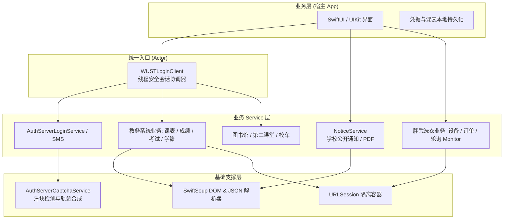

# WUSTFoundation 开发者接入指南

`WUSTFoundation` 是一个专为 Apple 平台（iOS 15+、macOS 15+、visionOS 1+）设计的 Swift Package，封装了武汉科技大学（WUST）校园信息化系统及周边生活服务（如胖乖生活洗衣机）的网络请求、认证流程与数据解析。

本文档面向下游应用开发者，旨在帮助你快速理解 SDK 架构，并顺畅地接入各项校园业务能力。

---

## 目录

1. [快速上手（Quick Start）](#1-快速上手quick-start)
2. [环境要求与集成配置](#2-环境要求与集成配置)
3. [核心架构与设计思想](#3-核心架构与设计思想)
4. [统一身份认证与会话管理](#4-统一身份认证与会话管理)
   - 4.1 [初始化 Client](#41-初始化-client)
   - 4.2 [原生账号密码登录（内置滑块）](#42-原生账号密码登录内置滑块)
   - 4.3 [短信验证码登录](#43-短信验证码登录)
   - 4.4 [WKWebView 网页托管登录](#44-wkwebview-网页托管登录)
   - 4.5 [会话检查、保活与退出](#45-会话检查保活与退出)
5. [教务业务功能接入](#5-教务业务功能接入)
   - 5.1 [学生基本信息](#51-学生基本信息)
   - 5.2 [学期、课表与教学周历](#52-学期课表与教学周历)
   - 5.3 [课程成绩查询](#53-课程成绩查询)
   - 5.4 [考试安排查询](#54-考试安排查询)
   - 5.5 [学分完成情况](#55-学分完成情况)
   - 5.6 [培养方案](#56-培养方案)
6. [校园公共服务（免登录 / 独立服务）](#6-校园公共服务免登录--独立服务)
   - 6.1 [学校通知资讯与 PDF 附件](#61-学校通知资讯与-pdf-附件)
   - 6.2 [图书馆服务](#62-图书馆服务)
   - 6.3 [第二课堂成绩单](#63-第二课堂成绩单)
   - 6.4 [校车时刻表](#64-校车时刻表)
7. [胖乖生活物联网（洗衣机）](#7-胖乖生活物联网洗衣机)
   - 7.1 [独立身份认证](#71-独立身份认证)
   - 7.2 [门店与空闲设备查询](#72-门店与空闲设备查询)
   - 7.3 [使用中订单与实时倒计时](#73-使用中订单与实时倒计时)
8. [错误处理与接入最佳实践](#8-错误处理与接入最佳实践)
9. [核心 API 与模型速查表](#9-核心-api-与模型速查表)

---

## 1. 快速上手（Quick Start）

通过以下几行代码，即可实现登录学校教务并获取当前学期课表：

```swift
import Foundation
import WUSTFoundation

// 1. 初始化 Client（建议保存在账号管理单例或 ViewModel 中）
let client = try WUSTLoginClient(username: "你的学号")

// 2. 原生账号密码登录（SDK 内部自动处理滑块拼图验证）
let loginResult = try await client.loginWithAuthServer(password: "你的教务密码")

guard case .authenticated = loginResult else {
    print("登录未完成，需重新登录")
    return
}

// 3. 查询当前学期课表
let termList = try await client.fetchAcademicTerms()
if let currentTerm = termList.terms.first(where: { $0.id == termList.selectedTermID }) {
    let timetable = try await client.fetchTimetable(term: currentTerm)
    print("获取到课程数量：\(timetable.meetings.count)")
}
```

---

## 2. 环境要求与集成配置

### 2.1 运行与编译环境
- **Swift 工具链**：Swift 6.4+（支持 Swift 6 严格并发模式）
- **支持平台**：
  - iOS 15.0+
  - macOS 15.0+
  - visionOS 1.0+
- **第三方依赖**：`SwiftSoup`（HTML DOM 解析，锁定版本 >= 2.14.3）
- **系统 Framework**：Foundation、URLSession、Vision（用于 OCR 图像处理）、WebKit（可选导入，用于托管网页登录）

### 2.2 在 Xcode 中添加依赖
1. 打开 Xcode 项目，点击菜单 **File** -> **Add Package Dependencies...**
2. 输入仓库地址：`https://github.com/xiaoka520/WUSTFoundation.git`
3. 选择对应的分支（如 `main`）或指定版本。
4. 在 App Target 的 **Frameworks, Libraries, and Embedded Content** 中添加 `WUSTFoundation`。

### 2.3 Package.swift 集成方式
若在其它 Swift Package 中引入，请在 `Package.swift` 中配置：
```swift
dependencies: [
    .package(url: "https://github.com/xiaoka520/WUSTFoundation.git", branch: "main")
],
targets: [
    .target(
        name: "YourAppTarget",
        dependencies: [
            .product(name: "WUSTFoundation", package: "WUSTFoundation")
        ]
    )
]
```

---

## 3. 核心架构与设计思想

`WUSTFoundation` 采用现代化 Swift 并发架构与分层设计：



### 关键设计原则：
1. **基于 Actor 的线程安全保障**：`WUSTLoginClient` 与 `LaundryOrderMonitor` 被声明为 `actor`，天然防止会话竞争、多线程重入及状态错乱。
2. **会话容器隔离**：默认使用 `.ephemeral` 独立 CookieJar，不同 `WUSTLoginClient` 实例之间会话完全隔离，切换账号无污染风险。
3. **分层分治，各司其职**：
   - **高层编排（Client）**：适合业务层直接调用，一条龙完成认证、Cookie 管理与数据解析。
   - **中层网络（Service）**：接收已认证的 `session` 或 `cookie` 发送具体网络请求。
   - **底层纯解析（Parser）**：无网络副作用，接收 HTML/JSON 返回结构化强类型 Model，易于离线单测。
4. **服务边界分明**：
   - **教务系统**：以学号为主键，由 `WUSTLoginClient` 统一托管。
   - **学校通知**：完全公开免登录，直接使用 `NoticeService` 即可。
   - **胖乖洗衣**：第三方商业系统，通过独立手机号和 Token 鉴权，不与教务混用。

---

## 4. 统一身份认证与会话管理

学校认证系统采用统一身份认证中心（`/authserver/login`），后端具有滑块验证码风控保护。

### 4.1 初始化 Client

每个登录账号应对应一个 `WUSTLoginClient` 实例：

```swift
// username 必须为真实学号（用于登录后核验身份一致性）
let client = try WUSTLoginClient(username: "202100010001")
```

> **注意**：请在全局状态（如 `AppEnvironment` 或 `AccountManager`）中持有该 client 实例，后续所有教务请求均复用它，**切勿每次请求都重新实例化**。

---

### 4.2 原生账号密码登录（内置滑块）

SDK 内部集成了新版滑块自动识别、仿生轨迹算法及参数加密，开发者无需自己写滑块交互：

```swift
do {
    let result = try await client.loginWithAuthServer(
        password: "user_password",
        maxSliderAttempts: 3 // 滑块重试次数上限（1-5，默认 3）
    ) { diagnostic in
        // 可选：接收滑块诊断回调，可用于调试或埋点
        if case .result(let code) = diagnostic {
            print("滑块校验服务端返回码：\(code)")
        }
    }

    switch result {
    case .authenticated(let cookie):
        print("登录成功，当前已建立教务会话")
    case .loginRequired:
        print("登录未完成，请检查账号密码")
    }
} catch {
    print("登录过程异常：\(error)")
}
```

**认证逻辑闭环说明**：
1. SDK 访问 `/authserver/login` 获取动态表单隐藏字段（如 `execution`、盐值）。
2. 请求滑块挑战，本地执行像素对齐与仿生轨迹生成（1.4s 拟人曲线）。
3. 校验通过后提交加密凭据，并顺延跟进重定向。
4. 请求教务主页读取学籍信息；**仅当学籍中的学号与初始化 `username` 完全吻合时**，才正式确认登录成功。

---

### 4.3 短信验证码登录

当账号开启短信两步验证，或通过手机动态码登录时使用：

```swift
// 第一步：发送验证码（支持传学号或绑定手机号，SDK 自动完成滑块并调用接口）
let cooldownSeconds = try await client.sendLoginSMSCode(to: "13800000000")
print("验证码已发送，重发冷却时间：\(cooldownSeconds ?? 60) 秒")

// 第二步：用户输入短信验证码后提交登录
let result = try await client.loginWithSMSCode("123456")
if case .authenticated = result {
    print("短信登录成功！")
}
```

---

### 4.4 WKWebView 网页托管登录

若用户遇到极端人机验证或需要走官方 Web 登录，可直接在 App 内嵌入 `WKWebView`：

```swift
#if canImport(WebKit)
import WebKit

@MainActor
func setupWebView(client: WUSTLoginClient) -> WKWebView {
    let webView = UndergraduateWebLogin.makeWebView()
    // 加载官方统一认证教务重定向入口
    webView.load(URLRequest(url: UndergraduateWebLogin.url))
    return webView
}

@MainActor
func onUserFinishedLoginInWebView(webView: WKWebView, client: WUSTLoginClient) async throws {
    // 当检测到重定向至教务站点后，一键提取 Cookie 并注入 client
    let result = try await UndergraduateWebLogin.complete(in: webView, using: client)
    if case .authenticated = result {
        print("网页登录提取成功，教务会话已就绪！")
    }
}
#endif
```

---

### 4.5 会话检查、保活与退出

```swift
// 1. 检查当前会话是否依旧有效（多用于 App 启动冷启动或进入前台时）
let sessionState = try await client.ensureSession()
if case .loginRequired = sessionState {
    // 会话已过期，需要重新展示登录界面
}

// 2. 安全登出
await client.logout() // 取消进行中请求、清理 Cookie 容器、重置凭据
```

---

## 5. 教务业务功能接入

所有教务接口均作为 `WUSTLoginClient` 的异步扩展方法提供，统一由 client actor 调度并发。

### 5.1 学生基本信息

```swift
let student: StudentInfo = try await client.fetchStudentInfo()

print("姓名：\(student.name)")
print("学号：\(student.studentID)")
print("学院：\(student.college)")
print("专业：\(student.major)")
print("班级：\(student.className)")
print("身份证号：\(student.idNumber)")
```

---

### 5.2 学期、课表与教学周历

课表模块采用两阶段模型：**获取学期列表** -> **指定学期抓取课表与校准周历**。

```swift
// 1. 获取所有可选学期
let termOptions = try await client.fetchAcademicTerms()
guard let currentTerm = termOptions.terms.first(where: { $0.id == termOptions.selectedTermID }) else {
    return
}

// 2. 拉取整学期课表（返回去重后的完整课程节次模型）
let timetable = try await client.fetchTimetable(term: currentTerm)

// 3. 按周次或星期进行本地高效筛选（无额外网络请求）
let week3MondayCourses = timetable.meetings(inWeek: 3, on: .monday)
for course in week3MondayCourses {
    print("\(course.name) | 教室：\(course.location ?? "未知") | 节次：\(course.sections)")
}

// 4. 校准教学周与公历日期对应关系
let calendar = try await client.fetchTeachingCalendar()
let currentWeekRange = try calendar.range(ofWeek: calendar.referenceWeek)
print("当前第 \(calendar.referenceWeek) 周，公历区间：\(currentWeekRange.startDate.yyyyMMdd) ~ \(currentWeekRange.endDate.yyyyMMdd)")
```

> **教学周换算提示**：
> `TeachingCalendar` 会向教务发送一次时间锚点校准。校准完成后，所有关于周次、星期与具体公历日期的推算均在本地完成，无需重复请求网络。

---

### 5.3 课程成绩查询

```swift
// 1. 获取可选筛选条件（所有学期、课程性质如必修/选修、显示方式等）
let options = try await client.fetchGradeQueryOptions()

// 2. 构造查询条件（默认 GradeQuery() 查询所有历史成绩）
let query = GradeQuery(
    termID: currentTerm.id, // 传 nil 表示查询全部学期
    displayMode: .best      // .best 表示最好成绩；.all 表示全部记录
)
let report: GradeReport = try await client.fetchGrades(query: query)

for record in report.records {
    print("""
    课程：\(record.courseName)
    学分：\(record.credits ?? "-")
    成绩：\(record.score)
    绩点：\(record.gradePoint ?? "-")
    性质：\(record.courseNature ?? "-")
    """)
}
```

---

### 5.4 考试安排查询

```swift
// 1. 获取考试查询条件
let options = try await client.fetchExamQueryOptions()

// 2. 指定学期查询考试
let schedule = try await client.fetchExamSchedule(
    query: ExamQuery(termID: options.selectedTermID ?? "")
)

// schedule.arrangements 包含了集中排考与自排考的合并列表
for exam in schedule.arrangements {
    print("""
    考试科目：\(exam.courseName)
    时间：\(exam.timeText ?? "待定")
    考场：\(exam.location ?? "待定")
    座位号：\(exam.seatNumber ?? "-")
    """)
}
```

---

### 5.5 学分完成情况

提供毕业审查学分进度、通识必修/选修修读状态、不及格课程及各门课程详细进度：

```swift
let progress: CreditProgress = try await client.fetchCreditProgress()

// 查看各大类课程要求与已获得学分
for category in progress.courseCategories {
    print("分类：\(category.name)，要求：\(category.requiredCredits ?? 0)，已获：\(category.earnedCredits ?? 0)，剩余：\(category.remainingCredits ?? 0)")
}

// 历史学期修读统计
if let stats = progress.pastSemesterStatistics {
    print("已修课程门数：\(stats.completedCourseCount ?? 0)，不及格课程：\(stats.failedCourseCount ?? 0)")
}
```

---

### 5.6 培养方案

支持读取全篇培养方案文字正文及结构化的合并单元格表格（保留了 `rowSpan` 和 `columnSpan` 拓扑信息）：

```swift
let plan = try await client.fetchTrainingPlan()
print("方案名称：\(plan.title)")

for block in plan.blocks {
    switch block {
    case .paragraph(let text):
        print("正文段落：\(text)")
    case .table(let table):
        print("表格：\(table.rowCount) 行 x \(table.columnCount) 列")
        // 支持安全读取指定行列位置的单元格（自动映射合并单元格）
        if let cell = table.cell(atRow: 0, column: 0) {
            print("首格内容：\(cell.text)")
        }
    }
}
```

---

## 6. 校园公共服务（免登录 / 独立服务）

### 6.1 学校通知资讯与 PDF 附件

学校各类官方通知是公开的，**无需任何登录授权**，直接使用 `NoticeService`：

```swift
let noticeService = NoticeService()

// 1. 获取指定渠道的第一页（支持 .campus / .academicAffairs / .studentAffairs 等）
let page = try await noticeService.fetchPage(source: .academicAffairs, using: .shared)

for item in page.items {
    print("[\(item.publishedDate)] \(item.title)")
}

// 2. 翻页查询
if let nextURL = page.nextPageURL {
    let nextPage = try await noticeService.fetchPage(source: .academicAffairs, at: nextURL, using: .shared)
}

// 3. 查看通知详情（纯文本段落与图片列表）
if let first = page.items.first {
    let detail = try await noticeService.fetchDetail(first, using: .shared)
    print("正文内容：\n\(detail.text)")
    
    // 4. 若正文内包含官方原版 PDF 附件，可直接下载原始 Data
    if let pdfDoc = detail.documents.first {
        let pdfData = try await noticeService.fetchPDF(pdfDoc, using: .shared)
        // 可将 pdfData 写入本地临时文件并使用 QLPreviewController 原汁原味展示
    }
}
```

---

### 6.2 图书馆服务

> **接入提示**：目前学校新版统一身份认证尚未对移动端开放图书馆的静默单点登录。使用 `LibraryService` 查询读者借阅与欠费时，需要宿主应用先行提供已认证的图书馆 Cookie / URLSession。

```swift
let libService = LibraryService()

// 查询当前借阅列表、即将到期与罚款统计
let dashboard = try await libService.fetchDashboard(using: authenticatedLibrarySession)
print("当前借阅册数：\(dashboard.statistics.loanCount ?? 0)")
for loan in dashboard.currentLoans.items {
    print("书名：\(loan.title ?? "") | 应还日期：\(loan.dueDate ?? "")")
}
```

---

### 6.3 第二课堂成绩单

与图书馆类似，第二课堂（学工系统）接口需要学工系统自身的登录会话：

```swift
let transcript = try await SecondClassService().fetchTranscript(using: studentAffairsSession)
print("第二课堂总学分：\(transcript.earnedCredits)，评语：\(transcript.evaluation)")
```

---

### 6.4 校车时刻表

获取武汉科技大学校区通勤车运行时刻表（直接解析门户公开时刻表卡片）：

```swift
let shuttle = try await client.fetchCampusShuttleSchedule()
print("标题：\(shuttle.title)")
for dep in shuttle.departures {
    print("\(dep.operatingDays) | \(dep.origin) -> \(dep.destination) | 发车时间：\(dep.departureTime)")
}
```

---

## 7. 胖乖生活物联网（洗衣机）

胖乖生活（qiekj）为校园宿舍提供洗衣机/烘干机物联网服务，采用独立的手机号 + Token 机制，与学校教务体系无关。

### 7.1 独立身份认证

```swift
let authService = LaundryAuthService()

// 1. 发送短信验证码
try await authService.sendSMSCode(to: "13800000000")

// 2. 验证码换取持久化凭据（LaundryCredential 实现了 Codable）
let credential = try await authService.login(phone: "13800000000", smsCode: "123456")

// 3. 安全保存凭据（例如存入系统 Keychain）
let encoded = try JSONEncoder().encode(credential)

// 4. 后续冷启动恢复凭据
let restored = try await authService.restore(credential)
```

---

### 7.2 门店与空闲设备查询

**查询周边洗衣房与设备状态不需要用户登录凭据**：

```swift
let deviceService = LaundryDeviceService()

// 1. 查询附近洗衣房（支持黄家湖等校区经纬度）
let shopsPage = try await deviceService.fetchNearbyShops(page: 1)
guard let shop = shopsPage.items.first else { return }

// 2. 查询该洗衣房所有可用空闲洗衣机
let inventory = try await deviceService.fetchInventory(for: shop)
print("门店：\(shop.name)，当前空闲设备：\(inventory.availableDevices.count) 台")
for washer in inventory.availableDevices {
    print("机号：\(washer.name)")
}
```

---

### 7.3 使用中订单与实时倒计时

用户启动洗衣机后，需要实时向用户展示剩余分钟数及订单状态：

```swift
let orderService = LaundryOrderService()

// 1. 获取当前用户正在运行的洗衣机订单
let runningSnapshots = try await orderService.fetchRunningWashers(credential: credential)

guard let running = runningSnapshots.first else {
    print("当前没有正在运行的洗衣任务")
    return
}

// 2. 初始化智能轮询监听器（LaundryOrderMonitor 为 Actor）
let monitor = LaundryOrderMonitor(
    orderID: running.order.id,
    credential: credential,
    initialSnapshot: running
)

// 3. UI 刷新定时器中调用：
let snapshot = try await monitor.currentSnapshot()

// 本地推算当前剩余秒数（UI 每秒刷新，纯数学计算，零网络消耗）
let secondsLeft = snapshot.remainingSeconds(at: Date())
print("剩余时间：\(secondsLeft ?? 0) 秒")
```

#### 智能动态轮询策略
`LaundryOrderMonitor` 内部设计了基于剩余时间的阶梯式缓存防抖算法，避免频繁对服务端造成风暴请求：

| 估算剩余时间 | 远端请求防抖缓存周期 |
|---|---|
| > 10 分钟 | 缓存 **120 秒** |
| 5 ~ 10 分钟 | 缓存 **60 秒** |
| 2 ~ 5 分钟 | 缓存 **30 秒** |
| <= 2 分钟 | **每次调用实时刷新远端**，捕捉结束瞬间 |

---

## 8. 错误处理与接入最佳实践

### 8.1 错误处理模式
SDK 中的错误类型细分明确，下游 App 推荐针对性捕获处理：

```swift
do {
    let timetable = try await client.fetchTimetable(term: currentTerm)
} catch WUSTLoginClientError.notAuthenticated {
    // 明确的教务认证失效 -> 引导用户弹出登录界面
    showLoginSheet = true
} catch let error as URLError {
    // 网络连通性问题（如校园网离线、超时） -> 提示用户检查网络，不要误当作密码错误
    showToast("网络连接不可用：\(error.localizedDescription)")
} catch let error as SliderCaptchaError {
    // 滑块重试多次仍未通过 -> 可引导用户切换至 WKWebView 网页登录
    fallbackToWebLogin()
} catch {
    showToast("发生错误：\(error)")
}
```

### 8.2 错误分类汇总

| 错误类型 | 产生原因 | 应对建议 |
|---|---|---|
| `WUSTLoginClientError.notAuthenticated` | 当前请求缺少有效 Session 或服务端 Session 已失效 | 弹窗展示登录视图引导用户重新登录 |
| `WUSTLoginClientError.operationInProgress` | 同一 Client 正在执行登录/短信流程 | 禁用登录按钮多次重复点击 |
| `WUSTLoginClientError.studentIDMismatch` | 登录返回的学号与初始 Client 学号不一致 | 提示用户不可在已有账号 Client 中跨人登录 |
| `AuthServerLoginError` | 表单参数解析异常、账号密码错误或短信校验失败 | 提示用户核对凭据输入 |
| `SliderCaptchaError` | 滑块识别置信度不足或被服务端风控拦截 | 适当重试，或走 `UndergraduateWebLogin` 网页备选链路 |
| `LaundryAuthError.loginRequired` | 胖乖 Token 过期失效 | 引导用户重新输入手机号获取短信验证码 |

### 8.3 数据持久化最佳实践
- **敏感凭据安全**：用户的教务密码不建议存入本地磁盘。胖乖的 `LaundryCredential` 包含用户 Token，请使用系统 **Keychain** 进行加密存储。
- **课表离线缓存**：`Timetable`、`AcademicTerm`、`TeachingCalendar` 均严格实现了 `Codable` 与 `Sendable`。建议拉取成功后存入 App 本地数据库或本地 JSON 缓存文件，在无网络时保证课表依然可秒级离线渲染。
- **生命周期管理**：App 进入后台切回前台时，可异步调用一次 `client.ensureSession()` 进行静默探活，若未失效则平滑继续，失效则优雅提示。

---

## 9. 核心 API 与模型速查表

### 9.1 核心类型一览

| 类型名称 | 角色 | 关键成员属性 / 方法 |
|---|---|---|
| `WUSTLoginClient` | 教务统一入口 Actor | `loginWithAuthServer`、`ensureSession`、`fetchTimetable`、`fetchGrades`、`logout` |
| `StudentInfo` | 学籍基本信息模型 | `name`、`studentID`、`college`、`major`、`className`、`idNumber` |
| `Timetable` | 课表模型 | `term: AcademicTerm`、`meetings: [CourseMeeting]`、`meetings(inWeek:on:)` |
| `CourseMeeting` | 单门/单次课程安排 | `name`、`weekday`、`weeks: [Int]`、`sections: [Int]`、`location`、`teacher` |
| `TeachingCalendar` | 教学周历校准模型 | `referenceWeek`、`range(ofWeek:)`、`week(containing:)`、`date(inWeek:on:)` |
| `GradeReport` | 成绩单模型 | `query: GradeQuery`、`records: [GradeRecord]`、`columns: [String]` |
| `ExamSchedule` | 考试安排模型 | `query: ExamQuery`、`arrangements: [ExamArrangement]` |
| `NoticeService` | 学校公开通知服务 | `fetchPage(source:at:using:)`、`fetchDetail(_:using:)`、`fetchPDF(_:using:)` |
| `LaundryDeviceService`| 胖乖设备服务 | `fetchNearbyShops(page:)`、`fetchInventory(for:)` |
| `LaundryOrderMonitor` | 胖乖订单倒计时 Actor | `currentSnapshot()`（智能阶梯防抖缓存） |

### 9.2 常用模型协议支持

| 模型 | Sendable | Codable | Hashable / Identifiable |
|---|:---:|:---:|:---:|
| `StudentInfo` | ✅ | ❌（纯业务承载） | ❌ |
| `Timetable` / `CourseMeeting` | ✅ | ✅ | ✅ |
| `TeachingCalendar` / `AcademicDate` | ✅ | ✅ | ✅ |
| `GradeReport` / `GradeRecord` | ✅ | ✅ | ✅ |
| `ExamSchedule` / `ExamArrangement` | ✅ | ✅ | ✅ |
| `CreditProgress` | ✅ | ✅ | ✅ |
| `TrainingPlan` | ✅ | ✅ | ✅ |
| `NoticeSummary` / `NoticePage` | ✅ | ✅ | ✅ |
| `LaundryCredential` | ✅ | ✅ | ✅ |
| `LaundryShop` / `LaundryWasher` | ✅ | ✅ (Decodable) | ✅ (Identifiable) |
| `LaundryOrder` | ✅ | ✅ (Decodable) | ✅ (Identifiable) |
